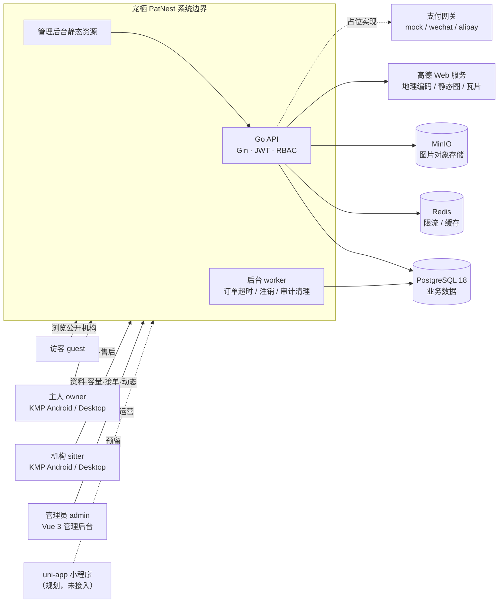
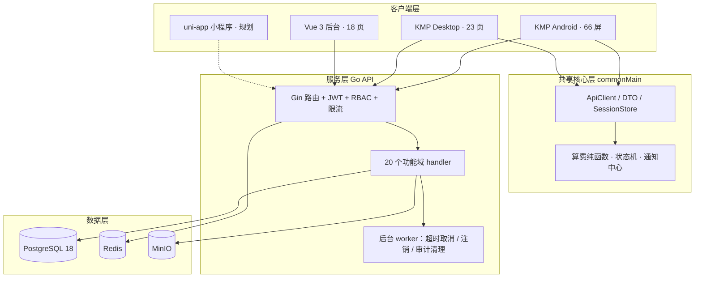
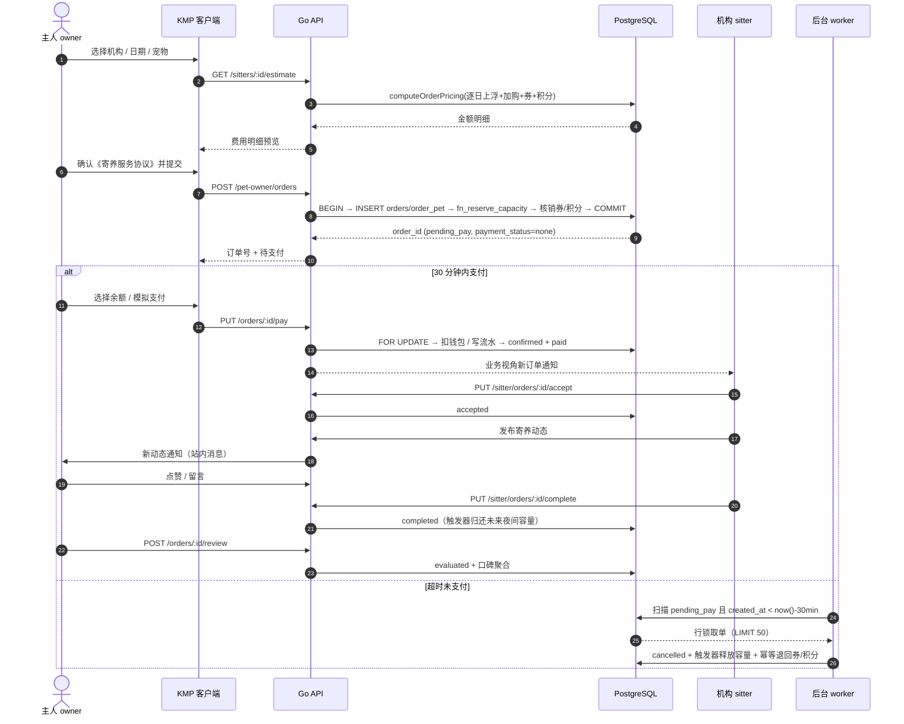
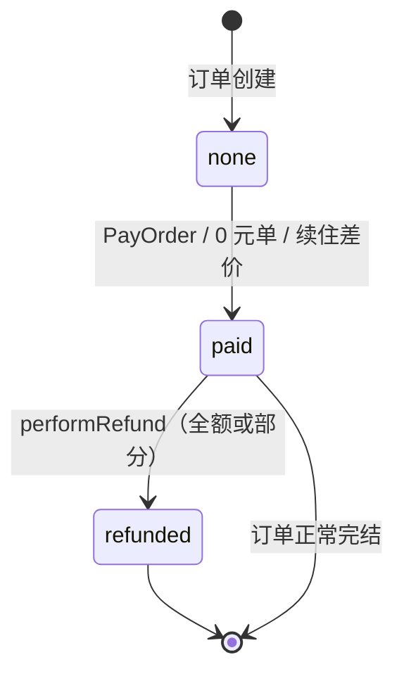
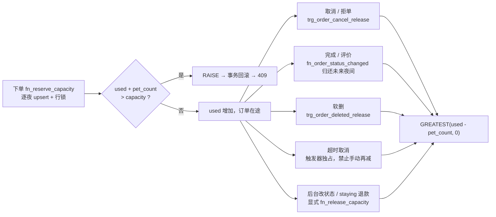
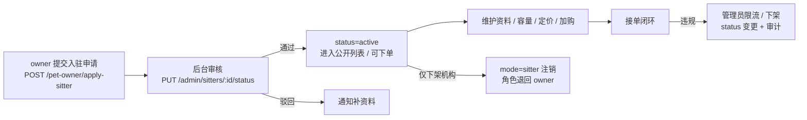
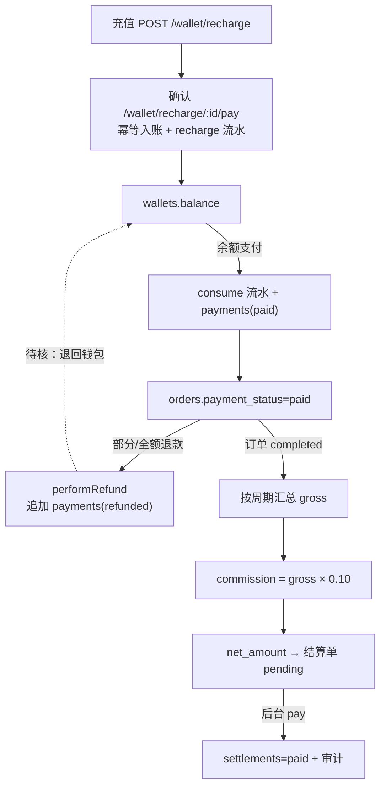
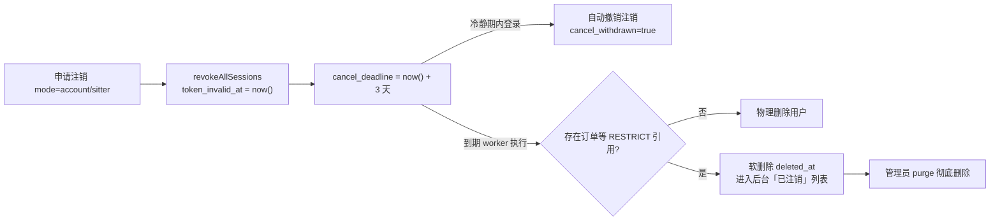
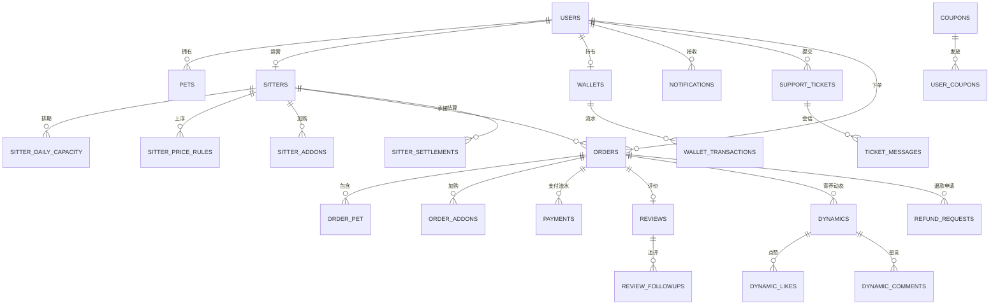

# 宠物寄养服务预约系统（宠栖 / PatNest）软件需求规格说明书

> Software Requirements Specification · SRS
> 产品名：宠栖　项目代号：PatNest　课题名：宠物寄养服务预约系统的设计与实现

---

## 0 文档控制

### 0.1 文档信息

| 项目 | 内容 |
| --- | --- |
| 文档名称 | 宠物寄养服务预约系统（宠栖 / PatNest）软件需求规格说明书 |
| 文档版本 | V1.0 |
| 文档状态 | **基线版**（依据 2026-11-09 仓库 `master` 工作区状态编制） |
| 编制方式 | 以**可运行源码为第一事实来源**，逐项对照过程文档校核 |
| 适用范围 | 后端 Go 服务、KMP Android / Desktop 客户端、Vue 3 管理后台、部署与运维脚本 |
| 预期读者 | 需求评审人员、指导教师、后端 / 客户端 / 后台开发、测试与验收人员、答辩评审 |
| 配套文档 | `docs/02-数据库设计.md`、`docs/03-接口文档.md`、`docs/04-部署与热更新.md`、`docs/05-编译打包发布运行.md` |
| 维护约定 | 需求变更须同步更新本文件「0.2 修订记录」与「第 11 章需求追溯矩阵」 |

### 0.2 修订记录

| 版本 | 日期 | 修订内容 | 依据 |
| --- | --- | --- | --- |
| V1.0 | 2026-11-09 | 首次建立完整需求基线；按源码核准全部功能域、状态值、接口与约束；标注已实现 / 部分实现 / 规划 / 已下线四类状态 | 全仓库源码与 `docs/` 过程文档 |
| V1.1 | 2026-11-09 | 新增 FR-OPS-08「更新代理容器化运行」：Linux 下改由 `agent` profile 容器执行发布，Windows / Podman 保留宿主机脚本；同步部署约束、环境变量、风险与追溯矩阵 | `Dockerfile.agent`、`agent-entrypoint.sh`、`compose.yaml`、`install.sh`、`deploy/docker/README.md` |
| V1.2 | 2026-11-09 | 核对全新库重建链路时纠正 `sitter_daily_capacity` 字段口径：主键为 `id`，唯一约束为 `(sitter_id, cap_date)`，非 `(sitter_id, date)` 联合主键 | `serverdb/init.sql`、原迁移 `0015_capacity_ledger_consistency.sql` |
| V1.3 | 2026-11-09 | 数据库基线合并：把 `0001`~`0021` 净效果并入 `init.sql`（36 张表、最终列/约束/函数/触发器/视图/种子），`0002`~`0021` 归档；同步 §6.1/§6.7/§9/§10/§11 的表数、迁移基线、风险与验收门禁 | `serverdb/init.sql`、`migrations/archive/`、`docs/02`、`docs/04`、`docs/05`、`README.md` |

### 0.3 事实来源与冲突裁决顺序

本仓库同时存在「规划稿」与「实现记录」，二者口径并不完全一致（例如 `docs/项目说明.md` 与 `docs/宠物寄养服务预约系统-角色与功能说明-V2.md` 中包含若干尚未落地的功能）。为避免把规划写成既成事实，本文档采用如下裁决顺序：

1. **源码**（`server/patnestServer/internal/`、`app/patnestApp/*/src/`、`webadmin/*/src/`）；
2. **全量基线** `serverdb/init.sql`、**接口契约文档** `docs/03-接口文档.md` 与**归档迁移脚本** `serverdb/migrations/archive/*.sql`；
3. **修复 / 收紧记录**（`docs/11` ~ `docs/17` 等，记录实际改动与遗留项）；
4. **数据库设计** `docs/02-数据库设计.md`；
5. **规划稿**（`docs/项目说明.md`、`docs/宠物寄养服务预约系统-角色与功能说明-V2.md`）——仅用于说明「意图」，凡与源码冲突处一律以源码为准，并在 §10.3 单列。

> 特别说明：`docs/项目说明.md` 中「SQLDelight 本地缓存」、「Vue rc + Vite 8 依赖组合」、「iOS / Web(wasmJs) 可交付」等为早期规划口径，与现状不符；实际客户端本地持久化用 DataStore，iOS / wasmJs target 未启用。各组件的实际锁定版本一律以 §2.6 所列 `gradle/libs.versions.toml`、`go.mod`、`package.json` 为准。

### 0.4 需求标识与优先级约定

| 约定 | 说明 |
| --- | --- |
| 功能需求编号 | `FR-<域>-<两位序号>`，域见 §0.6；编号在整个文档生命周期内稳定、不复用 |
| 非功能需求编号 | `NFR-<类别>-<两位序号>` |
| 接口需求编号 | `IF-<两位序号>` |
| 数据需求编号 | `DR-<两位序号>` |
| 优先级 P0 | 核心闭环，缺失则系统不可演示、不可验收；必须实现且必须通过测试 |
| 优先级 P1 | 重要能力，影响业务完整度或角色闭环；本期应实现 |
| 优先级 P2 | 增强 / 运营 / 体验类，可延后；允许以明确标注的「未实现」状态保留在基线中 |
| 验收方式 | 每条需求须给出可观察、可判定的验收条件，禁止「界面友好」「响应较快」等不可测表述 |

### 0.5 实现状态标记

| 标记 | 含义 | 判定依据 |
| --- | --- | --- |
| ✅ 已实现 | 有对应路由 / 页面 / 表结构 / 处理逻辑，且无「未挂载」标注 | `router.go` 已注册 + handler 有实现 + 客户端有入口 |
| ◐ 部分实现 | 骨架或数据模型存在，但关键链路缺失、或仅一端实现、或存在已记录的遗留缺陷 | 修复记录 / 缺失接口清单中明确记载 |
| ☐ 规划未实现 | 规划稿或设计文档提出，源码无实现入口 | 全仓库检索无对应符号与路由 |
| ⊘ 已下线 | 曾经实现，本期按需求变更整体移除 | 删除记录 + 反向迁移 |

### 0.6 需求域划分

| 域代码 | 名称 | 章节 |
| --- | --- | --- |
| AUTH | 认证、会话与账号 | §4.1 |
| USER | 用户与权限管理（后台） | §4.2 |
| BROWSE | 机构浏览、搜索与筛选 | §4.3 |
| PET | 宠物档案 | §4.4 |
| SHOP | 机构资料与资质 | §4.5 |
| CAP | 容量、定价与加购 | §4.6 |
| PRICE | 算费与下单 | §4.7 |
| FLOW | 订单状态机与流转 | §4.8 |
| PAY | 支付、钱包与充值 | §4.9 |
| AFTER | 退款、售后与工单 | §4.10 |
| DYN | 寄养动态 | §4.11 |
| REV | 评价与口碑 | §4.12 |
| PROMO | 优惠券与积分 | §4.13 |
| SETTLE | 机构收益与结算 | §4.14 |
| NOTIF | 消息通知与推送 | §4.15 |
| GEO | 地理位置服务 | §4.16 |
| UPL | 文件上传 | §4.17 |
| ADMIN | 后台监管与运营 | §4.18 |
| OPS | 系统更新、发布与运维 | §4.19 |
| PRIV | 账号注销与隐私合规 | §4.20 |

---

## 1 引言

### 1.1 编写目的

本文档对「宠栖 / PatNest」宠物寄养服务预约系统给出**完整、可验证、可追溯**的需求定义，用于：

1. 作为系统设计（架构、数据库、接口）与编码实现的唯一需求输入；
2. 作为需求评审、毕业设计答辩中「需求分析」章节的事实基线；
3. 作为测试用例设计与验收判定的依据（第 11 章给出追溯矩阵）；
4. 作为范围控制工具：明确哪些能力已经交付、哪些属于规划、哪些已下线，避免答辩口径与实物不符。

本文档**不描述**具体代码实现、类结构、算法伪码或部署操作步骤（分别见 `docs/02`、`docs/03`、`docs/04`、`docs/05`），但会引用它们作为需求证据。

### 1.2 项目背景

养宠家庭在节假日出行、出差、短期离家时面临宠物无人照看的问题。现有服务大量依赖微信群、朋友圈、电话等散点式沟通，存在四类突出痛点：

| 痛点 | 现象 | 后果 |
| --- | --- | --- |
| 信息不透明 | 机构环境、价格、资质靠口头描述与零散图片 | 主人难以比较与建立信任 |
| 预约靠人工 | 电话 / 微信确认档期，人工记录床位 | 易重复预约、超卖、漏单，纠纷无凭据 |
| 过程不可见 | 寄养期间主人无法获知宠物状态 | 焦虑感强，争议时缺少过程证据 |
| 资金与售后无闭环 | 收费、退款、评价靠私下协商 | 无流水、无审计、无口碑沉淀 |

系统整合**家庭寄养（home）、门店寄养（shop）、上门喂养（visit）**三类服务资源，把「找机构 → 建档案 → 预约下单 → 支付 → 接单 → 寄养动态 → 完成 → 评价 → 结算」串成可追溯的线上闭环，并为主人、机构、管理员三类角色提供各自的工作台。

### 1.3 业务范围与边界

#### 1.3.1 范围内（In Scope）

| 编号 | 范围项 | 说明 |
| --- | --- | --- |
| SC-01 | 三类角色与访客的账号、认证、会话与权限隔离 | owner / sitter / admin / guest |
| SC-02 | 机构展示、检索、详情、容量日历与口碑 | 含公开只读接口 |
| SC-03 | 宠物档案与免疫证明 | 含后台核验 |
| SC-04 | 在线预约、算费、优惠券 / 积分抵扣、下单 | 含预估接口 |
| SC-05 | 订单全生命周期 | 支付、接单、拒单、完成、取消、改期、续费、超时、评价 |
| SC-06 | 资金链路 | 钱包、充值、模拟支付、余额支付、退款申请与审批、机构结算 |
| SC-07 | 内容与互动 | 寄养动态、点赞、留言、四维评价、追评、机构回复 |
| SC-08 | 运营能力 | 优惠券、积分、消息通知、公告模板、推送任务、售后工单 |
| SC-09 | 平台治理 | 机构审核、内容治理、用户管理、权限点、审计日志、数据看板、CSV 导出 |
| SC-10 | 基础设施能力 | 图片上传、地理编码 / 静态图 / 瓦片 / 逆地理 / 地图选点、版本与健康检查、在线迁移与热更新 |

#### 1.3.2 范围外（Out of Scope）

| 编号 | 排除项 | 原因 / 现状 |
| --- | --- | --- |
| EX-01 | 真实微信支付 / 支付宝收款 | 个人主体无商户资质；`WechatGateway` / `AlipayGateway` 为占位实现，演示使用 mock 与余额支付 |
| EX-02 | 微信订阅消息、小程序端业务接入 | `uniapp/` 仍是 HBuilderX 默认模板，无接口层；演示期以站内消息中心替代 |
| EX-03 | 实时音视频直播 | **已于 2026-11-07 整体下线**（后端 `/live` 系列、SRS、双端页面、后台管理页、文档、部署编排全部移除；迁移 `0021` 回收数据表） |
| EX-04 | pgvector 语义推荐 | 规划加分项，需扩展与 embedding 链路，无实现入口 |
| EX-05 | 距离排序 / 按距离筛选 | 后端缺经纬度计算入口，客户端做兜底；`docs/03` 的 `distance_max` 参数未落地 |
| EX-06 | iOS / Web(wasmJs) 客户端 | iOS target 已移除（开发机无 macOS）；`wasmJs` target 未启用，仅保留 `android` + `jvm` |
| EX-07 | 在线客服即时通讯、独立客服 / 财务角色 | 以「售后工单」异步会话替代；管理员分级为预留 |
| EX-08 | 机构主动提现到银行卡 | C 端不开放；机构结算走 `sitter_settlements` 由后台确认打款 |
| EX-09 | 生产级短信验证码 / 实人认证 / 充值限额 | 演示期简化，登录支持手机号但无验证码 |
| EX-10 | 多租户、国际化、多币种 | 单平台、简体中文、人民币元 |

### 1.4 术语、缩写与定义

| 术语 | 定义 |
| --- | --- |
| 主人 / owner | 发起寄养预约的宠物主人，拥有宠物档案、订单、评价、优惠券、钱包 |
| 机构 / sitter | 提供寄养服务的商家账号，数据隔离在本机构范围内 |
| 管理员 / admin | 平台运营与监管角色，仅后台 Web 端登录，账号由 seed / 环境变量预置 |
| 访客 / guest | 未登录用户，仅可浏览公开机构信息与部分公开页 |
| 三类服务资源 | `home` 家庭寄养、`shop` 门店寄养、`visit` 上门喂养 |
| 计费模式 | `per_day` 按夜计费、`per_visit` 按次计费（与机构 `type` 的绑定关系源码未明确） |
| 容量 | `sitter_daily_capacity`：某机构某日可容纳的宠物数，`used` 为已占用数 |
| 加购服务 / addon | 机构自定义附加项（遛宠、洗澡等），下单时按 `price × qty` 计入 |
| 上浮规则 | `sitter_price_rules`：日期区间内的价格倍数 `multiplier`，范围 0.50~5.00 |
| 算费 | `computeOrderPricing`：基础房费 → 加购 → 券 → 积分的单一口径计算 |
| 订单状态 | `status` 字段，8 个取值，详见 §5.2 |
| 支付状态 | `payment_status` 字段，`none` / `paid` / `refunded` |
| 站内消息 scope | `personal`（主人视角）/ `business`（机构视角），迁移 0016 引入 |
| 权限点 | `role_permissions` 表中的细粒度后台权限，如 `orders.manage` |
| JWT 双令牌 | `access_token`（30 分钟）+ `refresh_token`（7 天，轮换 + 吊销） |
| 蓝绿发布 | 同机 `api-blue` / `api-green` 双槽位，Nginx upstream 原子切换 |
| KMP | Kotlin Multiplatform；`shared` 模块放网络层、模型与业务状态，两端只写 UI |
| SRS | Software Requirements Specification，软件需求规格说明书 |
| P0 / P1 / P2 | 需求优先级，定义见 §0.4 |
| ✅ / ◐ / ☐ / ⊘ | 实现状态标记，定义见 §0.5 |

### 1.5 参考资料

| 类别 | 资料 |
| --- | --- |
| 项目级 | `README.md`、`docs/项目说明.md`、`docs/README.md`、`docs/宠物寄养服务预约系统-角色与功能说明-V2.md`、`docs/宠物寄养服务预约系统毕业设计报告 · 完整文档结构.md` |
| 设计契约 | `docs/02-数据库设计.md`、`docs/03-接口文档.md`、`docs/04-部署与热更新.md`、`docs/05-编译打包发布运行.md`、`docs/10-定位与导航服务配置指南.md`、`docs/14-钱包功能设计方案.md` |
| 实现记录 | `docs/09-主人端缺失接口清单.md`、`docs/11-后端问题处理结果.md`、`docs/12-后端权限与限流收紧说明.md`、`docs/13-隐私与个人信息说明.md`、`docs/14-订单资金与容量缺陷修复.md`、`docs/15/16/17` 三份专项修复记录、`docs/audit_logs.md` |
| 源码 | `server/patnestServer/internal/router/router.go`、`internal/handler/*.go`、`internal/model/*.go`、`serverdb/init.sql`、`serverdb/migrations/`；`app/patnestApp/shared/src/{commonMain,androidMain}`、`desktopApp/src/main`；`webadmin/patnestServerAdminWeb/src` |
| 配置基线 | `server/patnestServer/.env.example`、`deploy/docker/.env.example`、`app/patnestApp/gradle/libs.versions.toml`、`go.mod`、`build.ps1` / `build.sh` |

### 1.6 文档约定

- 金额单位统一为**人民币元**；数据库资金字段 `NUMERIC(12,2)` / `NUMERIC(14,2)`，不使用浮点数存储。
- 日期 `YYYY-MM-DD`，时间戳 ISO 8601 带时区偏移（示例 `+08:00`）；天数口径为「含首不含尾」。
- 接口路径统一带 `/api/v1` 前缀（`/health`、`/api/v1/version` 除外）。
- 「已实现」仅描述源码中确有入口的能力；规划项一律写入 §10.3，不混入功能需求正文的已实现描述。
- 表格中 `—` 表示无权限 / 不适用；`⚠` 表示存在已记录的遗留缺陷或文档冲突，详见 §10.4。

---

## 2 总体描述

### 2.1 产品定位

> 主人不在家时，帮宠物找到一个值得托付的「临时之家」——通过多端应用快速找到合适的寄养机构，一键预约下单，全程看到宠物在寄养期间的真实动态。

产品是**多端一体化**系统，不是单一小程序：KMP Android 为主端（功能最完整）、KMP Desktop 为答辩演示端（主链路可用）、Vue 3 后台为平台治理端；`uni-app` 微信小程序为规划中的轻入口，当前未接入业务。所有端共享同一套 Go 后端与 PostgreSQL 数据源，不存在分库或数据孤岛。

### 2.2 系统上下文



**外部实体说明**

| 实体 | 交互方向 | 内容 | 失败降级 |
| --- | --- | --- | --- |
| 高德地图 Web 服务 | 系统 → 外部 | 地址转坐标、静态地图、瓦片、逆地理编码 | 未配 `AMAP_KEY` 返回 `501/50002`；客户端降级为地址文本展示 |
| MinIO | 系统 ↔ 外部 | 头像、宠物照片、动态图、评价图、资质照片 | 上传失败返回 `500`；`/health` 中 `minio=false` 告警但**不阻止启动** |
| Redis | 系统 ↔ 外部 | 限流计数、热点缓存 | Redis 不可达时**全部限流放行**、健康检查告警但不阻止启动；账号锁定仍由数据库兜底 |
| 支付网关 | 系统 ↔ 外部 | 演示 mock 同步置成功；真实通道为占位 | 演示不依赖外部通道 |
| 微信生态 | 系统 → 外部（规划） | 小程序、订阅消息、微信支付 | 均未接入，站内消息与 mock 支付替代 |

### 2.3 用户角色与画像

| 角色 | 使用端 | 核心诉求 | 技术水平 | 权限边界 | 主要场景 |
| --- | --- | --- | --- | --- | --- |
| 访客 guest | KMP 公开页 / 规划中的小程序 | 先看机构再决定是否注册 | 普通移动端用户 | 仅公开机构列表、详情、搜索、容量、评价；点击预约 / 收藏时引导登录 | 转化漏斗入口 |
| 主人 owner | KMP Android（66 屏）/ Desktop（23 页） | 找得到、算得清、看得见、退得了 | 普通移动端用户 | 只读写**自己的**宠物、订单、评价、券、积分、钱包、工单、通知 | 找机构 → 下单 → 追动态 → 评价 / 售后 |
| 机构 sitter | KMP 机构工作台 / Desktop 经营页 | 管好档期与定价、及时接单、沉淀口碑 | 小微商家，熟悉手机操作 | 只读写**本机构**资料、容量、订单、动态、评价回复、收益 | 入驻 → 定价 → 接单 → 发动态 → 结算 |
| 管理员 admin | Vue 3 管理后台（18 页） | 审核、监管、处理异常、看经营数据 | 平台运营人员 | 跨用户 / 跨机构全量读写；受 `role_permissions` 细粒度权限点约束（内置超管不受限） | 机构审核、订单干预、退款审批、内容治理、发布 |

**角色关系规则**

- 角色**非互斥**：同一账号可同时是主人与机构运营者，通过「角色切换」页在工作台间切换。
- 主人可通过 `POST /pet-owner/apply-sitter` 申请成为机构，需后台二次资料审核。
- 管理员账号与 C 端账号隔离，`role=admin` **不允许通过注册接口创建**（返回 `403`），只能由 seed 或环境变量预置。
- 内置 `admin` 受 `admin_guard.go` 保护：只有内置 admin 可改动 admin 角色账号；最后一个可用管理员不可禁用 / 降级；内置 admin 不可删除。

### 2.4 产品功能全景

| 功能域 | 主人 | 机构 | 管理员 | 状态 |
| --- | :-: | :-: | :-: | :-: |
| 账号与认证 | 注册 / 登录 / 资料 / 改密 / 注销 | 同左 | 后台登录 / 单会话 | ✅ |
| 机构浏览与筛选 | 列表 / 详情 / 搜索 / 容量 / 评价 | 同左 | 同左 + 全量管理 | ✅ |
| 宠物档案 | 增删改查 / 免疫证明 | 查看本单宠物 | 全量 + 核验 | ✅ |
| 预约与算费 | 预估 / 下单 / 加购 / 券 / 积分 | 查看 | 后台建单 / 改单 | ✅ |
| 订单流转 | 支付 / 取消 / 改期 / 续费 | 接单 / 拒单 / 完成 | 全状态干预 / 退款 | ✅（⚠ `staying` 无写入路径） |
| 资金 | 钱包 / 充值 / 余额支付 / 退款申请 | 收益 / 结算申请 | 调账 / 充值确认 / 退款审批 / 结算打款 | ✅ |
| 内容与互动 | 动态浏览 / 点赞 / 留言 / 四维评价 / 追评 | 发动态 / 回复评价 | 内容审核 / 隐藏 / 删除 | ✅ |
| 营销 | 领券 / 用券 / 积分 | 机构券配置 | 券模板 / 推送任务 / 模板 | ✅ |
| 容量与定价 | 查看容量日历 | 容量设置 / 上浮规则 / 加购定价 | 全量查看 | ✅ |
| 消息与售后 | 站内消息 / 公告 / 工单 | 业务消息 / 工单 | 广播 / 模板 / 推送 / 工单处理 | ✅ |
| 平台治理 | — | — | 用户 / 权限 / 审计 / 看板 / 导出 / 更新 | ✅ |
| 语义推荐 / 距离排序 | ☐ | ☐ | ☐ | ☐ 规划 |
| 直播 | — | — | — | ⊘ 已下线 |

### 2.5 运行环境

#### 2.5.1 构建机

| 依赖 | 要求 | 用途 |
| --- | --- | --- |
| Go | 1.25+（`go.mod` 声明 `go 1.25`） | 交叉编译 `linux/amd64` / `linux/arm64` 静态二进制 |
| JDK | 21（Gradle 工具链目标） | KMP Android / Desktop 构建 |
| Node.js | `^22.18.0 \|\| >=24.12.0`（`webadmin/package.json`；`docs/05` 早期口径为 20+/22+） | 管理后台 Vite 构建 |
| zip | 可选 | 无则打包退化为 `tar.gz` |
| git | 可选 | 把提交号写进版本号，缺失记 `unknown` |

#### 2.5.2 后端服务器

| 项 | 要求 |
| --- | --- |
| 容器运行时 | podman 或 docker（Docker Desktop 需 Linux containers 模式） |
| 编排 | `podman-compose` / `podman compose` / `docker compose` 任一 |
| 脚本环境 | bash 或 PowerShell 5.1+ |
| 开放端口 | 默认仅 `9200`（`PUBLIC_PORT` 可改）；API 内部端口 `9201` 仅在容器网络内 |
| 常驻服务 | `nginx`、`api-blue`（蓝绿双槽之一）、`redis`；`migrate`、`updates-init` 为 tools profile 一次性任务 |
| 资源下限 | 2C2G（演示数据量级） |
| 不需要 | 服务器上不安装 Go、Node，不编译源码 |

#### 2.5.3 存储服务器

| 项 | 要求 |
| --- | --- |
| PostgreSQL | 18，端口 `5432`，对后端服务器公网 IP 白名单开放，`ssl=on` + `scram-sha-256` |
| MinIO | 端口 `9000`，同样白名单开放；bucket `patnest-uploads` |
| 资源下限 | 2C4G；PostgreSQL 与 MinIO 各限 512MB 内存 |
| 网络形态 | **异地双服务器、公网直连**，不额外组网；Redis 留在后端服务器以减少跨地域往返 |

#### 2.5.4 客户端

| 端 | 运行环境 | 服务端地址配置 |
| --- | --- | --- |
| Android | `minSdk 28` / `compileSdk 37` / `targetSdk 37`（Android 8+） | 登录页填写并存入 `SharedPreferences`；真机联调需填局域网后端 `IP:9200` |
| Desktop | JVM 21，Windows 10/11、macOS、Linux | 读桌面端 `.env` |
| 管理后台 | 现代浏览器；开发态 Vite 代理 `VITE_PROXY_TARGET`（默认 `http://127.0.0.1:9200`） | 无需改服务端 CORS |
| 小程序 | 规划：微信基础库 3.x，HBuilderX 导入 | 未接入 |

### 2.6 技术栈与版本基线

> 以下版本取自 `gradle/libs.versions.toml`、`server/patnestServer/go.mod`、`webadmin/patnestServerAdminWeb/package.json` 与 `deploy/docker/compose.yaml`，为**实际锁定值**。

| 层 | 技术 | 锁定版本 / 说明 |
| --- | --- | --- |
| 客户端主端 | Kotlin + Compose Multiplatform | Kotlin `2.4.21`、Compose Multiplatform `1.12.2`、Material3 `1.13.0-beta01` |
| Android | AGP / AndroidX | AGP `9.4.1`、`minSdk 28`、`compileSdk 37`、navigation-compose `2.10.2` |
| 共享层 | Ktor Client + kotlinx.serialization + DataStore | Ktor `3.6.1`、serialization `1.12.0`、datastore `1.2.1`；本地持久化用 DataStore，**非 SQLDelight** |
| 桌面端 | Compose for JVM | 同 KMP；JVM 21 |
| 高德 Android SDK | 3D 地图 aar | `amap3dmap 10.0.600` 兜底；`shared/amap-repo/`（本地 Maven 仓库）有 aar 时按 `com.amap.api:amap-bundle` 坐标优先用本地包 |
| 管理后台 | Vue 3 + Vite + Element Plus | 见 `package.json`；`router` 18 页，`api/index.js` 统一封装 |
| 后端 | Go + Gin | Go `1.25`、Gin `1.9.1`、pgx/v5 `5.5.3`、jwt/v5 `5.2.0`、minio-go/v7 `7.0.70`、bcrypt（`x/crypto 0.21.0`） |
| Redis 客户端 | 手写精简 RESP 实现（`internal/cache`） | 不引入第三方 Redis 库，只覆盖本项目用到的命令 |
| 数据库 | PostgreSQL 18 | 业务数据 + `tsvector` / `pg_trgm` 全文检索 |
| 缓存 / 限流 | Redis | 固定窗口 `INCR` + `PEXPIRE` |
| 对象存储 | MinIO | 匿名只读 bucket |
| 部署 | nginx + 蓝绿 Go API + Redis + migrate | `compose.yaml`；镜像 `alpine` / `nginx` / `redis` 统一 latest + `--pull` |

### 2.7 设计与实现约束

| 编号 | 约束 | 依据 / 理由 |
| --- | --- | --- |
| C-01 | 后端采用 `handler / model / middleware` 分层，路由集中在 `router.go` | 现有工程结构 |
| C-02 | 数据归属校验必须落在 SQL / handler 层，不得只依赖中间件角色判断 | `docs/12` 明确「路由级粗筛 + 行级归属校验」 |
| C-03 | 不启用 PostgreSQL RLS | 降低调试与排错成本（规划稿约定） |
| C-04 | 下单正确性由数据库事务 + 行锁 + 唯一约束保证，Redis 不承担数据正确性 | `docs/14`、`docs/15` |
| C-05 | 已经上线的迁移脚本不再改内容，只往后追加 `00NN_*.sql` | `README.md` Git 约定、`docs/04` 零停机规范 |
| C-06 | 客户端业务逻辑放 `commonMain`，两端只写 UI | KMP 工程约定；算费纯函数双端对齐 |
| C-07 | 金额用 `NUMERIC`，应用层收敛两位小数（`roundMoney`），禁止 float 入库 | `docs/14` 修复记录 |
| C-08 | 演示环境使用明文 HTTP，生产须 HTTPS；CORS 白名单且不带 `Allow-Credentials` | `docs/12`、`docs/13` |
| C-09 | 个人主体无支付资质，支付网关须保持可替换（业务 handler 不感知通道） | `internal/payment/gateway.go` 工厂设计 |
| C-10 | 客户端不得持有高德 Web 服务 Key，Key 只在后端 | `docs/13` |
| C-11 | 答辩前两周冻结框架版本，不再升级 | `docs/项目说明.md` 版本策略 |
| C-12 | 直播能力已整体下线，不得再引入 `/live` 路由、SRS 容器或相关客户端依赖 | 2026-11-07 需求变更 + 迁移 `0021` |

### 2.8 假设与依赖

| 编号 | 类型 | 内容 |
| --- | --- | --- |
| A-01 | 假设 | 演示数据量级为数百用户、数千订单，单机 PostgreSQL 可承载 |
| A-02 | 假设 | 用户设备可访问后端服务器 `9200`；真机与后端在同一局域网或公网可达 |
| A-03 | 假设 | 机构均为单店经营，不需要多门店 / 多员工账号体系 |
| A-04 | 假设 | 管理员由平台内部人员担任，不需要自助注册 |
| A-05 | 依赖 | PostgreSQL 18、MinIO、Redis 可达；数据库不可达时 API **直接报错退出** |
| A-06 | 依赖 | 高德 Web 服务 Key（地理编码 / 静态图 / 瓦片）与 Android 平台 Key（地图 SDK） |
| A-07 | 依赖 | 签名 SHA1 与包名绑定：`team.wd.atnestapp`；debug `B5:26:...:47`、release `38:8E:...:22` |
| A-08 | 依赖 | 小程序若要上线，需已备案域名 + HTTPS 证书 + 微信主体认证（当前均不具备） |
| A-09 | 依赖 | 合并后的 `init.sql` 需先在空测试库完整执行一次，确认函数、触发器与约束均无报错 |

### 2.9 需求优先级与交付批次

| 批次 | 覆盖域 | 交付判定 |
| --- | --- | --- |
| M1 基础闭环 | AUTH、PET、BROWSE、SHOP | 可注册登录、建宠物档案、浏览机构 |
| M2 交易主链 | PRICE、FLOW、PAY、CAP | 可算费下单、支付、接单、完成；容量不超卖 |
| M3 内容与售后 | DYN、REV、AFTER、PROMO | 动态 / 评价 / 退款 / 券积分闭环 |
| M4 治理与运营 | ADMIN、USER、NOTIF、SETTLE、OPS | 后台审核、看板、导出、结算、热更新 |
| M5 增强与基础设施 | GEO、UPL、PRIV | 地图选点、图片上传、隐私与注销 |
| P2 规划项 | 语义推荐、距离排序、小程序、真实支付、订阅消息 | 明确标注未实现，不进本期验收 |

---

## 3 系统功能架构

### 3.1 分层架构



### 3.2 后端命名空间与路由规模

> 按 `internal/router/router.go` 解析，共 **185 个 method + path 注册**（含同一能力在公开组与鉴权组的重复挂载）。

| 命名空间 | 路由数 | 鉴权要求 | 主要职责 |
| --- | ---: | --- | --- |
| `/health` | 1 | 无 | 健康检查（`status` / `db` / `minio` / `redis`） |
| `/api/v1/version` | 1 | 无 | 版本、提交号、构建时间、slot |
| `/api/v1/auth/*` | 7 | 部分公开 | 注册 / 登录 / 刷新 / 退出 / 我的资料 / 改密 |
| `/api/v1/sitters/*` | 6 | 公开 | 机构列表 / 搜索 / 详情 / 容量 / 加购 / 评价 |
| `/api/v1/pet-owner/*` | 50 | JWT + owner/sitter | 宠物、订单、钱包、券、积分、动态互动、收藏、通知、售后、机构浏览（鉴权副本） |
| `/api/v1/sitter/*` | 33 | JWT + sitter | 店铺、接单、容量、定价、加购、动态、评价回复、收益、结算、机构券 |
| `/api/v1/admin/*` | 70 | JWT + admin + AdminPermission | 用户 / 机构 / 订单 / 宠物 / 动态 / 评价 / 券 / 退款 / 工单 / 结算 / 钱包 / 推送 / 权限 / 导出 / 更新 |
| `/api/v1/geo/*` | 8 | 混合 | 地理编码、静态图、瓦片、逆地理、选点会话 |
| `/api/v1/support/*` | 4 | JWT | 售后工单创建 / 列表 / 详情 / 追加回复 |
| `/api/v1/notifications/*` | 3 | JWT | 旧版统一通知接口（兼容保留） |
| `/api/v1/upload/image` | 1 | JWT | 图片上传 |
| `/api/v1/payments/recharge/notify/:channel` | 1 | 公开（预留） | 充值回调，真实支付接入时启用 |

### 3.3 客户端页面清单

#### 3.3.1 KMP Android（`DScreen` 枚举，66 屏）

| 分组 | 屏幕 |
| --- | --- |
| 主人端 · 主流程（9） | 首页、找机构、机构详情、机构位置、预约下单、我的订单、寄养动态、我的、我的宠物 |
| 账号与支付（9+1） | 登录、收银台、写评价、新增宠物、我的收藏、优惠券、消息通知、地址管理、设置、账号与安全 |
| 机构端 · 主流程（4） | 机构工作台、机构订单、机构动态、机构我的 |
| 订单与售后（6） | 订单详情、售后工单、工单会话、积分中心、支付成功、机构对比 |
| 更多功能（37） | 地图选点、角色切换、店铺资料、容量日历、发布动态、机构收益与结算、机构优惠券管理、机构评价、动态详情、宠物寄养历史、退款进度、加购服务管理、节假日定价规则、机构订单详情、搜索结果、平台公告、注册、个人资料编辑、宠物详情、领券中心、新增地址、联系客服、机构入驻、用户协议/隐私政策、取消订单、追评、邀请有礼、机构数据看板、搜索历史、空状态合集、积分明细、优惠券详情、订单改期、订单续费、机构相册、评价详情、钱包余额 |

> 说明：以上为设计层屏幕枚举，均已在 `DesignApp.kt` 分发器中挂载（枚举 66 / 分支 66）；其中「空状态合集」等为演示型页面。**「邀请有礼」已在迁移 0022 实现后端闭环**（邀请码生成、注册绑定、首单完成双方各得 100 积分、`GET /pet-owner/invite` 查询），并已接入 KMP Android / Desktop 与 uni-app 小程序：三端注册页均可填写邀请码，邀请页与个人中心展示服务端下发的真实邀请码和邀请统计，不再本地拼串。

#### 3.3.2 KMP Desktop（`AppPage` 枚举，23 页）

| 分组 | 页面 |
| --- | --- |
| 主人侧（15） | 首页、找机构、机构详情、我的宠物、新增宠物、预约下单、收银台、我的订单、寄养动态、四维评价、个人中心、我的收藏、优惠券、消息通知、我的钱包 |
| 机构侧（8） | 经营概览、接单管理、容量日历、寄养动态发布、评价管理、收益结算、机构资料、优惠券 |

#### 3.3.3 Vue 3 管理后台（18 页）

`dashboard` 经营看板 · `sitters` 机构管理 · `orders` 订单管理 · `pets` 宠物管理 · `dynamics` 寄养动态 · `reviews` 评价管理 · `coupons` 优惠券 · `notifications` 通知公告 · `templates` 消息模板 · `push-tasks` 推送任务 · `aftersales` 售后服务 · `settlements` 机构结算 · `wallets` 钱包管理 · `users` 用户管理 · `permissions` 权限配置 · `audit` 审计日志 · `updates` 系统更新。

> 后台侧栏按「总览 / 业务 / 运营 / 系统」分组；`gatedPages` 控制游客可访问范围，`sitterPages` 控制机构可见页。

#### 3.3.4 小程序（规划）

`uniapp/patnestUniapp` 为 HBuilderX 默认模板，含 2 个 `.vue`、2 个 `.js`、2 个 `.json`、`index.html` 与图标，**无接口层、无业务页面**；不通过 npm 启动，只发行微信小程序。所需接口契约整理在 `docs/09-主人端缺失接口清单.md`。

### 3.4 角色—功能权限矩阵

> ✅ 有权限 · ◐ 部分（见备注） · — 无权限 · ☐ 规划

| 功能 | guest | owner | sitter | admin | 实现状态 |
| --- | :-: | :-: | :-: | :-: | :-: |
| 浏览机构列表 / 详情 / 口碑 | ✅ | ✅ | ✅ | ✅ | ✅ |
| 机构类型 / 关键词 / 价格筛选 | ✅ | ✅ | ✅ | ✅ | ✅ |
| 评分 / 距离排序 | ◐ | ◐ | ◐ | ◐ | ◐ 距离排序未实现 |
| 容量日历查看 | — | ✅ | ✅ 本机构 | ✅ 全量 | ✅ |
| 收藏 / 机构对比 | — | ✅ | — | — | ✅ |
| 宠物档案增删改查 | — | ✅ | — | ✅ 监管 | ✅ |
| 免疫证明上传 / 核验 | — | ✅ 上传 | ✅ 查看本单 | ✅ 核验 | ✅ |
| 机构资料维护 / 入驻申请 | — | ✅ 申请 | ✅ 本机构 | ✅ 全量 | ✅ |
| 容量设置 / 上浮规则 / 加购定价 | — | — | ✅ 本机构 | ✅ 配置 | ✅ |
| 算费预估 / 提交订单 | — | ✅ | — | ✅ 后台建单 | ✅ |
| 支付 / 余额支付 / 充值 | — | ✅ | — | ✅ 调账 / 确认 | ✅ |
| 订单查看 / 取消 / 改期 / 续费 | — | ✅ 本人 | ✅ 本机构 | ✅ 全量 | ✅ |
| 接单 / 拒单 / 完成 | — | — | ✅ 本机构 | ✅ 干预 | ✅ |
| 退款申请 / 审批 | — | ✅ 申请 | ◐ 查看 | ✅ 审批 | ✅ |
| 寄养动态发布 / 审核 | — | — | ✅ 发布 | ✅ 审核 | ✅ |
| 动态点赞 / 留言 | — | ✅ | ✅ 回复 | — | ✅ |
| 四维评价 / 追评 | — | ✅ | — | ✅ 治理 | ✅ |
| 评价回复 | — | — | ✅ | — | ✅ |
| 领券 / 用券 / 积分 | — | ✅ | ✅ 发券 | ✅ 模板 | ✅ |
| 收益 / 结算申请 | — | — | ✅ | ✅ 打款 | ✅ |
| 站内消息 / 公告 | — | ✅ | ✅ | ✅ 广播 | ✅ |
| 售后工单 | — | ✅ | ✅ | ✅ 处理 | ✅ |
| 用户 / 权限点 / 审计 | — | — | — | ✅ | ✅ |
| 数据看板 / CSV 导出 | — | ◐ 机构看板 | ◐ 机构看板 | ✅ | ✅ |
| 系统更新 / 发布 | — | — | — | ✅ | ✅ |
| 语义推荐 / 订阅消息 / 真实支付 | — | ☐ | ☐ | ☐ | ☐ 规划 |
| 直播（已下线） | — | — | — | — | ⊘ |

### 3.5 数据所有权边界

| 角色 | 可读写范围 | 强制手段 |
| --- | --- | --- |
| owner | 自己的 `pets` / `orders` / `reviews` / `user_coupons` / `points_ledger` / `wallets` / `support_tickets` / `notifications(scope=personal)` | SQL 恒带 `owner_id = 当前用户`；`scope=mine` 为订单列表默认视角 |
| sitter | 本机构 `sitters` / `sitter_daily_capacity` / `sitter_price_rules` / `sitter_addons` / 本机构 `orders` / `dynamics` / `reviews` 回复 / `sitter_settlements` / 机构券 | `mySitterID(user_id)` 反查机构；写操作一律带 `sitter_id` |
| admin | 跨用户 / 跨机构全量 | `RequireRole("admin") + AdminPermission()`；细粒度权限点见 §4.2 |
| guest | 公开机构只读 | 公开组强制 `status='active'`；不下发 `email`、营业执照、身份证 |

**跨角色例外口径（已按 `docs/15` 统一）**：订单详情 / 取消 / 改期 / 续费使用 `o.owner_id = $user OR s.user_id = $user`，允许机构运营者查看与自己相关的订单；而 `SubmitReview` / `RequestRefund` / `ListDynamics` 等「主人动作」**不引入 OR**，防止机构替他人订单写评价或发起退款。支付流水仅 `o.owner_id == userID` 时返回，机构视角看不到用户支付渠道。

---

## 4 功能性需求

### 4.0 本章表述约定

每条功能需求按下述字段定义；为控制篇幅，**域内需求清单表**给出全量编号与一句话定义，随后对 P0 需求与含复杂规则的需求展开「输入 / 处理 / 输出 / 业务规则 / 异常 / 验收」六段详述。清单表中未展开的条目，其验收条件以对应接口契约（`docs/03`）与 §11 追溯矩阵为准。

| 字段 | 含义 |
| --- | --- |
| 编号 | 稳定标识符，格式见 §0.4 |
| 名称 / 描述 | 能力的一句话定义 |
| 优先级 | P0 / P1 / P2 |
| 状态 | ✅ / ◐ / ☐ / ⊘ |
| 参与者 | 触发该需求的角色 |
| 前置条件 | 触发前必须成立的状态 |
| 输入 / 处理 / 输出 | 输入数据、系统动作与规则、可观察结果 |
| 异常 | 可判定的失败分支与错误码 |
| 验收标准 | 可执行的判定条件，编号 `AC-<FR 编号>-<序号>` |

---

### 4.1 认证、会话与账号（AUTH）

| 编号 | 名称 | 优先级 | 状态 | 参与者 | 关联接口 / 页面 |
| --- | --- | :-: | :-: | --- | --- |
| FR-AUTH-01 | 用户注册 | P0 | ✅ | guest | `POST /auth/register`；Android `Register` / `ProfileEdit` |
| FR-AUTH-02 | 登录（用户名或手机号） | P0 | ✅ | guest | `POST /auth/login`；三端登录页 |
| FR-AUTH-03 | 双令牌签发与静默续期 | P0 | ✅ | 全体登录用户 | `POST /auth/refresh`；`ApiClient` |
| FR-AUTH-04 | 退出登录与会话吊销 | P0 | ✅ | 全体登录用户 | `POST /auth/logout` |
| FR-AUTH-05 | 个人资料查询与修改 | P0 | ✅ | 全体登录用户 | `GET /auth/me`、`PUT /auth/profile` |
| FR-AUTH-06 | 修改密码 | P0 | ✅ | 全体登录用户 | `PUT /auth/password` |
| FR-AUTH-07 | 角色切换与机构身份申请 | P1 | ✅ | owner | `POST /pet-owner/apply-sitter`；`RoleSwitch` / `SitterOnboarding` |
| FR-AUTH-08 | 管理员单会话约束 | P1 | ✅ | admin | 登录响应 `single_session:true` + 中间件 |
| FR-AUTH-09 | 登录失败限流与账号锁定 | P0 | ✅ | guest | 中间件 + `users.login_fail_count` |
| FR-AUTH-10 | 历史账号手机号补绑 | P1 | ✅ | owner / sitter | `PUT /auth/profile {"phone":...}` |

#### FR-AUTH-01 用户注册（详述）

- **前置条件**：无；请求未携带令牌。
- **输入**：

| 字段 | 类型 | 约束 |
| --- | --- | --- |
| `username` | string | 必填，3~50 字符；**不得为手机号格式**（`^1[3-9]\d{9}$`） |
| `password` | string | 必填，8~128 字符；后端仅校验长度，不强制大小写 / 数字 / 符号组合 |
| `phone` | string | 必填（2026-11-05 起），中国大陆 11 位 `^1[3-9]\d{9}$`，全表唯一（含软删行） |
| `role` | enum | `owner` / `sitter`；传 `admin` 拒绝 |
| `nickname` / `email` | string | 可选 |

- **处理**：
  1. 参数校验 → 2. 手机号格式与唯一性校验 → 3. 用户名唯一性与「非手机号」校验 → 4. `bcrypt` 生成 `password_hash` → 5. 写 `users` → 6. 签发 access + refresh，refresh 仅存 SHA-256 到 `refresh_tokens`。
- **输出**：`{code:0, data:{access_token, refresh_token, expires_in:1800, user:{...}, token_type:"Bearer"}}`。
- **业务规则**：
  - `BR-AUTH-01.1` 手机号唯一性覆盖软删除行，已注销账号的手机号不可被立即复用（除物理删除情形）。
  - `BR-AUTH-01.2` 内置 `admin` 及后台导入的历史账号可无手机号；这类账号登录成功但响应带 `need_bind_phone:true`、`user.phone_bound:false`、`user.phone:""`。
  - `BR-AUTH-01.3` 注册受 IP 限流：10 次 / 小时，超限 `429 / 42901`。
- **异常**：缺手机号 `400 请填写手机号`；格式错 `400 请输入正确的 11 位手机号`；重复 `409 / 30002 该手机号已被注册`；用户名为手机号 `400 账号不能使用手机号格式，请换一个用户名`；注册管理员 `403 / 20002 不允许注册管理员账号`。
- **验收**：
  - `AC-FR-AUTH-01-1` 用合法参数注册返回 `code=0` 且 `expires_in=1800`，数据库 `users` 新增一行且 `password_hash` 不以明文存储。
  - `AC-FR-AUTH-01-2` 重复手机号第二次注册返回 409，用户表不新增行。
  - `AC-FR-AUTH-01-3` 1 小时内第 11 次注册请求返回 `429 / 42901`。

#### FR-AUTH-02 / 03 登录与令牌（详述）

- **输入**：`username` 可传用户名或手机号（共用同一输入框）、`password`。
- **处理**：登录标识 + IP 双层限流校验 → bcrypt 比对 → 检查 `status` / `deleted_at` / `locked_until` → 签发双令牌。
- **令牌规格**：

| 项 | access_token | refresh_token |
| --- | --- | --- |
| 算法 / 密钥 | HS256 / `JWT_SECRET` | 同左 |
| issuer | `patnest` | `patnest-refresh` |
| 有效期 | 默认 **30 分钟**（`JWT_ACCESS_TTL_MINUTES`，响应 `expires_in` 按配置回显） | **7 天** |
| 存储 | 客户端内存 / `SessionStore` | 服务端仅存 SHA-256（`refresh_tokens.token_hash`） |
| 载荷 | `user_id`、`role`、`iat`、`exp` | 额外含 `session_key` |

- **业务规则**：
  - `BR-AUTH-03.1` **轮换**：每次刷新签发新 refresh 并当场把旧的置 `revoked_at`；先入库新令牌、后作废旧令牌；旧令牌复用返回 401，**不做级联吊销**（避免并发刷新 / 多标签互相踢下线）。
  - `BR-AUTH-03.2` 用 access token 调用刷新接口，或伪造 issuer，一律拒绝。
  - `BR-AUTH-03.3` **静默续期**：撞 401 → 调 `/auth/refresh` → 原请求重放**一次**；客户端用 `Mutex` 单飞（后台共享 `refreshPromise`），比较「带出去的令牌」与当前令牌避免重复刷新；refresh 失效触发 `onAuthExpired` → 强制登出。
  - `BR-AUTH-03.4` **会话吊销**：管理员禁用 / 删除 / 重置他人密码、退出登录、申请注销、管理员登录换会话键时，调用 `revokeAllSessions`：吊销全部 refresh + 置 `users.token_invalid_at = now()`；中间件每次请求按主键查 `users`，令牌 `iat` 早于吊销点即 401，留 **1 分钟时钟宽容窗口**。
  - `BR-AUTH-03.5` 自己改密码只踢其它设备（`revokeSessionsBefore(当前令牌 iat)`），当前设备不掉线。
  - `BR-AUTH-03.6` 管理员登录响应带 `single_session:true`；`session_key` 与库中不一致 → `401 / 20003`。
  - `BR-AUTH-03.7` 登录名同时命中用户名与手机号两个不同账号时，**优先用户名精确匹配**。
- **限流 / 锁定**：登录失败 `IP + 登录标识` 5 次 / 10 分钟 → `429 / 42901`；`users.login_fail_count` 累计 10 次 → 锁 15 分钟 → `403`；登录成功清两处状态。`SetTrustedProxies` 仅信 `127.0.0.1` / `::1` 与三个内网段，nginx 两处已配 `X-Forwarded-For`。刷新接口按 IP 60 次 / 小时限流。
- **验收**：
  - `AC-FR-AUTH-03-1` 用 access token 调 `/auth/refresh` 返回 401。
  - `AC-FR-AUTH-03-2` 刷新后旧 refresh 立即返回 401「令牌已被吊销」，新 refresh 可用。
  - `AC-FR-AUTH-03-3` 管理员改用户密码后，该用户已签发的 refresh 无法换发新 access。
  - `AC-FR-AUTH-03-4` 5 次错误密码后第 6 次返回 429（同 IP + 同登录标识）。

#### FR-AUTH-05 ~ 10 补充规则

- `FR-AUTH-05`：`GET /auth/me` 返回 `id / username / nickname / phone / phone_bound / role / status / points / avatar_url`；`PUT /auth/profile` 可改昵称、邮箱、头像、地址与联系人、手机号补绑。手机号补绑同样走唯一性校验。
- `FR-AUTH-06`：改密后当前设备保留会话，其余设备刷新令牌失效（见 `BR-AUTH-03.5`）。
- `FR-AUTH-07`：`owner` 可提交机构入驻申请，后台审核通过后角色具备机构能力；同一账号在两套工作台间切换，不产生第二个账号。
- `FR-AUTH-08`：管理员会话唯一，异地登录会使前一台设备 401（不依赖 refresh，直接由 `session_key` 判定）。
- `FR-AUTH-10`：历史未绑手机号账号登录仍能成功，但客户端须依据 `need_bind_phone` 引导补绑；补绑后 `GET /auth/me` 同步。

---

### 4.2 用户与权限管理（USER，后台）

| 编号 | 名称 | 优先级 | 状态 | 关联接口 |
| --- | --- | :-: | :-: | --- |
| FR-USER-01 | 用户列表 / 新增 / 编辑 / 删除 | P0 | ✅ | `/admin/users` CRUD |
| FR-USER-02 | 重置指定用户密码 | P1 | ✅ | `PUT /admin/users/:id/password` |
| FR-USER-03 | 彻底删除（purge）已注销账号 | P2 | ✅ | `DELETE /admin/users/:id/purge` |
| FR-USER-04 | 管理员账号保护 | P0 | ✅ | `admin_guard.go` |
| FR-USER-05 | 权限点查询与配置 | P1 | ✅ | `GET/PUT /admin/permissions` |
| FR-USER-06 | 审计日志查询 | P1 | ✅ | `GET /admin/audit` |

**关键业务规则**

- `BR-USER-04.1` 改动 `admin` 角色账号的角色 / 状态 / 密码、删除 admin 账号，只有内置 `admin` 可做，否则 `403 / 20002`。
- `BR-USER-04.2` 最后一个可用管理员（排除自身后 `role='admin' AND status=1 AND deleted_at IS NULL` 计数为 0）不可禁用或降级，返回 `400 / 10001`。内置 admin 不可删除 / 彻底删除。
- `BR-USER-05.1` 权限点清单（14 项）：`users.read`、`users.write`、`sitters.manage`、`orders.manage`、`pets.verify`、`dynamics.moderate`、`reviews.moderate`、`coupons.manage`、`notifications.manage`、`refunds.approve`、`tickets.handle`、`settlements.manage`、`audit.read`、`system.settings`。
- `BR-USER-05.2` 内置 `users.read`、`system.settings` 不允许被关闭；内置超级管理员 `admin` 始终放行所有权限点；权限矩阵缺行时中间件默认放行。
- `BR-USER-06.1` 审计动作覆盖：后台审核 / 下架 / 退款 / 结算 / 调账 / 充值确认 / 用户启停，以及机构侧 `SITTER_SET_CAPACITY`、`SITTER_CREATE/DELETE_PRICE_RULE`、`SITTER_CREATE/UPDATE/DELETE_ADDON`、`SITTER_UPDATE_SHOP`、优惠券三项。
- `BR-USER-06.2` 来源 IP 依赖 `auditClientIP(c)` + 可信代理白名单；**文档口径冲突**：`docs/12` 记「已接入全部 31 处 `fn_audit` 调用」，`docs/13` 记「`ip_address` 为预留字段、实际 NULL」——验收时须以部署版本实测为准（见 §10.4）。

**验收**：`AC-FR-USER-04-1` 用非内置管理员尝试改内置 admin 密码返回 403；`AC-FR-USER-05-1` 关闭 `orders.manage` 后普通管理员访问 `/admin/orders` 返回 403，内置 admin 仍可访问。

---

### 4.3 机构浏览、搜索与筛选（BROWSE）

| 编号 | 名称 | 优先级 | 状态 | 关联接口 / 页面 |
| --- | --- | :-: | :-: | --- |
| FR-BROWSE-01 | 机构列表（分页 / 类型 / 关键词） | P0 | ✅ | `GET /sitters`、`GET /pet-owner/sitters` |
| FR-BROWSE-02 | 机构详情 | P0 | ✅ | `GET /sitters/:id`、`SitterDetail` |
| FR-BROWSE-03 | 关键词搜索（中文全文检索） | P1 | ✅ | `GET /sitters/search`、`SearchResults` |
| FR-BROWSE-04 | 评分 / 价格排序 | P1 | ✅ | 列表 `sort` 参数 |
| FR-BROWSE-05 | 公开容量日历 | P1 | ✅ | `GET /sitters/:id/capacity`、`Capacity` |
| FR-BROWSE-06 | 公开加购服务与评价列表 | P1 | ✅ | `GET /sitters/:id/addons`、`/reviews` |
| FR-BROWSE-07 | 联系方式下发 | P1 | ✅ | 列表 / 详情 / 搜索 `LEFT JOIN users` |
| FR-BROWSE-08 | 收藏 / 取消收藏 / 机构对比 | P1 | ✅ | `/pet-owner/favorites*`、`SitterCompare` |
| FR-BROWSE-09 | 按距离筛选与排序 | P2 | ☐ | 规划，`distance_max` 未落地 |
| FR-BROWSE-10 | 语义智能推荐（pgvector） | P2 | ☐ | 规划，无入口 |

**关键业务规则**

- `BR-BROWSE-01.1` 公开接口强制 `sitters.status='active'`，未审核 / 下架机构不出现在任何公开列表。
- `BR-BROWSE-01.2` 分页 `page` / `per_page`，公开机构列表默认 `per_page=10`，后台与多数管理列表默认 `20`，上限多为 `50` 或 `100`；订单列表上限 `50`。响应 `{items,total,page,per_page}`。
- `BR-BROWSE-03.1` 中文检索用 PostgreSQL `tsvector` + `pg_trgm`（GIN）；分词在 Go 侧完成，不依赖自编译扩展。
- `BR-BROWSE-07.1` 列表 / 详情 / 搜索三处下发 `contact_phone` / `contact_name` / `contact_person`；未填时为空串，客户端降级为「站内留言」。**不下发** `email`、营业执照、身份证照片。
- `BR-BROWSE-07.2` 建议前端默认脱敏显示手机号（如 `138****8000`），点击拨号时才使用完整号码；管理员列表手机号目前明文返回，已列为待办。
- `BR-BROWSE-08.1` 收藏以 `(user_id, sitter_id)` 唯一；`GET /pet-owner/favorites/compare` 返回多机构对比数据。

**验收**：`AC-FR-BROWSE-01-1` 未审核机构不出现在公开列表；`AC-FR-BROWSE-07-1` 详情响应不含 `email` / `license_photo_url` / `id_card_photo_url` 字段。

---

### 4.4 宠物档案（PET）

| 编号 | 名称 | 优先级 | 状态 | 关联接口 / 页面 |
| --- | --- | :-: | :-: | --- |
| FR-PET-01 | 宠物列表 / 详情 | P0 | ✅ | `GET /pet-owner/pets`、`/pets/:id`；`Pets` / `PetDetail` |
| FR-PET-02 | 新增 / 编辑 / 删除宠物 | P0 | ✅ | `POST/PUT/DELETE /pet-owner/pets*`；`PetAdd` |
| FR-PET-03 | 免疫证明上传与状态 | P1 | ✅ | `PUT /pet-owner/pets/:id/vaccine` |
| FR-PET-04 | 宠物寄养历史 | P1 | ✅ | `GET /pet-owner/pets/:id/stays`；`PetHistory` |
| FR-PET-05 | 后台宠物管理与免疫核验 | P1 | ✅ | `/admin/pets*`、`PUT /admin/pets/:id/vaccine` |
| FR-PET-06 | 宠物档案归档 | P2 | ☐ | 规划稿要求，后端仅软删除 |
| FR-PET-07 | 多宠物快速选择（1~10 只 / 单） | P0 | ✅ | 下单 `pet_ids` 数组 |

**关键业务规则**

- `BR-PET-02.1` 字段：`name / species / breed / body_size / age_month / weight_kg / vaccinated / sterilized / vaccine_urls / vaccine_status / vaccine_note / photo_urls / avatar_url / notes`（健康与行为备注供机构照料参考）。
- `BR-PET-02.2` 删除为软删除（`deleted_at`），不物理清除；有订单引用的宠物不可物理删除。
- `BR-PET-03.1` `vaccine_status` 三态：已核验 / 待核验 / 缺证明；主人上传、机构查看本单宠物、管理员核验。
- `BR-PET-07.1` 单次下单 `pet_ids` 数量 1~10，且每个 `pet_id` 必须归属当前 `owner_id`，否则 `400`。
- `BR-PET-07.2` 同一宠物在 `[start_date, end_date)` 内不得存在两笔进行中订单；由 `order_pet` 重叠查询（`status IN ('pending_pay','confirmed','accepted','staying')`）拦截，冲突 `409`。

**验收**：`AC-FR-PET-07-1` 提交 11 只宠物返回 400；`AC-FR-PET-07-2` 同一宠物同日期重复下单返回 409。

---

### 4.5 机构资料与资质（SHOP）

| 编号 | 名称 | 优先级 | 状态 | 关联接口 / 页面 |
| --- | --- | :-: | :-: | --- |
| FR-SHOP-01 | 查看 / 创建 / 编辑本机构资料 | P0 | ✅ | `/sitter/shop*`；`ShopProfile` / `SbProfile` |
| FR-SHOP-02 | 机构入驻申请 | P0 | ✅ | `POST /pet-owner/apply-sitter`；`SitterOnboarding` |
| FR-SHOP-03 | 后台机构审核（通过 / 驳回 / 上下架） | P0 | ✅ | `PUT /admin/sitters/:id/status`；后台 `sitters` |
| FR-SHOP-04 | 资质与证照上传 | P1 | ✅ | `POST /upload/image` + 资料字段 |
| FR-SHOP-05 | 机构相册 / 环境标签 / 服务项目 | P1 | ✅ | `SitterGallery`、`ShopProfile` |
| FR-SHOP-06 | 机构数据看板 | P2 | ✅ | `GET /sitter/stats`；`SitterDashboard` |
| FR-SHOP-07 | 机构处罚（限流 / 下架） | P1 | ✅ | 后台状态接口 |

**关键业务规则**

- `BR-SHOP-01.1` 资料字段含名称、类型（`home/shop/visit`，迁移 0008 增加 `other`）、地址、经纬度、日单价 / 次单价、简介、环境标签、服务项目、容量、联系人。
- `BR-SHOP-01.2` 防重复创建：已存在未删除的机构资料时 `POST /sitter/shop` 返回 `409` 并提示改为编辑。
- `BR-SHOP-03.1` 仅 `status='active'` 的机构进入公开列表并可被下单；创建订单校验 `sitter.status='active'`。
- `BR-SHOP-04.1` 营业执照 / 身份证照片仅管理员接口返回，公开接口不下发。

---

### 4.6 容量、定价与加购（CAP）

| 编号 | 名称 | 优先级 | 状态 | 关联接口 / 页面 |
| --- | --- | :-: | :-: | --- |
| FR-CAP-01 | 查看本机构逐日容量 | P0 | ✅ | `GET /sitter/capacity`；`Capacity` / `SbCapacity` |
| FR-CAP-02 | 设置逐日容量 / 默认容量 | P0 | ✅ | `PUT /sitter/capacity` |
| FR-CAP-03 | 节假日 / 旺季上浮规则 CRUD | P1 | ✅ | `/sitter/pricing-rules*`；`HolidayRules` |
| FR-CAP-04 | 加购服务 CRUD（机构侧） | P1 | ✅ | `/sitter/addons*`；`Addons` |
| FR-CAP-05 | 公开加购列表 | P1 | ✅ | `GET /sitters/:id/addons` |
| FR-CAP-06 | 下单时占用容量 | P0 | ✅ | `fn_reserve_capacity` |
| FR-CAP-07 | 取消 / 拒单 / 完成 / 退款 / 软删时释放容量 | P0 | ✅ | 触发器 `trg_order_cancel_release` 等 |

#### FR-CAP-06 / 07 容量正确性（详述，本期关键质量需求）

- **输入**：`sitter_id`、`start_date`、`end_date`、`pet_count`。
- **处理**：`fn_reserve_capacity` 对 `[start, end)` 逐夜 `INSERT ... ON CONFLICT DO UPDATE ... RETURNING` upsert，每次按**当前生效上限**校验。
- **业务规则**：
  - `BR-CAP-06.1` `used + pet_count > capacity` 时 `RAISE`，整个下单事务回滚，返回 `409` 并带具体日期（如 `2026-12-01 当天容量已满，请换个日期或选择其他机构`）。`ON CONFLICT DO UPDATE` 自带行锁，同一机构同一晚的并发占用串行，杜绝两边同时通过。
  - `BR-CAP-06.2` 容量行以**行内 `capacity` 为准**（`COALESCE(c.capacity, s.capacity)`）；`is_override` 为 TRUE 才表示机构显式按日设置，否则视为快照，随机构默认容量变更由 `trg_sitter_capacity_sync` 批量刷新。
  - `BR-CAP-06.3` 应用层护栏：把默认容量调到低于某未覆盖日期已占用数时返回 `400` 并指出是哪一天。
  - `BR-CAP-07.1` 取消 / 拒单释放由 `AFTER UPDATE OF status` 触发器完成，`GREATEST(used - pet_count, 0)` 兜底，`used` 不会变负。
  - `BR-CAP-07.2` **禁止双重释放**：超时自动取消曾与触发器各减一次导致超卖（容量 10，A 占 2、B 占 3，A 超时后 `used` 被减到 1，实际占用 3 却可再塞 9 只），修复后 `expireOneOrder` 删除手动释放，触发器独占。
  - `BR-CAP-07.3` 保留手动释放的三个入口：`AdminUpdateOrder`（后台改状态）、`performRefund`（仅 `status='staying'` 时补刀）、`AdminDeleteOrder`（软删不触发状态触发器）。
  - `BR-CAP-07.4` 订单进入 `completed` / `evaluated` 时，由 `fn_order_status_changed`（迁移 0015）归还 `current_date` 之后的夜间容量；软删进行中订单由 `fn_order_deleted` 释放。
  - `BR-CAP-07.5` 改期事务内先 `fn_release_capacity(旧日期)` 再 `fn_reserve_capacity(新日期)`；续住事务内先占用 `[oldEnd, newEnd)`。
- **验收**：
  - `AC-FR-CAP-06-1` 50 并发在同一机构同一晚下单（每单 1 只，容量 10），最终成功数恰为 10，其余返回 409，`used` 恒等于成功订单宠物数之和。
  - `AC-FR-CAP-07-1` 取消一笔已占用订单后 `used` 只减一次，且与在途订单占用求和一致。
  - `AC-FR-CAP-07-2` 订单完成 / 评价后，未来日期占用归零。

---

### 4.7 算费与下单（PRICE）

| 编号 | 名称 | 优先级 | 状态 | 关联接口 / 页面 |
| --- | --- | :-: | :-: | --- |
| FR-PRICE-01 | 费用预估 | P0 | ✅ | `GET /sitters/:id/estimate`、`GET /pet-owner/sitters/:id/estimate`；`Booking` |
| FR-PRICE-02 | 提交订单 | P0 | ✅ | `POST /pet-owner/orders`；`Booking` / `Checkout` |
| FR-PRICE-03 | 天数与单价口径 | P0 | ✅ | `order_pricing.go` + `commonMain` 纯函数 |
| FR-PRICE-04 | 节假日逐日上浮 | P1 | ✅ | `sitter_price_rules` |
| FR-PRICE-05 | 加购服务计费 | P1 | ✅ | `order_addons` |
| FR-PRICE-06 | 优惠券抵扣 | P1 | ✅ | `user_coupons` |
| FR-PRICE-07 | 积分抵扣 | P1 | ✅ | `points_ledger` |
| FR-PRICE-08 | 费用明细预览与实时重算 | P0 | ✅ | `Checkout` / 预估接口 |
| FR-PRICE-09 | 金额异常保护 | P0 | ✅ | `40001` |

#### FR-PRICE-01 ~ 08 算费规格（详述）

- **输入**：`sitter_id`、`start_date`、`end_date`、`pet_ids[]`、`addons[{addon_id,qty}]`、`coupon_id?`、`points_used?`。
- **处理**：`computeOrderPricing` 为**唯一口径**，预估与下单共用（通过 `sqlQuerier` 同时适配 `pgx.Tx` 与 `db.Pool`）；下单路径 `lock=true` 对券行与 `users.points` 加 `FOR UPDATE`。
- **计算顺序**：

```text
totalDays  = (end_date - start_date) 的自然日数        // [start, end) 含首不含尾
estimated  = Σ(逐日 daily_price × multiplier) × pet_count   // per_day
           | visit_price × pet_count                        // per_visit，totalDays = 0
addonAmt   = Σ(addon.price × qty)
subtotal   = estimated + addonAmt
discountAmt= min(券减免, subtotal)                      // fixed: value；percent: subtotal * value / 100
remaining  = max(subtotal - discountAmt, 0)
pointsAmt  = min(pointsUsed, users.points, remaining*100) / 100   // 100 积分 = 1 元
totalAmt   = max(remaining - pointsAmt, 0)
```

- **业务规则**：
  - `BR-PRICE-03.1` `end_date > start_date`，否则 `400 end_date must be after start_date`；同一天（0 天）不允许下单。
  - `BR-PRICE-03.2` `PriceMode` 仅 `per_day` / `per_visit` 两种；机构 `type` 为 `home/shop/visit`，**两者绑定关系源码未明确**，不得在需求中假定一一对应。
  - `BR-PRICE-03.3` `daily_price <= 0` 或 `visit_price <= 0` → `400 该机构未设置有效价格，暂时无法下单`。
  - `BR-PRICE-04.1` 上浮规则匹配 `end_date >= start AND start_date < end`，逐日 `!d.Before(r.start) && !d.After(r.end)`；重叠规则取**最大** `multiplier`（默认 1.0）；`multiplier` 范围 **0.50~5.00**。
  - `BR-PRICE-05.1` `qty <= 0` 视为 1；`qty > 20` → `400 加购数量不能超过 20`；加购项必须属于该 `sitter_id` 且 `enabled`，否则 `400 加购服务不存在或已下架`。
  - `BR-PRICE-06.1` 券校验：`user_coupons.status='unused'`、`coupons.enabled`、`ends_at >= now()`、机构专属券 `sitter_id` 必须等于订单机构（否则 `400 该优惠券仅限发券机构使用`）、`subtotal >= min_amount`（否则 `400 订单金额未达到优惠券使用门槛`）。
  - `BR-PRICE-06.2` `type=percent` 时 `value` 是**减免百分比**（`20` = 减免 20%，不是 8 折），取值 1~100，库级约束 `ck_coupons_percent_range`（迁移 0018）。
  - `BR-PRICE-07.1` 积分余额不足 `400 积分余额不足`；`maxPoints = int(remaining*100)`，超出部分截断，不做二次找零。
  - `BR-PRICE-08.1` 金额单位元；资金表 `NUMERIC(12,2)`，应用层 `roundMoney(v)=math.Round(v*100)/100` 收敛两位小数。
  - `BR-PRICE-08.2` 续住差价 `renewAmounts`：`charge=roundMoney(addedStay)`、`estimated=oldEstimated+charge`、`total=oldTotal+charge`，不变式 `total_new = total_old + charge`，且**加购 / 券 / 积分三项金额不变**；已住过的天数不因机构调价重算。
  - `BR-PRICE-08.3` 改期差价 `rescheduleAmounts`：仅基础房费变化进入金额，`charge=roundMoney(newStay - oldEstimated)`、`total=oldTotal+charge`，`rescheduled_count + 1`。
  - `BR-PRICE-09.1` 后端算费逻辑异常返回 `40001`（HTTP 500，「后端算费逻辑错误，理论上不应触发」）。
- **输出**：`{estimated_amount, addon_amount, discount_amount, points_used, total_amount, total_days, pet_count, daily_breakdown?}`；下单另返回 `order_id` 与订单号 `PATN-YYYYMMDD-<seq>`。
- **异常**：券核销失败须判错回滚；`AND status='unused'` + `RowsAffected()==0 → 409`，防止同一张券反复下单。
- **验收**：
  - `AC-FR-PRICE-01-1` 同一入参下「预估接口」与「提交订单」的 `total_amount` 完全一致（分毫级）。
  - `AC-FR-PRICE-03-1` `2026-11-01 ~ 2026-11-03` 返回 `total_days=2`。
  - `AC-FR-PRICE-08-1` 续住后 `total_new - total_old == charge`，且 `addon_amount / discount_amount / points_used` 不变。
  - `AC-FR-PRICE-06-1` 同一张券并发用于两单，仅一单成功，另一单 409。

---

### 4.8 订单状态机与流转（FLOW）

| 编号 | 名称 | 优先级 | 状态 | 触发接口 |
| --- | --- | :-: | :-: | --- |
| FR-FLOW-01 | 创建订单（→ `pending_pay`） | P0 | ✅ | `POST /pet-owner/orders` |
| FR-FLOW-02 | 支付（→ `confirmed`） | P0 | ✅ | `PUT /pet-owner/orders/:id/pay` |
| FR-FLOW-03 | 机构接单（→ `accepted`） | P0 | ✅ | `PUT /sitter/orders/:id/accept` |
| FR-FLOW-04 | 机构拒单（→ `rejected`） | P1 | ✅ | `PUT /sitter/orders/:id/reject` |
| FR-FLOW-05 | 机构完成（→ `completed`） | P0 | ✅ | `PUT /sitter/orders/:id/complete` |
| FR-FLOW-06 | 评价后（→ `evaluated`） | P0 | ✅ | `POST /pet-owner/orders/:id/review` |
| FR-FLOW-07 | 主人 / 机构取消（→ `cancelled`） | P0 | ✅ | `PUT /pet-owner/orders/:id/cancel` |
| FR-FLOW-08 | 待支付超时自动取消（30 分钟） | P0 | ✅ | `StartOrderExpiryWorker` |
| FR-FLOW-09 | 订单改期 | P1 | ✅ | `PUT /pet-owner/orders/:id/reschedule` |
| FR-FLOW-10 | 订单续费（续住） | P1 | ✅ | `PUT /pet-owner/orders/:id/renew` |
| FR-FLOW-11 | 订单列表 / 详情（双视角） | P0 | ✅ | `GET /pet-owner/orders*`、`/sitter/orders*` |
| FR-FLOW-12 | 后台订单干预与删除 | P1 | ✅ | `/admin/orders*` |
| FR-FLOW-13 | 确认入住（→ `staying`） | P1 | ⚠ ◐ | **状态枚举存在但无写入路径** |

#### 状态取值与迁移（详述）

- `status` 白名单（8 个）：`pending_pay`、`confirmed`、`accepted`、`staying`、`completed`、`evaluated`、`cancelled`、`rejected`。
- `payment_status`（3 个）：`none`、`paid`、`refunded`。
- 下单写入 `status='pending_pay', payment_status='none'`。

| 迁移 | 接口 | 前置条件（SQL 条件） |
| --- | --- | --- |
| → `pending_pay` | `CreateOrder` | 机构 active；宠物归属校验通过；`end_date > start_date`；`fn_reserve_capacity` 成功 |
| `pending_pay → confirmed` | `PayOrder` | `status='pending_pay' AND payment_status!='paid'`；订单行 `FOR UPDATE`；写 `paid_at` |
| `pending_pay → confirmed`（0 元） | `PayOrder` | `total_amount <= 0`，不产生支付流水 |
| `confirmed → accepted` | `AcceptOrder` | 属本机构且 `status='confirmed'`；写 `accepted_at` |
| `accepted → completed` | `CompleteOrder` | 属本机构且 `status='accepted'`；写 `completed_at` |
| `completed → evaluated` | `SubmitReview` | `status='completed'`；`reviews.order_id` 唯一索引防重复；写 `evaluated_at` |
| `pending_pay / confirmed / accepted → cancelled` | `CancelOrder` | `owner_id=当前用户 OR 本机构`；写 `cancel_reason` / `cancel_time` |
| `pending_pay → cancelled`（自动） | 超时 worker | `payment_status='none' AND created_at < now()-30min`；每分钟扫描、单批 `LIMIT 50`、行锁 |
| `pending_pay / confirmed → rejected` | `RejectOrder` | `reason` 必填；属本机构 |
| 任意 → 任意 | `AdminUpdateOrder` | 后台 `orders.manage` 权限点 |
| `payment_status → refunded` | `performRefund` | `payment_status='paid'`，`0 < refundAmount <= totalAmount` |

- **业务规则**：
  - `BR-FLOW-08.1` 超时 worker 与触发器不得重复释放容量（见 `BR-CAP-07.2`）。
  - `BR-FLOW-08.2` 取消 / 拒单 / 退款 / 超时取消 / 后台改状态，必须触发 `fn_restore_order_benefits`（迁移 0014）**幂等**退回优惠券与积分：券 `used → unused` 且 `coupons.used_qty` 减一（先减计数再解绑 `order_id`）；积分要求 `points_used>0` 且无本单退回流水，补写一条 `'订单作废退回'` 反向流水。
  - `BR-FLOW-08.3` 管理员**删单（`deleted_at`）不退回**券与积分：删除是数据纠偏，资金与券走退款流程，两条都退等于二次退款。
  - `BR-FLOW-09.1` 改期限制：状态须在 `pending_pay/confirmed/accepted`；`!now().Before(oldStart)` → `400 订单已开始，不能改期`；已支付且 `charge>0` → `400 改期后金额高于原订单，请先联系平台补差价`；新日期容量不足 → `409 新日期容量不足`。
  - `BR-FLOW-10.1` 续费限制：`payment_status='paid'`；状态不得为 `completed/cancelled/pending_pay`；`newEnd > oldEnd`；容量不足 `409 续费日期容量不足`；差价写 `status='paid'` 流水 `RENEW-YYYYMMDD-<orderID>` 并立即入账。
  - `BR-FLOW-11.1` 列表 `scope=mine`（默认，主人视角）/ `received`（机构视角），其他值 `400 未知的订单视角`；`status_filter` 支持逗号分隔多状态，非法值 `400`。
  - `BR-FLOW-11.2` `payments` 流水仅 `o.OwnerID == userID` 时返回，机构视角不可见。
  - `BR-FLOW-13.1` **`staying` 缺口**：枚举被 `admin_pets.go`（宠物忙碌判定）、`admin_stats.go`（活跃订单统计）、`extra_ops.go` 使用，但全项目**无任何 handler 写入** `status='staying'`；`performRefund` 中针对该状态的容量补刀路径因此不可达。规划由机构端「确认入住」触发，本期按 ◐ 记录。
- **非法迁移错误文案（须逐条可复现）**：

| 场景 | 错误 |
| --- | --- |
| 重复支付 | `409 该订单已支付，无需重复支付` |
| 非待支付态支付 | `409 当前订单状态不支持支付` |
| 取消失败 | `400 order cannot be cancelled (not found or wrong status)` |
| 接单 / 拒单 / 完成失败 | `400 order cannot be accepted/rejected/completed (...)` |
| 评价非 completed | `400 can only review completed orders` |
| 重复评价 | `409 review already exists for this order` |
| 续费未支付 | `400 只有已支付订单可以续费` |

- **验收**：`AC-FR-FLOW-08-1` 构造 `created_at` 早于 30 分钟的 `pending_pay` 订单，worker 一分钟内置为 `cancelled`、`cancel_reason='待支付超时自动取消'`，且券与积分各退回一次、容量只释放一次；`AC-FR-FLOW-11-1` 机构视角订单详情不返回 `payments` 字段。

---

### 4.9 支付、钱包与充值（PAY）

| 编号 | 名称 | 优先级 | 状态 | 关联接口 / 页面 |
| --- | --- | :-: | :-: | --- |
| FR-PAY-01 | 订单支付（余额 / mock / wechat / alipay） | P0 | ✅ | `PUT /pet-owner/orders/:id/pay`；`Checkout` / `Pay` |
| FR-PAY-02 | 钱包总览 | P0 | ✅ | `GET /pet-owner/wallet`；`Wallet` / 桌面 `Wallet` |
| FR-PAY-03 | 资金流水分页 | P0 | ✅ | `GET /pet-owner/wallet/transactions`；`PointsLedger` 类似页 |
| FR-PAY-04 | 发起充值 | P1 | ✅ | `POST /pet-owner/wallet/recharge` |
| FR-PAY-05 | 确认充值（幂等入账） | P1 | ✅ | `POST /pet-owner/wallet/recharge/:id/pay` |
| FR-PAY-06 | 后台钱包列表 / 详情 / 人工调账 | P1 | ✅ | `/admin/wallets*` |
| FR-PAY-07 | 后台充值确认 | P1 | ✅ | `POST /admin/wallet/recharges/:id/confirm` |
| FR-PAY-08 | 支付回调（真实通道预留） | P2 | ◐ | `POST /payments/recharge/notify/:channel` |
| FR-PAY-09 | 真实微信 / 支付宝支付 | P2 | ☐ | 占位网关，未接商户资质 |

#### FR-PAY-01 余额支付（详述）

- **输入**：`method`（白名单 `balance|mock|wechat|alipay`，默认 `mock`，非法值 `400`）。
- **事务内顺序**：
  1. `SELECT status, payment_status, total_amount ... FOR UPDATE`；
  2. 幂等拦截（`409`）；
  3. `total_amount <= 0` → 直接 `confirmed` + `paid`，不产生支付流水；
  4. `INSERT INTO wallets (user_id) ON CONFLICT DO NOTHING`（首次访问自动建钱包）；
  5. 条件扣减 `UPDATE wallets SET balance=balance-$1, total_consume=total_consume+$1, version=version+1 WHERE user_id=$2 AND balance >= $1`；`RowsAffected()!=1 → 409 钱包余额不足`；
  6. 写 `wallet_transactions(type='consume', channel='balance', ref_type='order', transaction_id='WALLET-PAY-<orderID>', status='success', balance_after=服务端查询值)`；
  7. 写 `payments(method='balance', status='paid', transaction_id 同上)`；
  8. `UPDATE orders SET status='confirmed', payment_status='paid', paid_at=now()`；通知机构（`business`）；提交。
- **业务规则**：
  - `BR-PAY-01.1` `mock/wechat/alipay` 演示阶段同步置 paid，交易号 `PAY-MOCK-YYYYMMDD-<orderID>`。
  - `BR-PAY-01.2` `balance_after` 由服务端计算，客户端传值一律忽略。
  - `BR-PAY-01.3` 扣减 / 写流水失败时记录 `user/order/amount/balance_after/err` 并把底层错误回传客户端（不再笼统 500）。
  - `BR-PAY-03.1` `wallet_transactions.type` 七值：`recharge`（+）、`consume`（−）、`refund`（+）、`withdraw`（表结构保留、C 端不开放）、`settle_in`（机构钱包方案 B 预留）、`adjust_add` / `adjust_sub`（后台调账）。`channel` 六值：`balance / mock / wechat / alipay / bank / admin`（迁移 0019 修正 CHECK）。`status`：`pending/success/failed`。
  - `BR-PAY-05.1` 充值确认先 `FOR UPDATE`；`status=='paid'` 幂等返回当前余额但**不再入账**（防客户端把余额覆盖为 0）；`failed/closed → 409 充值单已关闭`；`transaction_id='MOCK-RECHARGE-<roID>'` 且 UNIQUE 作幂等键。演示期充值限额不校验。
  - `BR-PAY-06.1` 库级 CHECK：`balance >= 0`、`frozen_balance >= 0`、`amount > 0`。
  - `BR-PAY-08.1` `PaymentGateway` 接口为 `CreateCharge(ref, amount)` / `VerifyNotify(body, headers)`；接入真实通道只替换工厂返回值，**业务 handler 不变**。
- **验收**：`AC-FR-PAY-01-1` 余额不足时返回 409 且 `orders.status` 仍为 `pending_pay`、`wallet_transactions` 无新增；`AC-FR-PAY-05-1` 同一充值单确认两次，`balance` 只增加一次；`AC-FR-PAY-01-2` 重复支付返回 409 且资金流水不重复。

---

### 4.10 退款、售后与工单（AFTER）

| 编号 | 名称 | 优先级 | 状态 | 关联接口 / 页面 |
| --- | --- | :-: | :-: | --- |
| FR-AFTER-01 | 主人申请退款 | P0 | ✅ | `POST /pet-owner/orders/:id/refund-request`；`RefundProgress` |
| FR-AFTER-02 | 我的退款申请列表 | P1 | ✅ | `GET /pet-owner/refunds` |
| FR-AFTER-03 | 后台退款申请审批 | P0 | ✅ | `PUT /admin/refunds/:id`；后台 `aftersales` |
| FR-AFTER-04 | 后台直接退款 | P1 | ✅ | `POST /admin/orders/:id/refund` |
| FR-AFTER-05 | 售后工单创建 / 列表 / 详情 / 追加回复 | P1 | ✅ | `/support/tickets*`；`Tickets` / `TicketChat` |
| FR-AFTER-06 | 后台工单处理 | P1 | ✅ | `/admin/tickets*` |
| FR-AFTER-07 | 退款金额退回钱包 | P1 | ⚠ ◐ | 设计稿要求，源码未核对到 `wallet_transactions(type='refund')` 写入 |

**关键业务规则**

- `BR-AFTER-01.1` `reason` 必填（`min=2,max=500`）、`amount` 可选（`min=0.01`）；校验 `payment_status='paid'`、`amount<=total_amount`、同单无 `pending` 申请（否则 `409 该订单已有待处理的退款申请`）。
- `BR-AFTER-03.1` `action=approve/reject`；非 `pending` 申请 → `409 该申请已处理`；approve 先 `performRefund` 再置 `approved`，并写审计 `APPROVE_REFUND_REQUEST`；reject 写 `REJECT_REFUND_REQUEST`。
- `BR-AFTER-04.1` `performRefund` 为唯一实现：订单行 `FOR UPDATE`；`payment_status!='paid' → 400`；`0 < refundAmount <= totalAmount`；**原支付流水保持不动**，追加一条 `payments(status='refunded', transaction_id='REFUND-YYYYMMDD-<orderID>')`，`raw_response` 含 `refund_reason / refund_amount / refund_type / paid_amount / refund_of_payment_id / operator`。
- `BR-AFTER-04.2` `refundType=full/partial`；`paidAmount` 按**整单已支付流水求和**（续住会带来第二条），`refund_of_payment_id` 取 `MAX(id)` 最后一笔。
- `BR-AFTER-04.3` 订单 `payment_status='refunded'`；仍进行中则同时 `status='cancelled'` 并写 `cancel_reason/cancel_time`；`status=='staying'` 时额外手动释放容量；通知主人。
- `BR-AFTER-07.1` 口径待核：`docs/14-钱包功能设计方案.md` §8 声明退款优先退回钱包并写 `refund` 流水，但 `admin_payments.go` 的 `performRefund` 未核对到对应写入，验收前须实测确认（§10.4）。
- `BR-AFTER-05.1` 工单为异步会话（`support_tickets` + `ticket_messages`），状态由后台 `PUT /admin/tickets/:id` 推进；非本人 / 非管理员不得读取他人工单。

**验收**：`AC-FR-AFTER-04-1` 全额退款后 `payment_status='refunded'`、`payments` 新增一条 refunded 流水且原 paid 流水未被修改；`AC-FR-AFTER-04-2` 重复退款返回 400；`AC-FR-AFTER-01-1` 未支付订单申请退款返回 400。

---

### 4.11 寄养动态（DYN）

| 编号 | 名称 | 优先级 | 状态 | 关联接口 / 页面 |
| --- | --- | :-: | :-: | --- |
| FR-DYN-01 | 机构发布寄养动态 | P0 | ✅ | `POST /sitter/orders/:id/dynamics`；`PublishDynamic` / `SbPublish` |
| FR-DYN-02 | 主人查看本单动态 | P0 | ✅ | `GET /pet-owner/orders/:id/dynamics`、`GET /pet-owner/dynamics` |
| FR-DYN-03 | 动态详情 | P1 | ✅ | `GET /pet-owner/dynamics/:id`；`DynamicDetail` |
| FR-DYN-04 | 点赞 / 取消点赞 | P1 | ✅ | `POST/DELETE /pet-owner/dynamics/:id/like` |
| FR-DYN-05 | 留言列表 / 发表留言 | P1 | ✅ | `GET/POST /pet-owner/dynamics/:id/comments` |
| FR-DYN-06 | 机构管理自己的动态（列表 / 删除） | P1 | ✅ | `GET /sitter/dynamics`、`DELETE /sitter/dynamics/:id` |
| FR-DYN-07 | 后台内容审核（通过 / 驳回 / 下架） | P0 | ✅ | `/admin/dynamics*`；后台 `dynamics` |
| FR-DYN-08 | 动态可见性控制 | P0 | ✅ | `canAccessDynamic` |

**关键业务规则**

- `BR-DYN-01.1` 动态必须关联本机构的进行中订单，图文 / 图片 URL 来自 `POST /upload/image`。
- `BR-DYN-08.1` `canAccessDynamic` 判定：该单主人 / 承接机构成员 / 动态作者 / 管理员，否则 `403`；覆盖 `GetDynamic`、`ListDynamicComments`、`CreateDynamicComment`、`LikeDynamic`、`UnlikeDynamic` 五个入口（修复前换 `dynamic_id` 即可读取他人宠物动态、昵称与照片）。
- `BR-DYN-07.1` 规划稿要求「动态提交后经平台审核，通过后对主人可见」；当前后台具备 CRUD 与状态治理能力，客户端可见性由状态字段控制，**审核流的强制前置未见统一拦截**，按 ◐ 记录。
- `BR-DYN-05.1` 留言内容长度与敏感词策略「文档未明确」，以接口校验为准。

**验收**：`AC-FR-DYN-08-1` 用另一主人的令牌访问非本人动态详情 / 留言 / 点赞均返回 403。

---

### 4.12 评价与口碑（REV）

| 编号 | 名称 | 优先级 | 状态 | 关联接口 / 页面 |
| --- | --- | :-: | :-: | --- |
| FR-REV-01 | 提交四维评价 | P0 | ✅ | `POST /pet-owner/orders/:id/review`；`ReviewWrite` / `Review` |
| FR-REV-02 | 查看本单评价 | P1 | ✅ | `GET /pet-owner/orders/:id/review` |
| FR-REV-03 | 追评 | P1 | ✅ | `POST /pet-owner/reviews/:id/followup`；`ReviewAppend` |
| FR-REV-04 | 机构评价列表与回复 | P1 | ✅ | `GET /sitter/reviews`、`PUT /sitter/reviews/:id/reply` |
| FR-REV-05 | 公开机构口碑与评价列表 | P0 | ✅ | `GET /sitters/:id/reviews`、`SitterDetail` |
| FR-REV-06 | 后台评价治理 / 隐藏 | P1 | ✅ | `/admin/reviews*` |

**关键业务规则**

- `BR-REV-01.1` 四维评分：环境 / 服务 / 安全 / 性价比 + 文字 + 图片；仅 `status='completed'` 订单可评价，非 completed `400 can only review completed orders`；`reviews.order_id` 唯一索引防重复，`409 review already exists for this order`；评价成功后订单进入 `evaluated`。
- `BR-REV-03.1` 追评窗口规划为评价后 24 小时内；源码是否强制时限「文档未明确」，验收以接口实测为准。
- `BR-REV-05.1` 公开评价列表只返回**脱敏昵称**（`nickname` 为空回退 `username`），不下发用户手机号 / 邮箱。
- `BR-REV-05.2` 口碑聚合包含平均分、各维度分、好评率；聚合函数在 `docs/02` §5.3 描述。

---

### 4.13 优惠券与积分（PROMO）

| 编号 | 名称 | 优先级 | 状态 | 关联接口 / 页面 |
| --- | --- | :-: | :-: | --- |
| FR-PROMO-01 | 我的优惠券 | P1 | ✅ | `GET /pet-owner/coupons`；`Coupons` / `CouponDetail` |
| FR-PROMO-02 | 领券 | P1 | ✅ | `POST /pet-owner/coupons/:id/claim`；`ClaimCenter` |
| FR-PROMO-03 | 机构券 CRUD | P1 | ✅ | `/sitter/coupons*`；`SitterCoupons` |
| FR-PROMO-04 | 后台券模板 CRUD | P1 | ✅ | `/admin/coupons*` |
| FR-PROMO-05 | 积分余额 / 明细 | P1 | ✅ | `GET /pet-owner/points`；`Points` / `PointsLedger` |
| FR-PROMO-06 | 下单用券 / 用积分 | P0 | ✅ | `computeOrderPricing` |
| FR-PROMO-07 | 订单作废时幂等退回券与积分 | P0 | ✅ | `fn_restore_order_benefits`（迁移 0014） |
| FR-PROMO-08 | 按机构可用范围预过滤券列表 | P2 | ◐ | 仅预估接口内含门槛与归属校验，客户端预过滤 |

**关键业务规则**

- `BR-PROMO-02.1` `user_coupons.status`：`unused/used/expired`；`coupons.type`：`fixed`（立减）/ `percent`（减免百分比，1~100）。
- `BR-PROMO-05.1` 积分换算 `100 积分 = 1 元`；下单得分与抵扣写 `points_ledger`。
- `BR-PROMO-06.1` 券与积分按「基础房费 + 加购 → 券 → 积分」顺序抵扣并各自截断，详见 §4.7。
- `BR-PROMO-07.1` 退回覆盖取消 / 拒单 / 退款 / 超时取消 / 后台改状态 / `staying` 态取消六类入口；后台删单不退回。
- `BR-PROMO-07.2` 演示数据券 `id=16 value=99` 属运营误填（percent 语义为减免 99%），非算费缺陷；是否调整由运营决定。

---

### 4.14 机构收益与结算（SETTLE）

| 编号 | 名称 | 优先级 | 状态 | 关联接口 / 页面 |
| --- | --- | :-: | :-: | --- |
| FR-SETTLE-01 | 机构收益明细 | P1 | ✅ | `GET /sitter/earnings`；`SitterIncome` / `SbIncome` |
| FR-SETTLE-02 | 结算申请 | P1 | ✅ | `POST /sitter/settlements` |
| FR-SETTLE-03 | 我的结算单 | P1 | ✅ | `GET /sitter/settlements` |
| FR-SETTLE-04 | 后台结算列表与打款 / 驳回 | P1 | ✅ | `GET /admin/settlements`、`PUT /admin/settlements/:id` |
| FR-SETTLE-05 | C 端主动提现 | P2 | ☐ | 不开放；`wallet_transactions.withdraw` 仅表结构保留 |

**关键业务规则**

- `BR-SETTLE-02.1` 入参 `{period_start, period_end}`，格式 `YYYY-MM-DD`；同一时间段不可重复申请（校验 `status IN ('pending','paid')` 且区间重叠 → `409 该时间段已申请过结算`）。
- `BR-SETTLE-02.2` 仅统计 `status='completed' AND deleted_at IS NULL AND completed_at ∈ [start, end+1day)` 的订单；`gross = SUM(total_amount)`；**平台抽佣 `platformCommission = 0.10`**；`net_amount = gross - commission`；落库 `order_count / gross_amount / commission_amount / net_amount`。
- `BR-SETTLE-04.1` `action=pay/reject`；`sitter_settlements.status`：`pending/paid/rejected`；打款动作写审计 `SETTLE_SITTER`。
- `BR-SETTLE-05.1` 机构钱包方案 B（机构也建钱包、`settle_in` 入账、替换结算单）为后续扩展，默认采用方案 A（结算单 + 后台确认）。

---

### 4.15 消息通知与推送（NOTIF）

| 编号 | 名称 | 优先级 | 状态 | 关联接口 / 页面 |
| --- | --- | :-: | :-: | --- |
| FR-NOTIF-01 | 三视角消息中心 | P0 | ✅ | `/notifications`（旧版统一）、`/pet-owner/notifications`、`/sitter/notifications`；`Messages` |
| FR-NOTIF-02 | 单条 / 全部标为已读 | P1 | ✅ | 三组 `PUT .../:id/read`、`.../read-all` |
| FR-NOTIF-03 | 后台公告 / 广播 | P1 | ✅ | `GET/POST /admin/notifications`、`/broadcast`、`DELETE` |
| FR-NOTIF-04 | 消息模板 CRUD | P2 | ✅ | `/admin/notification-templates*` |
| FR-NOTIF-05 | 推送任务创建 / 发送 / 取消 | P2 | ✅ | `/admin/push-tasks*`；后台 `push-tasks` |
| FR-NOTIF-06 | 微信订阅消息 | P2 | ☐ | 需主体认证 + HTTPS 域名 + 模板，站内消息兜底 |
| FR-NOTIF-07 | 客户端未读角标与通知中心 | P1 | ✅ | `shared/NotificationCenter` |

**关键业务规则**

- `BR-NOTIF-01.1` `scope`（迁移 0016）：`personal`（主人视角）/ `business`（机构视角）；新通知由写入点显式打标；历史数据按 `type` + 标题 + 收件人角色规则一次性回填，属近似归类，个别不准需 `UPDATE notifications SET scope='business' WHERE id=...` 修正。
- `BR-NOTIF-01.2` 旧版 `/notifications` 为兼容已发布 Desktop / Android 客户端保留，仅用于未读角标，待客户端全量升级后下线。
- `BR-NOTIF-03.1` 业务触发点：下单 / 支付成功通知机构、订单状态变更通知主人、新动态通知主人、退款结果通知主人。
- `BR-NOTIF-05.1` `deliverPushTask` 原子领取任务，避免多实例重复推送；任务状态与失败记录落 `notification_push_tasks`。
- `BR-NOTIF-07.1` `NotificationCenter` 位于 `commonMain`，Android `MobileState` 与桌面 `AppState` 均委托之，保证三视角口径一致。

---

### 4.16 地理位置服务（GEO）

| 编号 | 名称 | 优先级 | 状态 | 关联接口 / 页面 |
| --- | --- | :-: | :-: | --- |
| FR-GEO-01 | 地址地理编码 | P1 | ✅ | `POST /geo/geocode` |
| FR-GEO-02 | 逆地理编码 | P1 | ✅ | `POST /geo/reverse` |
| FR-GEO-03 | 静态地图 | P1 | ✅ | `GET /geo/static-map` |
| FR-GEO-04 | 地图瓦片代理 | P1 | ✅ | `GET /geo/tile` |
| FR-GEO-05 | 地图选点会话（创建 / 页面 / 提交 / 轮询） | P1 | ✅ | `POST /geo/pick`、`GET` 或 `POST` `/geo/pick/:token`、`GET /geo/pick-result/:token`；`MapPicker` |
| FR-GEO-06 | 机构位置展示与导航跳转 | P1 | ✅ | `SitterMap`、`SitterDetail` |
| FR-GEO-07 | 基于经纬度的距离排序 | P2 | ☐ | 规划，SQL Haversine 未落地 |

**关键业务规则**

- `BR-GEO-00.1` 高德 Web 服务 Key 只在后端保存，客户端不持有；未配置返回 `501 / 50002`。
- `BR-GEO-00.2` 限流（Redis 固定窗口，按用户）：地理编码 **20 次/分钟**、静态图 **120 次/分钟**、瓦片 **600 次/分钟**、选点 **6 次/分钟**；超限 `429 / 42901`。
- `BR-GEO-01.1` 地理编码结果缓存 `geocode_cache`，TTL **180 天**。
- `BR-GEO-05.1` 选点会话 `geo_pick_sessions` **5 分钟过期、取走即删**；链接过期返回 **410**。
- `BR-GEO-06.1` Android 使用高德 3D 地图 aar（`SitterMap`、瓦片组件在 `commonMain` 侧做投影算法）；导航跳转通过 `queries` 声明高德 / 百度 / 腾讯地图包名，系统仅调起已安装 App，不内置导航。
- `BR-GEO-06.2` 定位权限仅前台使用，**不申请后台定位**；Android 运行时权限由地图页按需申请，不在启动时弹窗。

---

### 4.17 文件上传（UPL）

| 编号 | 名称 | 优先级 | 状态 | 关联接口 |
| --- | --- | :-: | :-: | --- |
| FR-UPL-01 | 图片上传 | P0 | ✅ | `POST /upload/image` |
| FR-UPL-02 | 类型与大小白名单 | P0 | ✅ | 同上 |
| FR-UPL-03 | 文件头嗅探复核 | P0 | ✅ | `sniffImageType` |
| FR-UPL-04 | 对象键生成与匿名只读访问 | P1 | ✅ | MinIO `patnest-uploads` |

**关键业务规则**

- `BR-UPL-02.1` 扩展名白名单 `jpg/jpeg/png/gif/webp`，**≤ 5MB**；按用户 `u{user_id}` 限流 **60 次/小时**，超限 `429 / 42901`。
- `BR-UPL-03.1` 读文件头 12 字节复核真实类型（PNG / JPEG / GIF / WEBP），认不出或与扩展名不符 → `400`；落盘扩展名与 `Content-Type` 一律取嗅探结果；用 `bufio.Reader.Peek(12)` 不消费字节。
- `BR-UPL-04.1` 对象键 `uploads/YYYY/MM/{uuid}.{ext}`；Kotlin 侧 `isPngImage` 在缺失 `Content-Type` 时按 PNG 文件头兜底。

---

### 4.18 后台监管与运营（ADMIN）

| 编号 | 名称 | 优先级 | 状态 | 后台页面 / 接口 |
| --- | --- | :-: | :-: | --- |
| FR-ADMIN-01 | 经营看板 | P1 | ✅ | `dashboard`；`GET /admin/stats` |
| FR-ADMIN-02 | 机构审核与管理 | P0 | ✅ | `sitters`；`/admin/sitters*` |
| FR-ADMIN-03 | 全量订单查询与干预 | P0 | ✅ | `orders`；`/admin/orders*` |
| FR-ADMIN-04 | 宠物与免疫证明核验 | P1 | ✅ | `pets`；`/admin/pets*` |
| FR-ADMIN-05 | 动态 / 评价内容治理 | P1 | ✅ | `dynamics` / `reviews` |
| FR-ADMIN-06 | 退款 / 工单 / 结算 / 钱包处理 | P0 | ✅ | `aftersales` / `settlements` / `wallets` |
| FR-ADMIN-07 | 数据导出 CSV | P2 | ✅ | `GET /admin/export/:kind` |
| FR-ADMIN-08 | 系统信息与版本 | P2 | ✅ | `GET /admin/system/info`、`GET /api/v1/version` |
| FR-ADMIN-09 | 旺季 / 差评预警、报表 | P2 | ◐ | 规划稿中的看板增强项，源码覆盖不完整 |
| FR-ADMIN-10 | 智能匹配参数配置（pgvector） | P2 | ☐ | 规划，无入口 |

**关键业务规则**

- `BR-ADMIN-01.1` 看板至少包含 GMV / 订单量 / 入住率 / 平台评分 / 新增用户 / 活跃机构，以及 14 日收入趋势；数据来自 `AdminStats`。
- `BR-ADMIN-03.1` `AdminUpdateOrder` 可改 `status`（`payment_status` 允许 `none/paid/refunded`）并同步释放容量；`AdminDeleteOrder` 走软删（`deleted_at`），由 `fn_order_deleted` 释放容量、资金与券不退回。
- `BR-ADMIN-07.1` `kind` 白名单由后端控制，导出以 CSV 返回；导出属 `audit.read` 或对应模块权限点范围。
- `BR-ADMIN-08.1` `/api/v1/version` 公开且**不再返回 `go_version`**（运行时细节仅登录后 `/admin/system/info` 可见）。
- `BR-ADMIN-00.1` 后台所有写操作应写 `audit_logs`（`actor_id / action / resource_type / resource_id / detail / ip_address / user_agent`）；动作名统一，后台侧与机构侧 `SITTER_*` 前缀分开。

---

### 4.19 系统更新、发布与运维（OPS）

| 编号 | 名称 | 优先级 | 状态 | 入口 |
| --- | --- | :-: | :-: | --- |
| FR-OPS-01 | 健康检查 | P0 | ✅ | `GET /health` |
| FR-OPS-02 | 版本查询 | P1 | ✅ | `GET /api/v1/version` |
| FR-OPS-03 | 数据库在线迁移 | P0 | ✅ | `cmd/migrate -dir serverdb/migrations`；`-status` 查已应用版本 |
| FR-OPS-04 | 后端蓝绿热更新 | P1 | ✅ | `/admin/updates*`：`scan / upload / apply`、任务查询 |
| FR-OPS-05 | 管理面板热更新与版本提示 | P1 | ✅ | release 目录 + `current` 软链；页面每 60 秒比对 `version.json` |
| FR-OPS-06 | 版本回滚 | P1 | ✅ | `deploy/scripts/rollback.*`、`deploy/docker/scripts/rollback.*` |
| FR-OPS-07 | 后台 worker | P0 | ✅ | 订单超时、账号注销冷静期、审计清理 |
| FR-OPS-08 | 更新代理容器化运行（可切换宿主模式） | P1 | ✅ | `AGENT_MODE`、`compose.yaml` 的 `agent` profile、`Dockerfile.agent`、`agent-entrypoint.sh` |

**关键业务规则**

- `BR-OPS-01.1` `/health` 返回 `status=ok` 与 `db / minio / redis` 三项连接结果；**数据库不可达直接报错退出**，MinIO / Redis 不可达仅告警、不阻止启动。
- `BR-OPS-03.1` 增量迁移按 `00NN_名字.sql` 顺序执行，含校验和与咨询锁；已归档脚本不改内容、只往后追加（C-05）。全量结构以 `init.sql` 为准（已合并 `0001`~`0021` 净效果）；主目录仅留 `0001_baseline.sql` 占位，新库执行 `init.sql` 后 `migrate` 为幂等空操作。
- `BR-OPS-04.1` 蓝绿同机双槽位（`api-blue` / `api-green`），`/health` 健康门禁通过后 Nginx upstream 原子切换；`upstream.conf` 由发布脚本生成。
- `BR-OPS-07.1` 订单超时 worker 每分钟扫描、单批 `LIMIT 50`；账号注销冷静期 **3 天**；审计日志清理按 `AUDIT_RETENTION_DAYS`（默认 **180** 天）每天分批执行（文档口径有冲突，见 §10.4）。
- `BR-OPS-07.2` 管理面板版本来自 `package.json`，后端版本由 `-ldflags` 注入，二者保持一致。
- `BR-OPS-08.1` 更新代理由 `.env` 的 `AGENT_MODE` 选择形态：`auto`（默认，检测到 `docker.sock` + `docker compose` 用容器）、`container`（强制 `agent` profile 容器）、`host`（宿主机 `update-agent.sh` / `.ps1`）、`none`（不启动）。两种形态**互斥**，切换时安装脚本须先停掉另一侧，避免两个消费者抢同一 `queue`。
- `BR-OPS-08.2` 容器模式把 `/var/run/docker.sock` 挂进代理容器（等价于宿主机容器引擎控制权），并以 `PACKAGE_ROOT` 把部署包以**宿主机相同的绝对路径**挂进容器。因为发布时代理在容器内执行 `docker compose build`，build context 由宿主机 daemon 解析；路径不一致会找不到 Dockerfile 或误建另一套 compose 项目。`PACKAGE_ROOT` 由 `install.sh` 写入，移动部署目录后须重跑。
- `BR-OPS-08.3` 容器模式仅支持 Linux + Docker Engine（镜像内用 docker CLI）；Windows / Podman 回退 `host`。容器内 `PATNEST_AGENT_CONTAINER=1` 时，`common.sh` 强制 `COMPOSE=(docker compose)`、`ENGINE=docker`，`update-agent.sh` 启动前清理卷里残留的 `agent.pid` / `agent.lock`（容器内 PID 会复用，否则误判「已在运行」而不写心跳）。
- `BR-OPS-08.4` 两种形态写同一个 `data/updates/agent.heartbeat`，后端按 `UPDATE_AGENT_STALE_SECONDS`（默认 30 秒）判定在线，管理后台状态语义不变。
- `BR-OPS-08.5` 代理镜像只提供 `bash` + `docker CLI`，脚本、程序包与 `data/updates` 均来自挂载目录；`Dockerfile.agent` / 脚本变更不属于热更新允许替换的文件，须重新打完整发布包。

---

### 4.20 账号注销与隐私合规（PRIV）

| 编号 | 名称 | 优先级 | 状态 | 关联接口 / 页面 |
| --- | --- | :-: | :-: | --- |
| FR-PRIV-01 | 申请注销（账号 / 仅机构） | P1 | ✅ | `POST /pet-owner/account/cancel-request`；`SettingsDetail` |
| FR-PRIV-02 | 撤销注销（冷静期内登录自动撤销） | P1 | ✅ | `POST /pet-owner/account/cancel-withdraw` + 登录流程 |
| FR-PRIV-03 | 个人信息可见范围控制 | P0 | ✅ | 各接口字段裁剪 |
| FR-PRIV-04 | 敏感字段脱敏 | P1 | ◐ | 评价昵称已脱敏；管理员列表手机号明文待改 |
| FR-PRIV-05 | 数据保留与清理 | P1 | ✅ | 见 §6.6 |
| FR-PRIV-06 | 用户协议 / 隐私政策展示 | P1 | ✅ | `Agreements` |
| FR-PRIV-07 | 小程序《用户隐私保护指引》 | P2 | ☐ | 小程序接入后必须配置 |

**关键业务规则**

- `BR-PRIV-01.1` `mode=account`（注销账号）/ `mode=sitter`（仅下架机构、账号保留、角色退回 `owner`）；冷静期 **3 天**（`users.cancel_deadline`），期间登录自动撤销，响应带 `cancel_withdrawn:true`。
- `BR-PRIV-01.2` 到期后：有订单 / 评价 / 资金记录等 `RESTRICT` 引用时**软删除**，进入后台「已注销」列表；只有完全没有业务与资金痕迹的空账号才可能被物理删除（实际上有 `wallets` 行就会挡住，因此绝大多数走软删除）。软删除时同步下架机构（`sitters.deleted_at`），避免账号注销后机构仍出现在列表里接单。
- `BR-PRIV-01.3` **机构注销的资金处理**（`mode=sitter`）分三道闸：
  1. **申请阶段拦截**（`POST /pet-owner/account/cancel-request`）：存在 `pending` 结算单、存在未完成订单（`confirmed`/`accepted`/`staying`）任一项时**不允许提交**，接口返回 400 并说明具体是哪些（如「有 1 笔结算正在等待平台打款（共 54.00 元）」）。原因是机构注销后 `sitters.deleted_at` 非空，`mySitterID()` 失效，机构端收益页 / 结算页全部 404，机构既看不到也申请不了剩余的钱。
  2. **执行阶段自动结算**（冷静期到期，`executeSitterCancel`）：先算「上次结算之后 → 今天」的收益，在同一事务里生成一张 `pending` 结算单（`note = 机构注销自动结算`，同时落库当时生效的 `commission_rate`），**再**软删除机构。这样平台欠机构的钱变成一张后台可见的待打款单，不会随账号消失。
  3. **凭证保留**：`sitter_settlements.sitter_id` 为 `ON DELETE RESTRICT`（0005），机构存在结算记录时无法物理删除，注销退化为软删除，转账凭证保留可对账。`purgeUserAccount` 另有余额与待打款结算的前置检查。

  机构注销**不涉及钱包余额**：账号仍然保留（角色退回 `owner`），余额可以继续使用，因此不做拦截也不转出。
- `BR-PRIV-01.4` **钱包余额退款**（`mode=account`）：钱包没有提现接口，账户注销后用户登录不了，余额留在 `wallets` 里没有任何入口能取回。因此注销执行时（`sweepWalletBeforeCancel`，独立事务先提交）把可用余额转成一张 `pending` 退款单（`wallet_withdrawals`，`source = cancel`，`contact` 自动带用户手机号），余额扣到 0，并写一条 `withdraw` 流水（`status = pending`，`ref_type = withdrawal`）。后台「钱包管理 → 余额退款」：
  - **确认打款** → 单据 `paid`，流水转 `success`；
  - **驳回** → 单据 `rejected`，金额原路退回钱包，写 `refund` 流水，原流水置 `failed`。

  不自动打款是有意的：没有收款账户信息时打错人追不回来，线下打款 + 运营确认是当前唯一安全路径。转出失败时**不执行注销**，保持冷静期到期状态下一轮重试，避免钱随账号一起悬空。
- `BR-PRIV-01.5` **注销执行失败的处理**：worker 每次失败按 **1 / 5 / 15 / 30 / 60 分钟**退避（把 `cancel_deadline` 往后推）。退避是必须的——扫描是 `ORDER BY cancel_deadline LIMIT 20`，失败账号若时间不变会一直排队首，一条永久失败的数据就能把后面所有待注销账号堵死。连续 **5 次**失败后置 `cancel_blocked_at` 停止自动处理并写审计 `ACCOUNT_CANCEL_BLOCKED`，后台「用户管理 → 注销异常」展示失败原因并支持「立即重试」（清零次数、`cancel_deadline = now()` 重新排队）。
- `BR-PRIV-01.6` **退款单通知**：打款 / 驳回成功后给用户写一条站内通知（`notifications` 的 `user_id` 是 `ON DELETE CASCADE`，软删除后行仍在，写得进去）。已注销用户登录不了，这条通知只能作为留痕；主动申请退款（未注销）的用户能真正看到。对外触达仍依赖客服电话，平台没有短信通道。
- `BR-PRIV-01.7` **用户主动申请退款**：`POST /pet-owner/wallet/withdrawals`，金额 ≥ 1 元且不超过可用余额，收款人/账号必填；同一用户同时只允许一笔 `pending` 单。提交即扣余额并写 `withdraw` 流水，避免「钱既在钱包里又在退款中」的重复占用。
- `BR-PRIV-03.1` 可见性矩阵：账号 / 手机号 / 邮箱 → 本人 + 管理员；宠物档案与免疫证明 → 本人 + 承接该单机构 + 管理员；资质照片 → 仅本机构 + 管理员；订单与支付 → 本人 + 本机构 + 管理员；评价 → 游客可见但脱敏；动态 → 订单主人 + 本机构 + 管理员。
- `BR-PRIV-03.2` 第三方仅两家：高德地图（机构地址或坐标）、MinIO 自建对象存储（图片）；短信与微信通道演示环境为模拟，不实际外发；不出售或共享个人信息。
- `BR-PRIV-05.1` 生产环境须 HTTPS（开发 / 演示期明文 HTTP 仅限内网与答辩现场）。

---

## 5 业务流程与状态机

### 5.1 预约主流程（时序）



**主流程步骤与责任方**

| 步 | 动作 | 参与方 | 系统保证 |
| --- | --- | --- | --- |
| 1 | 注册 / 登录、建立宠物档案 | 主人 | 手机号唯一、宠物归属校验 |
| 2 | 浏览、筛选、查看容量与口碑 | 主人 / 访客 | 仅 `active` 机构公开 |
| 3 | 预估费用 | 系统 | 预估与下单同一算费函数 |
| 4 | 提交订单 | 系统 | 事务 + 容量行锁 + 券 / 积分核销 |
| 5 | 支付 | 主人 | 幂等、条件扣款、流水原子 |
| 6 | 接单 / 拒单 | 机构 | 行级归属校验 |
| 7 | 寄养动态互动 | 双方 | `canAccessDynamic` 403 防护 |
| 8 | 完成、评价、追评 | 双方 | 唯一索引防重复评价 |
| 9 | 结算 | 机构 / 管理员 | 10% 抽佣、区间不重叠 |

### 5.2 订单状态机

```mermaid
stateDiagram-v2
    [*] --> pending_pay : CreateOrder
    pending_pay --> confirmed : PayOrder（含 0 元单）
    pending_pay --> cancelled : CancelOrder / 超时 worker(30min)
    pending_pay --> rejected : RejectOrder(reason)
    confirmed --> accepted : AcceptOrder
    confirmed --> cancelled : CancelOrder
    confirmed --> rejected : RejectOrder
    accepted --> completed : CompleteOrder
    accepted --> cancelled : CancelOrder
    completed --> evaluated : SubmitReview
    cancelled --> [*]
    rejected --> [*]
    evaluated --> [*]

    note right of pending_pay
        payment_status = none
        创建时占用容量
    end note
    note right of confirmed
        payment_status = paid
        改期 / 续费仅在此后允许
    end note
    note right of staying
        枚举存在但无写入路径
        （FR-FLOW-13 遗留）
    end note
```

**状态迁移矩阵**（行 = 源状态，列 = 目标状态；`✓` 合法，`A` 仅后台可改）

|  | pending_pay | confirmed | accepted | staying | completed | evaluated | cancelled | rejected |
| --- | :-: | :-: | :-: | :-: | :-: | :-: | :-: | :-: |
| `pending_pay` | — | ✓ 支付 | — | — | — | — | ✓ 取消/超时 | ✓ 拒单 |
| `confirmed` | — | — | ✓ 接单 | — | — | — | ✓ 取消 | ✓ 拒单 |
| `accepted` | — | — | — | ☐ 无写入 | ✓ 完成 | — | ✓ 取消 | — |
| `staying` | — | — | — | — | A | — | A | — |
| `completed` | — | — | — | — | — | ✓ 评价 | — | — |
| `evaluated` | — | — | — | — | — | — | — | — |
| `cancelled` / `rejected` | — | — | — | — | — | — | — | — |
| 任意 | A | A | A | A | A | A | A | A |

> 非法迁移一律拒绝并返回明确文案（见 §4.8 错误表）。后台 `AdminUpdateOrder` 是唯一允许跨状态改写的入口，且须带 `orders.manage` 权限点并写审计。

### 5.3 支付与退款状态



- 退款申请 `refund_requests.status`：`pending → approved | rejected | cancelled`。
- 充值单 `recharge_orders.status`：`pending → paid | failed | closed`；`pending→paid` 幂等。
- 结算单 `sitter_settlements.status`：`pending → paid | rejected`。
- 用户券 `user_coupons.status`：`unused → used → unused`（作废退回）| `expired`。

### 5.4 容量账目生命周期



**不变量**：任一时刻 `sitter_daily_capacity.used` 必须等于「状态属于 `pending_pay / confirmed / accepted / staying` 且覆盖该夜的订单宠物数之和」；验收见 `AC-FR-CAP-06-1`、`AC-FR-CAP-07-1`。

### 5.5 机构入驻与治理流程



### 5.6 资金与结算流程



### 5.7 账号注销流程



### 5.8 异常与补偿流程总表

| 异常场景 | 检测点 | 系统动作 | 补偿目标 |
| --- | --- | --- | --- |
| 待支付超时 | 每分钟 worker | 置 `cancelled`、写原因 | 容量释放一次、券与积分各退回一次 |
| 支付时余额不足 | `UPDATE ... WHERE balance >= amount` | 409，事务回滚 | 订单仍 `pending_pay`，无流水 |
| 重复支付 / 重复退款 / 重复充值确认 | 幂等拦截 | 409 / 幂等返回 | 资金不重复变动 |
| 容量不足 | `fn_reserve_capacity` | 409 带日期 | 整单回滚，不产生半占用 |
| 下单核销券失败 | `RowsAffected()==0` | 409 + 回滚 | 券不可被复用 |
| 改期 / 续费新日期满员 | 事务内占用 | 409 | 原订单状态与容量不变 |
| 订单作废 | `fn_restore_order_benefits` | 幂等退券退积分 | 用户权益无损 |
| 第三方不可达 | `/health`、网关超时 | 501 或降级 | 数据库不可达才阻止启动 |
| 刷新令牌失效 | 401 → 单飞刷新失败 | `onAuthExpired` 强制登出 | 不出现无限重放 |

---

## 6 数据需求

### 6.1 数据实体总表

> 2026-11-09 起 `serverdb/init.sql` 是**唯一全量基线**（已合并原 `0001`~`0021` 的净效果）：
> 文件内共 **36 张表 = 35 张业务表 + `schema_migrations`**，另预写 `0001` 迁移记录。
> 历史迁移脚本移入 `migrations/archive/` 仅供追溯，不再被 `cmd/migrate` 加载。
> 直播相关的 3 张表已随功能下线整体移除，**不在基线中**（下表末行仅作历史注记）。

| 分组 | 表 | 主要用途 |
| --- | --- | --- |
| 账号与权限（4） | `users`、`refresh_tokens`、`role_permissions`、`audit_logs` | 账号、会话、后台权限点、操作留痕 |
| 机构与容量（5） | `sitters`、`sitter_daily_capacity`、`sitter_price_rules`、`sitter_addons`、`sitter_settlements` | 机构资料、逐日容量、上浮规则、加购、结算；机构券复用 `coupons`（以 `sitter_id` / `issuer` 区分），无独立表 |
| 宠物（1） | `pets` | 宠物档案、免疫证明、健康备注 |
| 订单（5） | `orders`、`order_pet`、`order_addons`、`payments`、`refund_requests` | 订单主表、宠物 / 加购关联、支付流水、退款申请 |
| 内容互动（6） | `dynamics`、`dynamic_likes`、`dynamic_comments`、`reviews`、`review_followups`、`favorites` | 寄养动态、点赞、留言、四维评价、追评、收藏 |
| 营销与资金（7） | `coupons`、`user_coupons`、`points_ledger`、`wallets`、`wallet_transactions`、`recharge_orders`、`system_release` | 券模板 / 持有券、积分流水、钱包、资金流水、充值单、发布记录 |
| 消息与售后（5） | `notifications`、`notification_templates`、`notification_push_tasks`、`support_tickets`、`ticket_messages` | 站内消息（含 scope）、模板、推送任务、工单会话 |
| 地理（2） | `geocode_cache`、`geo_pick_sessions` | 地理编码缓存、一次性地图选点会话 |
| 迁移记录（1） | `schema_migrations` | 由 `init.sql` 预建并写入 `0001` 校验和，供 `cmd/migrate` 使用 |
| ⊘ 已下线（3，不在基线中） | `live_rooms`、`live_viewers`、`live_messages` | 原 `0020` 建、`0021` 删，净效果为零；合并基线时未写入 |

### 6.2 核心实体字段规格

#### DR-01 `users` 用户表

| 字段 | 类型 / 约束 | 说明 |
| --- | --- | --- |
| `id` | BIGSERIAL PK | 用户标识 |
| `username` | VARCHAR(50) UNIQUE | 3~50，不可为手机号格式 |
| `phone` | VARCHAR(20) UNIQUE | 必填（新账号），`^1[3-9]\d{9}$`，唯一性含软删行 |
| `password_hash` | TEXT | bcrypt |
| `role` | ENUM / TEXT | `owner` / `sitter` / `admin` |
| `status` | INT | 启用 / 禁用 |
| `nickname` / `email` / `avatar_url` | 可空 | 个人资料 |
| `points` | INT | 积分余额 |
| `login_fail_count` / `locked_until` | INT / TIMESTAMPTZ | 登录失败计数与锁定截止 |
| `session_key` | TEXT | 管理员单会话校验 |
| `token_invalid_at` | TIMESTAMPTZ | 迁移 0013；全局会话吊销时间点 |
| `cancel_deadline` | TIMESTAMPTZ | 迁移 0006；注销冷静期截止 |
| `deleted_at` | TIMESTAMPTZ | 软删除 |

#### DR-02 `orders` 订单主表

| 字段 | 说明 |
| --- | --- |
| `id` / `order_no` | 主键 / `PATN-YYYYMMDD-<seq>` |
| `owner_id` / `sitter_id` | 主人 / 承接机构（均 NOT NULL，外键） |
| `start_date` / `end_date` | 日期，`[start, end)` 含首不含尾 |
| `total_days` / `pet_count` | 天数 / 宠物数（1~10） |
| `estimated_amount` / `addon_amount` / `discount_amount` / `points_used` / `total_amount` | 算费五段金额 |
| `status` | 8 态，见 §5.2 |
| `payment_status` | `none` / `paid` / `refunded` |
| `cancel_reason` / `cancel_time` / `paid_at` / `accepted_at` / `completed_at` / `evaluated_at` | 关键时间轴 |
| `rescheduled_count` | 改期次数 |
| `deleted_at` | 软删除（后台删单） |

#### DR-03 `sitter_daily_capacity` 每日容量

| 字段 | 说明 |
| --- | --- |
| `id` | `BIGSERIAL` 主键 |
| `sitter_id` / `cap_date` | 机构 / 日期；`CONSTRAINT uq_sitter_date UNIQUE (sitter_id, cap_date)` 联合唯一（源码与 `init.sql` / 迁移 0015 均用 `cap_date`，不是 `date`） |
| `capacity` / `used` | 当日上限 / 已占用 |
| `is_override` | 迁移 0015；TRUE 表示机构显式设置（不再随默认容量刷新） |

#### DR-04 资金类表

| 表 | 关键字段与约束 |
| --- | --- |
| `wallets` | `user_id` PK、`balance NUMERIC(12,2)`、`frozen_balance NUMERIC(12,2)`、`total_recharge / total_consume NUMERIC(14,2)`、`version` 乐观锁；CHECK `balance>=0`、`frozen_balance>=0` |
| `wallet_transactions` | `type`（7 值）、`channel`（6 值）、`amount NUMERIC(12,2)>0`、`status`、`ref_type/ref_id`、`transaction_id` UNIQUE、`balance_after` 服务端计算 |
| `recharge_orders` | `user_id`、`amount`、`channel`、`status pending/paid/failed/closed` |
| `payments` | `order_id`、`method`、`status paid/refunded`、`transaction_id`、`raw_response JSONB`、`refunded_at` |
| `sitter_settlements` | `period_start/end`、`order_count`、`gross_amount`、`commission_amount`、`net_amount`、`status` |

#### DR-05 其它关键约束

- `reviews.order_id` 唯一索引：一单只能评价一次。
- `wallet_transactions.transaction_id` 唯一：充值 / 回调幂等键。
- `uq` 唯一索引：一个机构同一时间只能有一个进行中直播间的约束**已随直播下线删除**。
- `(user_id, sitter_id)` 唯一：收藏不重复。
- `order_pet` 关联表用于宠物时间重叠检测。

### 6.3 实体关系



### 6.4 数据字典（枚举值）

| 实体 / 字段 | 取值 | 说明 |
| --- | --- | --- |
| `users.role` | `owner` / `sitter` / `admin` | 三角色 |
| `sitters.type` | `home` / `shop` / `visit` / `other` | 迁移 0008 增加 other |
| `sitters.status` | `pending` / `active` / 下架态 | 仅 `active` 公开可下单 |
| `orders.status` | `pending_pay` / `confirmed` / `accepted` / `staying` / `completed` / `evaluated` / `cancelled` / `rejected` | 8 态，`staying` 无写入路径 |
| `orders.payment_status` | `none` / `paid` / `refunded` | 3 态 |
| `price_mode` | `per_day` / `per_visit` | 与 `sitters.type` 的绑定关系源码未明确 |
| `coupons.type` | `fixed` / `percent` | percent 的 `value` 为减免百分比 1~100 |
| `user_coupons.status` | `unused` / `used` / `expired` | 作废退回 `used → unused` |
| `recharge_orders.status` | `pending` / `paid` / `failed` / `closed` | — |
| `refund_requests.status` | `pending` / `approved` / `rejected` / `cancelled` | — |
| `sitter_settlements.status` | `pending` / `paid` / `rejected` | — |
| `wallet_transactions.type` | `recharge` / `consume` / `refund` / `withdraw` / `settle_in` / `adjust_add` / `adjust_sub` | `withdraw`、`settle_in` 为预留 |
| `wallet_transactions.channel` | `balance` / `mock` / `wechat` / `alipay` / `bank` / `admin` | 迁移 0019 修正 CHECK |
| `wallet_transactions.status` | `pending` / `success` / `failed` | — |
| `notifications.scope` | `personal` / `business` | 迁移 0016 |
| `pets.vaccine_status` | 已核验 / 待核验 / 缺证明 | 三态 |
| `role_permissions.permission` | 14 项，见 `BR-USER-05.1` | 内置两项不可关闭 |
| `support_tickets.status` | 由后台推进（待处理 / 处理中 / 已关闭等） | 具体取值以接口为准 |
| `priority` | `P0` / `P1` / `P2` | 需求优先级（本文档） |

### 6.5 完整性约束与索引策略

| 类别 | 约束 |
| --- | --- |
| 金额 | 库级 `NUMERIC(12,2)` / `NUMERIC(14,2)`；CHECK `balance>=0`、`frozen_balance>=0`、`amount>0`；`payments.amount >= 0`（迁移 0010） |
| 百分比券 | `ck_coupons_percent_range`：`type <> 'percent' OR (value > 0 AND value <= 100)`（迁移 0018） |
| 并发 | 订单行 `FOR UPDATE`；券行 / 积分余额 `FOR UPDATE`；容量 `ON CONFLICT DO UPDATE` 行锁；钱包 `WHERE balance >= amount` + `version` 乐观锁 |
| 唯一 | `reviews.order_id`、`wallet_transactions.transaction_id`、`users.phone`（含软删）、`users.username` |
| 时间 | `updated_at` 由触发器全局刷新；订单取消 / 完成 / 软删由状态触发器驱动容量与权益补偿 |
| 常用索引 | `idx_wtx_user_time (user_id, id DESC)`、`idx_wtx_ref (ref_type, ref_id)`、`uq_sitter_date (sitter_id, cap_date)` 唯一约束、机构列表 GIN 全文索引 |

### 6.6 数据保留与清理

| 数据 | 保留期 / 策略 |
| --- | --- |
| `access_token` | 30 分钟；可被 `token_invalid_at` 提前作废 |
| `refresh_token` | 7 天；每次刷新轮换，旧令牌立即吊销（哈希留存用于判定） |
| 注销申请 | 3 天冷静期 |
| `geocode_cache` | 180 天 |
| `geo_pick_sessions` | 5 分钟，取走即删 |
| `audit_logs` | 默认 180 天（`AUDIT_RETENTION_DAYS`），每天分批清理 ⚠ 文档口径冲突见 §10.4 |
| 业务数据（订单 / 支付 / 评价 / 动态） | 长期保留；账号注销后按 RESTRICT 引用情况软删除或物理删除 |
| 图片对象 | 随业务数据保留，不做自动回收 |

### 6.7 数据库迁移基线

| 项 | 内容 |
| --- | --- |
| 全量基线 | `serverdb/init.sql`：36 张表、14 个函数、14 个触发器、7 个视图与种子数据；**新库一条 `psql -f` 即完成** |
| 主目录 | `migrations/0001_baseline.sql`，内容仅 `SELECT 1;` 占位，**字节与 SHA256 不得改动**（老库校验和依赖） |
| 归档 | `migrations/archive/` 下 `0002`~`0021` 共 20 个历史脚本，仅供追溯；`cmd/migrate` 只读主目录、跳过子目录 |
| 预写记录 | `init.sql` 内建 `schema_migrations` 并写入 `0001`（checksum `18b884e9…f783`），故新库跑 `migrate` 为幂等空操作 |
| 老库兼容 | 老库 `schema_migrations` 里多余的 `0002`~`0021` 记录不会被检查，迁移器不因文件缺失报错；可选清理 `DELETE FROM schema_migrations WHERE version >= '0002'`（不影响运行） |
| 后续变更 | 从 `0022` 起新增 `00NN_名字.sql`，并**同步更新 `init.sql`**，保证新库与老库结构一致 |

**合并时的关键取舍**

- `0020`（建 live 三表）与 `0021`（删三表）净效果为零，基线中均不保留；`sitters.live_banned_at` / `live_ban_reason` 与 `lives.manage` 权限行同样不写入。
- 只针对老库的一次性数据修复不写入基线：`0015` 容量账目重算、`0016` `scope` 回填、`0018` 脏值检查、`0019` 约束替换（新库直接以最终约束建表）。
- 列、约束、索引、函数全部取最终状态并内联；命名约束与老库一致：`payments_amount_check`、`ck_coupons_percent_range`、`ck_wallet_transactions_channel`、`uq_sitter_date`。
- 补齐了旧 `init.sql` 缺失的 `fn_sync_capacity_rows` 定义——旧文件创建了引用它的 `trg_sitter_capacity_sync` 却未定义函数，单独执行会在 `CREATE TRIGGER` 处失败。

> **上线门禁**：新版 `init.sql` 必须先在**空测试库**完整执行一次 `psql -f init.sql`，确认无报错后再用于正式建库（见 §11.4 G-01）。

---

## 7 接口需求

### 7.1 通用约定（IF-01）

| 项 | 约定 |
| --- | --- |
| 基础 URL | 开发 `http://localhost:9200/api/v1`；演示 `http://<服务器IP>:9200/api/v1`；正式 `https://<域名>/api/v1` |
| 请求头 | `Authorization: Bearer <access_token>`；`X-Request-Id` 仅允许跨域透传，**后端不生成也不回写**（无 RequestID 中间件） |
| 内容类型 | `application/json; charset=utf-8`；上传用 `multipart/form-data` |
| 成功响应 | `{ "code": 0, "message": "ok", "data": {...} }` |
| 失败响应 | `{ "code": <业务码>, "message": "<可读文案>", "data": {...} }`，**HTTP 状态码与 code 同时反映错误** |
| 判定顺序 | 客户端优先按 HTTP 状态码判断，`code` 用于细分；早期文档「失败也返回 200」的口径已纠正 |
| 分页 | `page` / `per_page`；响应 `{items,total,page,per_page}`；默认值不统一（公开机构 10、后台 20、订单列表上限 50），以各接口说明为准 |
| 日期 / 时间 | 日期 `YYYY-MM-DD`；时间戳 ISO 8601 带偏移（如 `+08:00`）；钱包流水展示可用 `YYYY-MM-DD HH:mm` |
| 编号格式 | 订单 `PATN-YYYYMMDD-<seq>`；支付 `PAY-MOCK-YYYYMMDD-<orderID>`；余额支付 `WALLET-PAY-<orderID>`；续住 `RENEW-YYYYMMDD-<orderID>`；退款 `REFUND-YYYYMMDD-<orderID>`；充值 `MOCK-RECHARGE-<roID>` |

### 7.2 错误码表（IF-02）

| Code | 含义 | HTTP | 典型场景 |
| ---: | --- | ---: | --- |
| `0` | 成功 | 200 | — |
| `10001` | 参数校验失败 | 400 | 必填缺失、格式错误、最后一个管理员不可降级、容量低于已占用数 |
| `20001` | 认证失败 | 401 | 令牌过期 / 签名错误 / 缺失、refresh 已吊销、账号禁用或注销 |
| `20002` | 权限不足 | 403 | 角色不符、无模块权限、改管理员账号被拒 |
| `20003` | 管理员会话失效 | 401 | 已在其他设备登录，`session_key` 轮换 |
| `30001` | 资源不存在 | 404 | ID 被删或不存在 |
| `30002` | 资源冲突 | 409 | 用户名 / 手机号重复、机构资料重复、结算区间重叠、券已被使用 |
| `40001` | 金额计算异常 | 500 | 后端算费逻辑错误（理论上不应触发） |
| `42901` | 请求过于频繁 | 429 | 注册 / 刷新 / 登录失败 / 上传 / 地理编码 / 地图 / 选点限流 |
| `50001` | 内部错误 | 500 | 未知异常、数据库或对象存储失败 |
| `50002` | 第三方 / 配置缺失 | 501 | 未配置 `AMAP_KEY` / `AMAP_JS_KEY`；网关报错 |
| `410` | 选点链接过期 | 410 | `geo_pick_sessions` 超过 5 分钟 |

> 早期文档中的 `10002` / `10003` / `40002` 在代码中无对应分支，已从基线移除。

### 7.3 鉴权分层与限流（IF-03）

| 路由组 | 中间件 | 数据范围 |
| --- | --- | --- |
| 公开 | 无 | `/health`、`/api/v1/version`、`/auth/register`、`/auth/login`、`/auth/refresh`、`/sitters*`、`/geo/pick/:token` 页面 |
| `browse` | `JWTAuth()` | `/pet-owner/sitters*`，任意登录用户 |
| `pet-owner` | `JWTAuth() + RequireRole("owner","sitter")` | 全部查询带 `owner_id=当前用户`（订单详情等按 `BR-FLOW-11` 的 OR 例外） |
| `sitter` | `JWTAuth() + RequireRole("sitter")` | `mySitterID(user_id)` 反查机构 |
| `admin` | `JWTAuth() + RequireRole("admin") + AdminPermission()` | 跨用户 / 跨机构；内置 admin 不受模块权限限制 |
| `geo` | 混合（部分公开） | 选点页面公开，其余需登录 |

**限流阈值表**（Redis `INCR` + `PEXPIRE` 固定窗口，不写库；Redis 未启用时全部放行，账号锁定例外）

| 场景 | 维度 | 阈值 | 触发 | 配置项 |
| --- | --- | --- | --- | --- |
| `/auth/register` | IP | 10 次 / 小时 | `429 / 42901` | `REGISTER_RATE_LIMIT` |
| `/auth/refresh` | IP | 60 次 / 小时 | `429 / 42901` | `REFRESH_RATE_LIMIT` |
| 登录失败 | IP + 登录标识 | 5 次 / 10 分钟 | `429 / 42901` | `LoginFailLimit` |
| 账号锁定 | 用户 | 累计 10 次 → 锁 15 分钟 | `403` | `incrementLoginFail` |
| `/upload/image` | 用户 `u{user_id}` | 60 次 / 小时 | `429 / 42901` | `UPLOAD_RATE_LIMIT` |
| `/geo/geocode` | 用户 | 20 次 / 分钟 | `429 / 42901` | `geocodeRatePerMinute` |
| `/geo/static-map` | 用户 | 120 次 / 分钟 | `429 / 42901` | `staticMapRatePerMinute` |
| `/geo/tile` | 用户 | 600 次 / 分钟 | `429 / 42901` | `tileRatePerMinute` |
| `/geo/pick` | 用户 | 6 次 / 分钟 | `429 / 42901` | `geoPickRateMax` |
| 其余接口 | — | 未限流 | — | — |

> 设计取舍：刷新在未登录态只能按 IP，阈值放宽到 60 以免校园网同出口 IP 互相挤占；上传按用户计数才能拦住盗号者批量投放。

### 7.4 接口分组契约（IF-04）

| 组 | 数量 | 代表接口 | 需求编号 |
| --- | ---: | --- | --- |
| `auth` | 7 | `POST /auth/register`、`/auth/login`、`/auth/refresh`、`/auth/logout`、`GET /auth/me`、`PUT /auth/profile`、`PUT /auth/password` | FR-AUTH-01~10 |
| `sitters`（公开） | 6 | `GET /sitters`、`/search`、`/:id`、`/:id/capacity`、`/:id/addons`、`/:id/reviews` | FR-BROWSE-01~07 |
| `pet-owner` | 50 | 宠物 7、订单 12、钱包 5、券 / 积分 4、动态互动 6、收藏 3、通知 3、售后 / 注销 6、机构浏览 4 | FR-PET / PRICE / FLOW / PAY / PROMO / NOTIF / PRIV |
| `sitter` | 33 | 店铺 3、订单 6、容量 2、定价 3、加购 4、动态 3、评价回复 1、收益结算 3、机构券 4、通知 3 | FR-SHOP / CAP / FLOW / DYN / SETTLE |
| `admin` | 70 | 用户 6、机构 7、订单 7、宠物 5、动态 4、评价 4、券 4、模板 4、权限 2、退款 2、工单 4、结算 2、钱包 6、推送 4、更新 5、导出 / 统计 / 审计 4 | FR-ADMIN / USER / OPS |
| `geo` | 8 | `geocode`、`reverse`、`static-map`、`tile`、`pick` 创建 / 页面 / 提交 / 轮询 | FR-GEO-01~06 |
| `support` | 4 | 工单创建 / 列表 / 详情 / 追加回复 | FR-AFTER-05 |
| `notifications` | 3 | 旧版列表 / 单条已读 / 全部已读 | FR-NOTIF-01~02 |
| `upload` / `payments` / `version` / `health` | 4 | `POST /upload/image`、`POST /payments/recharge/notify/:channel`、`GET /version`、`GET /health` | FR-UPL / PAY / OPS |

> **全量 185 条 method+path 清单**见附录 F（由 `internal/router/router.go` 自动生成索引）；接口字段与示例以 `docs/03-接口文档.md` 为准。

### 7.5 外部接口（IF-05）

| 外部系统 | 协议 / 端点 | 输入 | 输出 | 失败处理 |
| --- | --- | --- | --- | --- |
| 高德 Web 服务 | HTTPS REST（后端转发） | 地址 / 经纬度 / 瓦片坐标 | 坐标 / 静态图 / 瓦片 / 地址 | 未配 Key `501/50002`；限流见 §7.3；缓存 180 天 |
| MinIO | S3 兼容 API | 图片字节流 | 对象 URL | 上传失败 500；`/health` 告警不阻止启动 |
| 支付网关 | 内部接口 `PaymentGateway` | `ref`、`amount` | `pay_params` / 验签结果 | mock 同步成功；真实通道为占位 |
| 地图 App（Android） | Intent 调起 | 目标经纬度 | — | 未安装时客户端提示；`queries` 声明三个包名 |
| 微信生态 | 规划 | — | — | 未接入 |

### 7.6 客户端接口适配（IF-06）

- `IF-06.1` 所有端统一通过 `shared/commonMain` 的 `ApiClient` 访问后端；DTO 与序列化在 `commonMain` 定义，Android / Desktop 不重复建模。
- `IF-06.2` 401 静默续期必须实现单飞与「只重放一次」，详见 `BR-AUTH-03.3`；未接入的小程序将来必须复用同一逻辑，否则需调大 `JWT_ACCESS_TTL_MINUTES` 或每 30 分钟掉线。
- `IF-06.3` `SessionStore`（DataStore）持久化令牌；服务端地址 Android 存 `SharedPreferences`、桌面读 `.env`。
- `IF-06.4` 后台管理端通过 `api/index.js` 统一封装 `request`，开发态由 Vite 代理转发，无需改服务端 CORS。

### 7.7 CORS 与传输（IF-07）

- 白名单 `CORS_ALLOW_ORIGINS`，默认仅 `http://127.0.0.1:5173`、`http://localhost:5173`；不带 `Origin` 的请求照常放行。
- **不再声明** `Access-Control-Allow-Credentials`（使用 Bearer 令牌，不用 Cookie）。
- 生产强制 HTTPS；演示期明文 HTTP 仅限内网与答辩现场（`docs/13`）。

---

## 8 非功能性需求

### 8.1 性能（NFR-PERF）

| 编号 | 指标 | 目标值 | 验收方式 |
| --- | --- | --- | --- |
| NFR-PERF-01 | 下单接口 P95 响应 | < 500 ms（规划稿指标） | 本地 / 演示环境压测 100 次取 P95 |
| NFR-PERF-02 | 并发下单不超卖 | 50 并发无超卖 | `AC-FR-CAP-06-1` 的并发用例 |
| NFR-PERF-03 | 列表接口分页 | 单页 ≤ 100 条，订单列表 ≤ 50 | 接口契约校验 |
| NFR-PERF-04 | 超时订单扫描 | 每分钟一次，单批 ≤ 50 笔 | 构造 60 笔超时订单观察两轮内清空 |
| NFR-PERF-05 | 健康检查 | 间隔 15 s、超时 5 s、重试 5 次、启动宽限 20 s | `compose.yaml` healthcheck 配置核对 |
| NFR-PERF-06 | 会话校验开销 | 每请求 1 次 `users` 主键查询 | 明确**不引入缓存**（加 30 s 缓存会把「禁用即刻生效」退化成 30 s 窗口） |
| NFR-PERF-07 | 管理面板版本探测 | 每 60 s 比对 `version.json` | 前端定时器核对 |

### 8.2 安全性（NFR-SEC）

| 编号 | 需求 | 验收方式 |
| --- | --- | --- |
| NFR-SEC-01 | 密码 bcrypt 不可逆存储，长度 8~128 | 查库无明文；短密码注册返回 400 |
| NFR-SEC-02 | JWT HS256 双令牌、refresh 仅存 SHA-256 | 查 `refresh_tokens` 无原始令牌 |
| NFR-SEC-03 | 三角色越权防护：路由粗筛 + 行级归属校验 | 用 owner 令牌访问 `/sitter/*` 返回 403；换 ID 访问他人订单返回 404/400 |
| NFR-SEC-04 | 动态互动参与者校验 | `AC-FR-DYN-08-1` |
| NFR-SEC-05 | 上传扩展名白名单 + 文件头嗅探 + 5 MB 上限 | 上传改扩展名的文本文件返回 400 |
| NFR-SEC-06 | 全部限流阈值按 §7.3 生效 | 逐项触发返回 `429 / 42901` |
| NFR-SEC-07 | CORS 白名单，不回显任意 Origin、不带 Credentials | 伪造 `Origin` 检查响应头 |
| NFR-SEC-08 | 凭据变更后旧令牌立即失效 | `AC-FR-AUTH-03-3` |
| NFR-SEC-09 | 管理员账号保护与最后管理员约束 | `AC-FR-USER-04-1` |
| NFR-SEC-10 | 公开接口不下发 `email` / 营业执照 / 身份证 | `AC-FR-BROWSE-07-1` |
| NFR-SEC-11 | 高德 Web Key 只在后端，客户端不持有 | 全端源码检索无 Key 字面量 |
| NFR-SEC-12 | 生产 HTTPS；演示明文 HTTP 限内网 | 部署检查清单 |

### 8.3 可靠性与可用性（NFR-REL）

| 编号 | 需求 | 说明 |
| --- | --- | --- |
| NFR-REL-01 | 资金与容量操作事务化 | 下单 / 支付 / 改期 / 续费 / 退款全程事务 + 行锁 |
| NFR-REL-02 | 幂等 | 重复支付 / 退款 / 充值确认 / 券核销 / 权益退回均不得重复生效 |
| NFR-REL-03 | 降级 | Redis / MinIO 不可达仅告警；数据库不可达才阻止启动 |
| NFR-REL-04 | 蓝绿发布零停机 | 健康门禁通过后原子切换 upstream |
| NFR-REL-05 | 优雅退出 | Go API 收到信号后停止接新请求、处理完在途请求 |
| NFR-REL-06 | 数据迁移可回滚 | 版本化脚本 + 校验和 + 咨询锁；`docs/04` 零停机变更规范 |
| NFR-REL-07 | 自动重启 | compose `restart: unless-stopped` |
| NFR-REL-08 | 补偿可重入 | `fn_restore_order_benefits` 幂等；触发器与手动释放不重叠 |

### 8.4 兼容性与可移植性（NFR-COMP）

| 编号 | 需求 |
| --- | --- |
| NFR-COMP-01 | Android `minSdk 28`（Android 8+），`targetSdk 37`；真机通过局域网 IP 访问后端 |
| NFR-COMP-02 | Desktop JVM 21，Windows 10/11、macOS、Linux |
| NFR-COMP-03 | 管理后台现代浏览器；Node `^22.18.0 \|\| >=24.12.0` 构建 |
| NFR-COMP-04 | 容器运行时 podman / docker 任一；compose 文件按 OCI 通用写法 |
| NFR-COMP-05 | 交叉编译 `linux/amd64` 与 `linux/arm64` |
| NFR-COMP-06 | 规划：微信基础库 3.x（小程序未接入） |

### 8.5 可维护性与可扩展性（NFR-MAINT）

| 编号 | 需求 |
| --- | --- |
| NFR-MAINT-01 | 业务逻辑集中在 `commonMain`，两端只写 UI；算费纯函数在后端与共享层双向对齐测试 |
| NFR-MAINT-02 | 统一响应格式与全局错误码；禁止吞错（`_, _ = tx.Exec(...)` 类写法已在修复中清理） |
| NFR-MAINT-03 | 增量脚本只追加不改写（C-05），`0001` 占位文件内容与校验和永久不变；历史脚本归档在 `migrations/archive/`；`init.sql` 与新增迁移须同步更新 |
| NFR-MAINT-04 | 支付网关可替换：业务 handler 不感知具体通道 |
| NFR-MAINT-05 | 后端分层 `handler / model / middleware`，路由集中注册 |
| NFR-MAINT-06 | 结构化日志：资金异常须带 `user/order/amount/balance_after/err` |
| NFR-MAINT-07 | 答辩前两周冻结框架版本（C-11） |

### 8.6 易用性（NFR-USE）

| 编号 | 需求 |
| --- | --- |
| NFR-USE-01 | 费用明细可预览、改期 / 提价实时重算，避免账单歧义 |
| NFR-USE-02 | 游客可先浏览机构，仅在预约 / 收藏时引导登录 |
| NFR-USE-03 | 带「多选项」的控件必须弹出下拉菜单选择，不得点击轮换（历史需求变更约定） |
| NFR-USE-04 | 机构工作台与主人工作台通过「角色切换」入口互达 |
| NFR-USE-05 | 空状态、加载中、失败重试三类状态在列表页均须有可辨识反馈 |
| NFR-USE-06 | 定位 / 相机等敏感权限按需申请，不在启动时弹窗 |

### 8.7 合规与隐私（NFR-PRIV）

| 编号 | 需求 | 依据 |
| --- | --- | --- |
| NFR-PRIV-01 | 收集的个人信息范围与可见性矩阵固定，不得超范围下发 | §4.20、`docs/13` |
| NFR-PRIV-02 | 评价昵称脱敏；机构电话前端默认脱敏 | `BR-REV-05.1`、`BR-BROWSE-07.2` |
| NFR-PRIV-03 | 账号注销 3 天冷静期、可撤销、软删 / 物理删分级 | `BR-PRIV-01.1/01.2` |
| NFR-PRIV-04 | 第三方共享仅限高德与自建 MinIO，不出售个人信息 | `BR-PRIV-03.2` |
| NFR-PRIV-05 | 小程序接入后须在微信后台配置《用户隐私保护指引》 | ☐ 待办 |
| NFR-PRIV-06 | 管理员列表手机号明文返回须整改（默认脱敏 + 二次确认） | ⚠ 待办 |

### 8.8 可观测性（NFR-OBS）

| 编号 | 需求 |
| --- | --- |
| NFR-OBS-01 | `/health` 暴露 `db / minio / redis` 三项连接状态 |
| NFR-OBS-02 | `/api/v1/version` 暴露版本 / 提交号 / 构建时间 / slot；运行时细节仅登录后可见 |
| NFR-OBS-03 | 后台「系统与发布信息」展示数据库版本、迁移记录、发布记录 |
| NFR-OBS-04 | 审计日志覆盖全部后台写操作与机构侧容量 / 定价 / 资料变更 |
| NFR-OBS-05 | 后台更新任务可查询状态（`GET /admin/updates/jobs/:id`） |

### 8.9 部署与恢复（NFR-DEP）

| 编号 | 需求 |
| --- | --- |
| NFR-DEP-01 | 一键构建产物 `release/patnest-docker-<version>/` + 同名 zip，含前后端镜像、compose 配置与校验和 |
| NFR-DEP-02 | 首次安装脚本依次执行：初始化更新目录 → 数据库迁移 → 启动 `redis / nginx / api-blue` → 等待健康检查 → 按 `AGENT_MODE` 启动容器化或宿主机更新代理（并停掉另一侧） |
| NFR-DEP-03 | 默认只放行 `9200`；存储服务器仅对后端公网 IP 白名单开放 `5432` / `9000` |
| NFR-DEP-04 | Redis 不对外监听，仅绑定后端服务器回环地址 |
| NFR-DEP-05 | 版本回滚脚本可用（`rollback.sh` / `rollback.ps1`） |
| NFR-DEP-06 | 资源下限：后端 2C2G、存储 2C4G（演示量级） |

---

## 9 约束、假设与风险

### 9.1 需求级约束汇总

技术约束 C-01 ~ C-12 见 §2.7；业务约束与接口约定分别见 §4、§7。本节补充**会影响交付判定的硬约束**：

| 编号 | 硬约束 | 违反后果 |
| --- | --- | --- |
| HC-01 | 演示环境无商户支付资质，不得把真实收款写进验收范围 | 主流程无法演示 |
| HC-02 | 开发机为 Windows，无 macOS / iOS 构建链；iOS target 已移除 | 不得在答辩中宣称 iOS 可用 |
| HC-03 | 小程序工程无接口层，静默续期未接 | 不得宣称「多端齐活」 |
| HC-04 | 不得改写 `0001_baseline.sql` 与已归档脚本；`0001` 校验和被老库依赖 | 迁移历史 / 校验和错位 |
| HC-05 | 存储服务器经公网直连，安全组 + 宿主防火墙双重白名单不可省略 | 数据暴露 |
| HC-06 | 直播能力已下线，任何新增代码不得恢复 `/live` 路由、SRS 流媒体服务或相关依赖 | 范围回潮 |

### 9.2 风险登记册

| 编号 | 风险 | 等级 | 影响 | 缓解 / 处置 |
| --- | --- | :-: | --- | --- |
| R-01 | 合并后的 `init.sql` 尚未在空库完整执行验证（原 `0014` 的函数逻辑已内联进基线） | 高 | 建库时可能在函数 / 触发器 / 约束处报错 | 上线前在空测试库完整跑一次 `psql -f init.sql`（§11.4 G-01） |
| R-02 | 老库若执行过历史 `0021`，其直播数据表已被物理删除 | 高 | 数据不可恢复 | 已发生且不可回退；合并后的 `init.sql` 不含直播表，新库无此风险；重建前仍须备份现有库 |
| R-03 | `staying` 状态无写入路径 | 中 | 「寄养中」无法在 UI 呈现，部分统计与退款补刀逻辑不可达 | 由机构端「确认入住」补齐；本期按 ◐ 记录 |
| R-04 | 退款是否退回钱包口径不明 | 中 | 用户资金体验与设计稿不一致 | 实测 `performRefund` 是否写 `wallet_transactions(type='refund')`，再统一文档与代码 |
| R-05 | 改期到更便宜档期差价无法退回 | 中 | 订单金额低于实付，退款上限校验截断 | 需新增「改期差价退回」流水，与续住差价收取对称（明确遗留） |
| R-06 | 文档冲突：审计清理 / 来源 IP 是否已实现 | 中 | 合规表述与实物不符 | 以部署版本实测为准，统一 `docs/12` 与 `docs/13` |
| R-07 | 线上二进制版本落后（曾为 `1.0.38` / `1.0.44`） | 中 | 文档描述的能力线上不生效 | 重新构建发布；数据库迁移 0018/0019 已执行但需同版本二进制 |
| R-08 | 小程序未接入且未复用静默续期 | 中 | 接入后每 30 分钟掉线 | 复用 `commonMain` 续期逻辑或调大 access TTL |
| R-09 | 真实支付 / 订阅消息依赖外部资质与 HTTPS 域名 | 中 | 无法在本期交付 | 保持 mock + 站内消息兜底，明确列为范围外 |
| R-10 | 异地公网直连的延迟与安全 | 中 | 演示偶发抖动；配置失误导致数据暴露 | 连接池 / 超时留余量；双重白名单 + TLS + 强密码 |
| R-11 | 管理员列表手机号明文返回 | 中 | 隐私合规缺口 | 前端默认脱敏 + 点击查看完整二次确认 |
| R-12 | 每请求查 `users` 主键 | 低 | 额外一次 DB 往返 | 刻意接受，换取「禁用 / 删除即刻生效」 |
| R-13 | `notifications.scope` 历史回填为近似归类 | 低 | 个别消息归类不准 | 按需 `UPDATE ... SET scope='business'` 修正 |
| R-14 | 演示券 `id=16 value=99`（percent = 减免 99%） | 低 | 演示时金额近乎归零，易被误判为算费 bug | 由运营决定是否调整数值 |
| R-15 | Android 端未在本机执行过完整 Gradle 构建 | 中 | 编译期问题可能在答辩前暴露 | 交付前执行 `:shared:compileAndroidMain` → `:androidApp:assembleDebug` |
| R-16 | 已发布 `release/patnest-docker-1.0.46~1.0.51` 仍含直播配置与前端产物 | 低 | 老包部署会带回已下线能力 | 新包已清除；部署时核对版本，不复用旧包 |
| R-17 | 容器化更新代理挂载 `docker.sock` | 高 | 代理容器取得宿主机容器引擎控制权，一旦被攻破可操作所有容器 | 仅 Linux 部署启用；`cap_drop` 之外用 `no-new-privileges`；不接受则 `AGENT_MODE=host`；socket 路径经 `DOCKER_SOCKET` 显式配置 |
| R-18 | `PACKAGE_ROOT` 与宿主机路径不一致（移动部署目录、手工改 .env） | 中 | 容器内 `compose build` 找不到 Dockerfile，或蓝绿槽位被建成另一套 compose 项目 | 由 `install.sh` 自动写入；入口脚本校验 `compose.yaml` 存在；移动目录后重跑安装脚本 |

### 9.3 待确认问题（Open Issues）

| 编号 | 问题 | 影响需求 | 建议裁决人 |
| --- | --- | --- | --- |
| Q-01 | `sitters.type`（home/shop/visit）与 `price_mode`（per_day/per_visit）的绑定关系 | FR-PRICE-03 | 需求 / 后端 |
| Q-02 | 退款是否退回钱包、是否写 `refund` 流水 | FR-AFTER-07 | 需求 / 后端 |
| Q-03 | 追评 24 小时窗口是否由后端强制 | FR-REV-03 | 需求 / 后端 |
| Q-04 | 动态「平台审核通过后可见」是否为强制前置 | FR-DYN-07 | 需求 / 运营 |
| Q-05 | 审计日志清理与来源 IP 的真实落地状态 | FR-USER-06 / NFR-PRIV | 后端 / 运维 |
| Q-06 | 机构钱包方案 B 是否纳入本期 | FR-SETTLE-05 | 需求 |
| Q-07 | 合并版 `init.sql` 的空库验证排期 | 发布门禁 | 项目负责 |
| Q-08 | 已发布 release 包是否需要回溯清理 | 范围控制 | 项目负责 |

---

## 10 需求实现状态与交付清单

### 10.1 已实现基线（截至 2026-11-09）

| 维度 | 规模 | 证据 |
| --- | ---: | --- |
| 后端路由 | 185 个 method+path 注册 | `internal/router/router.go` 解析 |
| 后端 handler 文件 | 79 个 Go 文件（含 cmd / model / middleware） | `server/patnestServer` |
| 数据库表 | `init.sql` 自包含 36 张表（35 张业务表 + `schema_migrations`） | `serverdb/init.sql` |
| 数据库迁移 | 基线 1 个（`0001` 占位）+ 归档 20 个（`0002`~`0021`） | `serverdb/migrations/` 与 `archive/` |
| Android 屏幕 | 66 屏，枚举 66 / 分发分支 66 | `DNav.kt` + `DesignApp.kt` |
| Desktop 页面 | 23 页 | `AppPage` 枚举 + `MainShell.kt` |
| 管理后台页面 | 18 页 | `router/index.js` |
| 功能需求域 | 20 个，共定义 **155 条 FR**（编号唯一，见 §4 各域清单表） | 本文档第 4 章 |
| 非功能需求 | 8 类约 45 条 | 本文档第 8 章 |

### 10.2 已实现功能域一览

| 域 | 状态 | 域 | 状态 |
| --- | :-: | --- | :-: |
| AUTH 认证会话 | ✅ | NOTIF 消息通知 | ✅ |
| USER 用户权限 | ✅ | GEO 地理位置 | ✅ |
| BROWSE 机构浏览 | ✅ | UPL 文件上传 | ✅ |
| PET 宠物档案 | ✅ | ADMIN 后台监管 | ✅ |
| SHOP 机构资料 | ✅ | OPS 更新运维 | ✅ |
| CAP 容量定价 | ✅ | PRIV 注销隐私 | ◐ 部分（脱敏待办） |
| PRICE 算费下单 | ✅ | FLOW 订单状态机 | ◐ 部分（`staying` 缺口） |
| PAY 支付钱包 | ✅ | AFTER 退款售后 | ◐ 部分（退钱包待核） |
| DYN 寄养动态 | ✅ | PROMO 券积分 | ✅ |
| REV 评价口碑 | ✅ | SETTLE 结算 | ✅ |

### 10.3 明确未实现 / 规划项（不进本期验收）

| 编号 | 未实现项 | 原因 | 关联文档 |
| --- | --- | --- | --- |
| NI-01 | `staying` 状态写入路径（确认入住） | 枚举预留，handler 未写 | `docs/09` 缺口 C、`docs/15` §六 |
| NI-02 | 距离排序 / `distance_max` 筛选 | 后端缺经纬度计算入口，客户端兜底 | `docs/03` §3.1 |
| NI-03 | pgvector 语义推荐 | 需扩展 + embedding 链路 | 规划稿 §8.3 |
| NI-04 | 微信订阅消息 | 需主体认证 + HTTPS 域名 + 模板 | `docs/角色与功能说明 V2` |
| NI-05 | 真实微信 / 支付宝支付 | 个人主体无资质；网关占位、回调待挂载 | `internal/payment/gateway.go` |
| NI-06 | 改期差价退回 | 需与续住差价对称的新流水 | `docs/14` §5 |
| NI-07 | 宠物档案「归档」 | 后端仅软删除 | 规划稿 |
| NI-08 | 按机构可用范围预过滤券列表 | 仅预估接口内含校验 | P2 |
| NI-09 | 安卓端钱包页 | 按用户要求暂缓；DTO 与 API 已就绪 | Task #16 遗留 |
| NI-10 | C 端主动提现 / 机构钱包方案 B | 默认方案 A（结算单） | `docs/14-钱包功能设计方案` |
| NI-11 | 充值限额、短信 / 实人认证 | 演示期简化 | `docs/14-钱包功能设计方案` |
| NI-12 | 小程序业务接入 | `uniapp/` 仅默认脚手架 | `README.md`、`docs/09` |
| NI-13 | 旧版 `/notifications` 下线 | 为兼容已发布客户端保留 | `docs/12` |
| NI-14 | 历史 `scope` 精确归类 | 一次性近似回填 | 迁移 0016 |
| NI-15 | 管理员列表手机号脱敏 | 中优先级待办 | `docs/13` §7 |
| NI-16 | 审计日志归档 / 来源 IP 统一 | 文档口径冲突 | `docs/12` vs `docs/13` |
| NI-17 | `docs/02` users DDL 与实现同步 | 文档自相矛盾 | `docs/12` §4/§5 |
| NI-18 | 会话校验缓存 | **刻意不做**（会延迟禁用生效） | `docs/12` §4 |
| NI-19 | 合并版 `init.sql` 的空库执行验证（原 `0014` 历史风险随函数内联进入基线） | 无本地 PG 实例 | `docs/14` §7、§11.4 G-01 |
| NI-20 | 线上二进制同步 | 需重新构建发布 | `docs/15/16/17` |
| NI-21 | 旺季 / 差评预警、pgvector 参数配置 | 规划稿看板增强项 | 规划稿 §4.1 / §4.3 |
| NI-22 | 直播（**已下线**） | 2026-11-07 需求变更，整套移除 | 迁移 `0021`、`.workbuddy/memory/2026-11-07.md` |

### 10.4 已记录缺陷与文档冲突

| 编号 | 事项 | 状态 | 说明 |
| --- | --- | :-: | --- |
| DF-01 | 超时取消重复释放容量导致超卖 | 已修 | 删 `expireOneOrder` 手动释放，触发器独占 |
| DF-02 | 取消 / 拒单不退券与积分 | 已修 | 迁移 `0014` 幂等退回 |
| DF-03 | 下单核销券吞错导致券可复用 | 已修 | 判错回滚 + `AND status='unused'` + `RowsAffected` |
| DF-04 | 续住免费 + `total_amount` 被覆盖 | 已修 | `renewAmounts` 只累加差价 |
| DF-05 | 改期覆盖 `total_amount` | 已修 | `rescheduleAmounts` 仅基础价进金额 |
| DF-06 | 退款只读最后一条支付流水 | 已修 | 改为整单求和 |
| DF-07 | 容量陈旧快照 / 完成不释放 / 软删不释放 | 已修 | 迁移 `0015` |
| DF-08 | 余额支付 `wallet_transactions.channel` CHECK 缺 `balance` | 已修 | 迁移 `0019` |
| DF-09 | sitter 账号订单详情 / 改期 / 续费 / 取消 404 | 已修 | 四处改 OR 组合 |
| DF-10 | 公开机构接口不下发联系电话 | 已修 | 三处 `LEFT JOIN users` |
| DF-11 | CORS 任意回显 Origin + Credentials | 已修 | 白名单 + 去掉 Credentials |
| DF-12 | 动态四接口缺参与者校验 | 已修 | `canAccessDynamic` 403 |
| DF-13 | 管理员同级互相接管 | 已修 | `admin_guard.go` |
| DF-14 | 凭据变更后 refresh 仍有效 | 已修 | `revokeAllSessions` |
| DF-15 | Register / Refresh 无界 | 已修 | `ipRateLimit` |
| CF-01 | 审计日志自动清理：`docs/12` 记已完成、`docs/13` 记未实现 | ⚠ 冲突 | 以部署版本实测为准 |
| CF-02 | 审计来源 IP：`docs/12` 记已接 31 处、`docs/13` 记字段为 NULL | ⚠ 冲突 | 同上 |
| CF-03 | `docs/02` users DDL 同步状态自相矛盾 | ✅ 已消除 | 2026-11-09 基线合并后 `init.sql` 与 `docs/02` 均以最终结构为准，不再依赖迁移执行顺序 |
| CF-04 | 退款退回钱包：设计稿要求、源码未核到 | ⚠ 待核 | Q-02 |
| CF-05 | 端点规模：`docs/03` 附录记 170，实际注册 185 | ℹ 口径差 | 以 `router.go` 为准（含重复挂载） |

---

## 11 验收标准与需求追溯

### 11.1 验收原则

1. 关键路径上的 P0 需求（认证、算费、容量、支付、退款、越权防护）至少对应一个编号化的可执行验收条件（AC，共 29 个）；其余 P0 需求以对应业务规则（BR）、错误码与 §11.2 功能验收矩阵中的动作为判定依据；
2. 验收以**可运行系统**为准，不以文档描述为准；文档与实物冲突时先修文档；
3. 资金、容量、权限三类需求必须包含**并发或越权**的反向用例；
4. 未实现项（§10.3）不参与本期验收，但须在答辩材料中明确标注；
5. 已下线能力（直播）须验证「无路由、无页面、无依赖、无数据表」。

### 11.2 功能验收矩阵

| 域 | 关键 AC | 验收动作 | 通过判据 |
| --- | --- | --- | --- |
| AUTH | `AC-FR-AUTH-01-1/2/3`、`AC-FR-AUTH-03-1~4` | 注册 / 登录 / 刷新 / 吊销 / 限流用例 | 令牌行为、限流码、唯一性符合 §4.1 |
| BROWSE | `AC-FR-BROWSE-01-1`、`-07-1` | 公开列表与详情字段检查 | 未审核机构不可见；敏感字段不下发 |
| PET | `AC-FR-PET-07-1/2` | 多宠物与重叠订单 | 11 只返回 400；同宠同日期返回 409 |
| CAP | `AC-FR-CAP-06-1`、`-07-1/2` | 50 并发下单 + 取消 / 完成回归 | `used` 恒等于在途占用，无超卖、无双减 |
| PRICE | `AC-FR-PRICE-01-1`、`-03-1`、`-08-1`、`-06-1` | 预估 vs 下单、天数、续住、并发用券 | 金额一致；券不可复用 |
| FLOW | `AC-FR-FLOW-08-1`、`-11-1` | 超时 worker 与双视角详情 | 状态、原因、权益、容量四项同时正确 |
| PAY | `AC-FR-PAY-01-1/2`、`-05-1` | 余额不足 / 重复支付 / 充值幂等 | 资金无重复、无负余额 |
| AFTER | `AC-FR-AFTER-04-1/2`、`-01-1` | 全额 / 重复 / 未支付退款 | 流水追加而非改写 |
| DYN | `AC-FR-DYN-08-1` | 跨用户访问动态 | 403 |
| REV | 重复评价用例 | 同单二次评价 | 409 |
| PROMO | 券 / 积分退回用例 | 取消待支付单 | 各退回一次 |
| SETTLE | 区间重叠用例 | 重复申请结算 | 409；抽佣恰为 10% |
| GEO / UPL | 限流与文件头用例 | 触发阈值 / 伪造扩展名 | 429 / 400 |
| ADMIN | `AC-FR-USER-04-1`、`-05-1` | 越权与权限点开关 | 403 / 内置超管放行 |
| OPS | 健康检查与迁移 | `curl /health`、`migrate -status` | `db=true`；迁移版本连续 |
| PRIV | 注销冷静期 | 申请后 3 天内登录 | `cancel_withdrawn=true` |
| 下线验证 | 直播残留扫描 | 全局检索 `/live` / SRS 流媒体 / media3 等 | `init.sql` 无直播 DDL；仅 `migrations/archive/0020`/`0021` 与文档说明命中 |

### 11.3 非功能验收方法

| 类别 | 方法 |
| --- | --- |
| 性能 | 下单接口 100 次采样取 P95；50 并发容量用例；worker 批量超时用例 |
| 安全 | 越权矩阵逐格验证；限流逐项触发；上传伪造文件头；CORS 伪造 Origin |
| 可靠 | 重复请求幂等用例；Redis / MinIO 停机观察 `/health`；蓝绿切换观察 upstream |
| 兼容 | Android 真机（≥8）、Windows Desktop、管理后台浏览器各跑一遍主流程 |
| 隐私 | 逐接口字段白名单核对；脱敏展示；注销流程演练 |
| 部署 | 全新目录解压 → `install.sh` → `/health` → 主流程冒烟 → 回滚演练 |

### 11.4 发布门禁清单

| 序号 | 门禁项 | 判据 |
| --- | --- | --- |
| G-01 | 合并版 `init.sql` 在空测试库完整执行通过 | `psql -f init.sql` 无报错；`migrate -status` 显示 `0001` 已应用且无失败版本 |
| G-02 | 重建 / 删库前已备份 | `pg_dump` 备份文件存在且可恢复；新库由 `init.sql` 建立，不再执行 `0021` |
| G-03 | `:shared:compileAndroidMain` + `:androidApp:assembleDebug` 通过 | 无编译错误 |
| G-04 | 桌面端 `:desktopApp:run` 主流程冒烟 | 登录 → 下单 → 支付可达 |
| G-05 | 管理后台构建通过 | `vite build` 无错误 |
| G-06 | `go build ./...` 通过 | 无悬空 handler 引用 |
| G-07 | 全量路由与 `docs/03` 对齐 | 新增 / 删除接口已更新文档 |
| G-08 | 直播残留扫描 | 见 §11.2 最后一行 |
| G-09 | `.env` 敏感项已替换（JWT_SECRET、DB、Redis、MinIO） | 无默认弱口令 |
| G-10 | 回滚脚本可用 | 演练一次蓝绿回滚 |
| G-11 | 更新代理形态已确认 | `.env` 的 `AGENT_MODE` 与现场匹配；容器模式核对 `PACKAGE_ROOT`、`DOCKER_SOCKET`，`docker compose --profile agent ps` 显示 Up 且心跳 30 秒内刷新；仅有一种代理形态在运行 |

### 11.5 需求追溯矩阵

| 需求域 | FR 范围 | 主要接口 | 客户端页面 | 数据表 | 验收 AC |
| --- | --- | --- | --- | --- | --- |
| AUTH | FR-AUTH-01~10 | `/auth/*` | 登录 / 注册 / 设置 / 账号与安全 | `users`、`refresh_tokens` | AC-FR-AUTH-* |
| USER | FR-USER-01~06 | `/admin/users`、`/permissions`、`/audit` | 用户管理 / 权限配置 / 审计日志 | `users`、`role_permissions`、`audit_logs` | AC-FR-USER-* |
| BROWSE | FR-BROWSE-01~10 | `/sitters*` | 首页 / 找机构 / 机构详情 / 搜索 | `sitters`、`reviews`、`favorites` | AC-FR-BROWSE-* |
| PET | FR-PET-01~07 | `/pet-owner/pets*`、`/admin/pets*` | 我的宠物 / 宠物详情 / 新增宠物 | `pets`、`order_pet` | AC-FR-PET-* |
| SHOP | FR-SHOP-01~07 | `/sitter/shop*`、`/admin/sitters*` | 店铺资料 / 机构入驻 / 机构资料 | `sitters` | §4.5 规则 |
| CAP | FR-CAP-01~07 | `/sitter/capacity`、`/pricing-rules`、`/addons` | 容量日历 / 节假日规则 / 加购管理 | `sitter_daily_capacity`、`sitter_price_rules`、`sitter_addons` | AC-FR-CAP-* |
| PRICE | FR-PRICE-01~09 | `/sitters/:id/estimate`、`POST /pet-owner/orders` | 预约下单 / 收银台 | `orders`、`order_addons`、`user_coupons` | AC-FR-PRICE-* |
| FLOW | FR-FLOW-01~13 | `/pet-owner/orders/*`、`/sitter/orders/*` | 我的订单 / 订单详情 / 改期 / 续费 | `orders`、`payments` | AC-FR-FLOW-* |
| PAY | FR-PAY-01~09 | `/pet-owner/wallet*`、`/admin/wallets*` | 钱包余额 / 积分明细 / 钱包管理 | `wallets`、`wallet_transactions`、`recharge_orders` | AC-FR-PAY-* |
| AFTER | FR-AFTER-01~07 | `/refund-request`、`/admin/refunds`、`/support/tickets` | 退款进度 / 售后工单 / 工单会话 | `refund_requests`、`support_tickets`、`ticket_messages` | AC-FR-AFTER-* |
| DYN | FR-DYN-01~08 | `/sitter/orders/:id/dynamics`、`/pet-owner/dynamics*` | 寄养动态 / 动态详情 / 发布动态 | `dynamics`、`dynamic_likes`、`dynamic_comments` | AC-FR-DYN-08-1 |
| REV | FR-REV-01~06 | `/orders/:id/review`、`/reviews/:id/followup` | 写评价 / 追评 / 评价详情 | `reviews`、`review_followups` | §4.12 规则 |
| PROMO | FR-PROMO-01~08 | `/pet-owner/coupons`、`/points`、`/sitter/coupons` | 优惠券 / 领券中心 / 积分中心 | `coupons`、`user_coupons`、`points_ledger` | §4.13 规则 |
| SETTLE | FR-SETTLE-01~05 | `/sitter/earnings`、`/sitter/settlements`、`/admin/settlements` | 机构收益与结算 / 机构结算 | `sitter_settlements` | §4.14 规则 |
| NOTIF | FR-NOTIF-01~07 | 三组 `/notifications`、`/admin/push-tasks` | 消息通知 / 平台公告 / 推送任务 | `notifications`、`notification_templates`、`notification_push_tasks` | §4.15 规则 |
| GEO | FR-GEO-01~07 | `/geo/*` | 机构位置 / 地图选点 | `geocode_cache`、`geo_pick_sessions` | §7.3 限流 |
| UPL | FR-UPL-01~04 | `/upload/image` | 全部含图页面 | MinIO 对象 | §4.17 规则 |
| ADMIN | FR-ADMIN-01~10 | `/admin/*` | 18 个后台页面 | 全表只读 / 治理 | §4.18 规则 |
| OPS | FR-OPS-01~08 | `/health`、`/version`、`/admin/updates`、`agent` profile | 系统更新 | `system_release` | §11.4 门禁 |
| PRIV | FR-PRIV-01~07 | `/pet-owner/account/*` | 账号与安全 / 用户协议 | `users` | §4.20 规则 |

---

## 12 附录

### 附录 A 缩写对照

| 缩写 | 全称 / 含义 |
| --- | --- |
| KMP | Kotlin Multiplatform |
| CMP | Compose Multiplatform |
| SRS | Software Requirements Specification（本文件）；注意与已下线的流媒体服务 SRS 区分 |
| JWT | JSON Web Token |
| RBAC | Role-Based Access Control |
| DTO | Data Transfer Object |
| AC | Acceptance Criteria，验收条件 |
| BR | Business Rule，业务规则 |
| FR / NFR / IF / DR | 功能 / 非功能 / 接口 / 数据需求编号 |
| P95 | 95 分位响应时间 |
| GMV | Gross Merchandise Volume |
| P0 / P1 / P2 | 需求优先级 |
| TTL | Time To Live |
| RTO / RPO | 恢复时间 / 恢复点目标（本文档未设具体值） |

### 附录 B 错误码速查

见 §7.2（IF-02）完整表。

### 附录 C 状态枚举速查

见 §6.4 数据字典、§5.2 订单状态机、§5.3 支付与旁支状态。

### 附录 D 环境变量清单（配置基线）

| 变量 | 用途 | 来源 |
| --- | --- | --- |
| `APP_PORT` / `APP_SLOT` | API 监听端口与蓝绿槽位 | `compose.yaml` environment |
| `DB_*` | PostgreSQL 连接（主机、端口、库、用户、密码、SSL） | `server/patnestServer/.env.example` |
| `JWT_SECRET` / `JWT_ACCESS_TTL_MINUTES` | 签名密钥与 access 有效期（默认 30 分钟） | 同上 |
| `REDIS_ADDR` / `REDIS_PASSWORD` / `REDIS_DB` | Redis 连接 | `deploy/docker/.env.example` |
| `MINIO_ENDPOINT` / `ACCESS_KEY` / `SECRET_KEY` / `BUCKET` / `USE_SSL` | 对象存储 | 同上 |
| `AMAP_KEY` / `AMAP_BASE_URL` | 高德 Web 服务（仅后端） | 同上 |
| `VITE_AMAP_JS_KEY` / `VITE_AMAP_SECURITY_CODE` | 管理后台地图选点 | `webadmin/.env.local` |
| `REGISTER_RATE_LIMIT` / `REFRESH_RATE_LIMIT` / `UPLOAD_RATE_LIMIT` | 限流阈值 | 后端配置 |
| `AUDIT_RETENTION_DAYS` | 审计日志保留天数（默认 180） | 后端配置 |
| `CORS_ALLOW_ORIGINS` | 跨域白名单 | 后端配置 |
| `PUBLIC_PORT` / `APP_VERSION` | 对外端口 / 镜像标签 | `deploy/docker/.env` |
| `VITE_PROXY_TARGET` | 开发态后台代理目标 | `webadmin/.env.local` |
| `AGENT_MODE` | 更新代理形态：`auto` / `container` / `host` / `none` | `deploy/docker/.env.example` |
| `PACKAGE_ROOT` | 容器模式：部署包宿主机绝对路径，须与容器内挂载路径一致（`install.sh` 自动写入） | 同上 |
| `DOCKER_SOCKET` | 容器模式：Docker Engine socket，默认 `/var/run/docker.sock` | 同上 |
| `POLL_SECONDS` | 更新代理轮询 `queue` 与心跳间隔，默认 3 秒 | 同上 |
| `UPDATE_AGENT_STALE_SECONDS` | 心跳过期阈值，默认 30 秒 | 同上 |

> `LIVE_RTMP_BASE` / `LIVE_HLS_BASE` / `LIVE_FLV_BASE` 已随直播下线从 `.env` 与 `.env.example` 移除。

### 附录 E 端口清单

| 端口 | 用途 | 暴露范围 |
| --- | --- | --- |
| `9200` | Nginx（管理页面 + `/api` 反代） | 公网（`PUBLIC_PORT` 可改） |
| `9201` | Go API 内部端口（蓝绿两槽一致） | 仅容器网络 |
| `5432` | PostgreSQL 18 | 仅后端服务器公网 IP 白名单 |
| `9000` | MinIO API | 仅后端服务器公网 IP 白名单 |
| `6379` | Redis | 后端服务器回环，不对外 |
| `5173` | Vite 开发服务器 | 本机 |
| ~~`9201` / `9202`（RTMP / HLS-FLV）~~ | ~~SRS 直播~~ | ⊘ 已随直播下线 |

### 附录 F 接口全量索引

> 由 `internal/router/router.go` 自动解析，共 **185** 条 method + path 注册；路径已展开 Group 前缀。字段与请求/响应示例见 `docs/03-接口文档.md`。

#### health（1 条）

| 方法 | 路径 | Handler |
| --- | --- | --- |
| `GET` | `/health` | `Health` |

#### api/v1/version（1 条）

| 方法 | 路径 | Handler |
| --- | --- | --- |
| `GET` | `/api/v1/version` | `Version` |

#### api/v1/auth（7 条）

| 方法 | 路径 | Handler |
| --- | --- | --- |
| `POST` | `/api/v1/auth/register` | `Register` |
| `POST` | `/api/v1/auth/login` | `Login` |
| `POST` | `/api/v1/auth/refresh` | `Refresh` |
| `POST` | `/api/v1/auth/logout` | `Logout` |
| `GET` | `/api/v1/auth/me` | `GetProfile` |
| `PUT` | `/api/v1/auth/profile` | `UpdateMyProfile` |
| `PUT` | `/api/v1/auth/password` | `ChangeMyPassword` |

#### api/v1/sitters（6 条）

| 方法 | 路径 | Handler |
| --- | --- | --- |
| `GET` | `/api/v1/sitters` | `ListSitters` |
| `GET` | `/api/v1/sitters/search` | `SearchSitters` |
| `GET` | `/api/v1/sitters/:id` | `GetSitter` |
| `GET` | `/api/v1/sitters/:id/capacity` | `SitterCapacityPublic` |
| `GET` | `/api/v1/sitters/:id/addons` | `ListAddons` |
| `GET` | `/api/v1/sitters/:id/reviews` | `SitterReviewsPublic` |

#### api/v1/pet-owner（50 条）

| 方法 | 路径 | Handler |
| --- | --- | --- |
| `GET` | `/api/v1/pet-owner/pets` | `ListPets` |
| `POST` | `/api/v1/pet-owner/pets` | `CreatePet` |
| `GET` | `/api/v1/pet-owner/pets/:id` | `GetPet` |
| `PUT` | `/api/v1/pet-owner/pets/:id` | `UpdatePet` |
| `DELETE` | `/api/v1/pet-owner/pets/:id` | `DeletePet` |
| `PUT` | `/api/v1/pet-owner/pets/:id/vaccine` | `UpdatePetVaccine` |
| `GET` | `/api/v1/pet-owner/pets/:id/stays` | `GetPetStays` |
| `POST` | `/api/v1/pet-owner/orders` | `CreateOrder` |
| `GET` | `/api/v1/pet-owner/orders` | `ListMyOrders` |
| `GET` | `/api/v1/pet-owner/orders/:id` | `GetOrderDetail` |
| `PUT` | `/api/v1/pet-owner/orders/:id/pay` | `PayOrder` |
| `PUT` | `/api/v1/pet-owner/orders/:id/cancel` | `CancelOrder` |
| `GET` | `/api/v1/pet-owner/orders/:id/dynamics` | `ListDynamics` |
| `GET` | `/api/v1/pet-owner/orders/:id/review` | `GetReview` |
| `POST` | `/api/v1/pet-owner/orders/:id/review` | `SubmitReview` |
| `PUT` | `/api/v1/pet-owner/orders/:id/reschedule` | `RescheduleOrder` |
| `PUT` | `/api/v1/pet-owner/orders/:id/renew` | `RenewOrder` |
| `POST` | `/api/v1/pet-owner/orders/:id/refund-request` | `RequestRefund` |
| `GET` | `/api/v1/pet-owner/refunds` | `ListMyRefundRequests` |
| `GET` | `/api/v1/pet-owner/favorites` | `ListFavorites` |
| `POST` | `/api/v1/pet-owner/favorites` | `AddFavorite` |
| `DELETE` | `/api/v1/pet-owner/favorites/:sitter_id` | `RemoveFavorite` |
| `GET` | `/api/v1/pet-owner/favorites/compare` | `CompareFavorites` |
| `GET` | `/api/v1/pet-owner/points` | `MyPoints` |
| `GET` | `/api/v1/pet-owner/wallet` | `WalletOverview` |
| `GET` | `/api/v1/pet-owner/wallet/transactions` | `WalletTransactions` |
| `POST` | `/api/v1/pet-owner/wallet/recharge` | `CreateRecharge` |
| `POST` | `/api/v1/pet-owner/wallet/recharge/:id/pay` | `ConfirmRecharge` |
| `GET` | `/api/v1/pet-owner/coupons` | `MyCoupons` |
| `POST` | `/api/v1/pet-owner/coupons/:id/claim` | `ClaimCoupon` |
| `POST` | `/api/v1/pet-owner/dynamics/:id/like` | `LikeDynamic` |
| `DELETE` | `/api/v1/pet-owner/dynamics/:id/like` | `UnlikeDynamic` |
| `GET` | `/api/v1/pet-owner/dynamics/:id` | `GetDynamic` |
| `GET` | `/api/v1/pet-owner/dynamics/:id/comments` | `ListDynamicComments` |
| `POST` | `/api/v1/pet-owner/dynamics/:id/comments` | `CreateDynamicComment` |
| `POST` | `/api/v1/pet-owner/reviews/:id/followup` | `FollowUpReview` |
| `GET` | `/api/v1/pet-owner/dynamics` | `ListOwnerDynamics` |
| `POST` | `/api/v1/pet-owner/sitters/:id/contact` | `ContactSitter` |
| `POST` | `/api/v1/pet-owner/apply-sitter` | `ApplySitter` |
| `POST` | `/api/v1/pet-owner/account/cancel-request` | `RequestAccountCancel` |
| `POST` | `/api/v1/pet-owner/account/cancel-withdraw` | `WithdrawAccountCancel` |
| `GET` | `/api/v1/pet-owner/notifications` | `ListPersonalNotifications` |
| `PUT` | `/api/v1/pet-owner/notifications/:id/read` | `MarkPersonalNotificationRead` |
| `PUT` | `/api/v1/pet-owner/notifications/read-all` | `MarkAllPersonalNotificationsRead` |
| `GET` | `/api/v1/pet-owner/sitters` | `ListSitters` |
| `GET` | `/api/v1/pet-owner/sitters/search` | `SearchSitters` |
| `GET` | `/api/v1/pet-owner/sitters/:id` | `GetSitter` |
| `GET` | `/api/v1/pet-owner/sitters/:id/capacity` | `SitterCapacityPublic` |
| `GET` | `/api/v1/pet-owner/sitters/:id/addons` | `ListAddons` |
| `GET` | `/api/v1/pet-owner/sitters/:id/estimate` | `EstimateOrder` |

#### api/v1/sitter（33 条）

| 方法 | 路径 | Handler |
| --- | --- | --- |
| `GET` | `/api/v1/sitter/shop/me` | `GetMyShop` |
| `POST` | `/api/v1/sitter/shop` | `CreateMyShop` |
| `PUT` | `/api/v1/sitter/shop/me` | `UpdateMyShop` |
| `GET` | `/api/v1/sitter/orders/manage` | `ListReceivedOrders` |
| `GET` | `/api/v1/sitter/orders/:id` | `GetOrderDetail` |
| `PUT` | `/api/v1/sitter/orders/:id/accept` | `AcceptOrder` |
| `PUT` | `/api/v1/sitter/orders/:id/reject` | `RejectOrder` |
| `PUT` | `/api/v1/sitter/orders/:id/complete` | `CompleteOrder` |
| `POST` | `/api/v1/sitter/orders/:id/dynamics` | `PublishDynamic` |
| `PUT` | `/api/v1/sitter/reviews/:id/reply` | `ReplyReview` |
| `GET` | `/api/v1/sitter/capacity` | `MySitterCapacity` |
| `PUT` | `/api/v1/sitter/capacity` | `SetSitterCapacity` |
| `GET` | `/api/v1/sitter/reviews` | `ListSitterReviews` |
| `GET` | `/api/v1/sitter/dynamics` | `ListSitterDynamics` |
| `DELETE` | `/api/v1/sitter/dynamics/:id` | `DeleteSitterDynamic` |
| `GET` | `/api/v1/sitter/stats` | `SitterStats` |
| `GET` | `/api/v1/sitter/pricing-rules` | `ListPriceRules` |
| `POST` | `/api/v1/sitter/pricing-rules` | `CreatePriceRule` |
| `DELETE` | `/api/v1/sitter/pricing-rules/:id` | `DeletePriceRule` |
| `GET` | `/api/v1/sitter/addons` | `ListAddons` |
| `POST` | `/api/v1/sitter/addons` | `CreateAddon` |
| `PUT` | `/api/v1/sitter/addons/:id` | `UpdateAddon` |
| `DELETE` | `/api/v1/sitter/addons/:id` | `DeleteAddon` |
| `GET` | `/api/v1/sitter/earnings` | `SitterEarnings` |
| `GET` | `/api/v1/sitter/settlements` | `ListMySettlements` |
| `POST` | `/api/v1/sitter/settlements` | `ApplySettlement` |
| `GET` | `/api/v1/sitter/coupons` | `ListSitterCoupons` |
| `POST` | `/api/v1/sitter/coupons` | `CreateSitterCoupon` |
| `PUT` | `/api/v1/sitter/coupons/:id` | `UpdateSitterCoupon` |
| `DELETE` | `/api/v1/sitter/coupons/:id` | `DeleteSitterCoupon` |
| `GET` | `/api/v1/sitter/notifications` | `ListBusinessNotifications` |
| `PUT` | `/api/v1/sitter/notifications/:id/read` | `MarkBusinessNotificationRead` |
| `PUT` | `/api/v1/sitter/notifications/read-all` | `MarkAllBusinessNotificationsRead` |

#### api/v1/admin（70 条）

| 方法 | 路径 | Handler |
| --- | --- | --- |
| `GET` | `/api/v1/admin/users` | `AdminListUsers` |
| `POST` | `/api/v1/admin/users` | `AdminCreateUser` |
| `PUT` | `/api/v1/admin/users/:id` | `AdminUpdateUser` |
| `DELETE` | `/api/v1/admin/users/:id` | `AdminDeleteUser` |
| `DELETE` | `/api/v1/admin/users/:id/purge` | `AdminPurgeUser` |
| `PUT` | `/api/v1/admin/users/:id/password` | `AdminResetPassword` |
| `GET` | `/api/v1/admin/sitters` | `AdminListSitters` |
| `POST` | `/api/v1/admin/sitters` | `AdminCreateSitter` |
| `GET` | `/api/v1/admin/sitters/:id` | `AdminGetSitterDetail` |
| `PUT` | `/api/v1/admin/sitters/:id` | `AdminUpdateSitter` |
| `PUT` | `/api/v1/admin/sitters/:id/status` | `AdminUpdateSitterStatus` |
| `DELETE` | `/api/v1/admin/sitters/:id` | `AdminDeleteSitter` |
| `GET` | `/api/v1/admin/orders` | `AdminListOrders` |
| `POST` | `/api/v1/admin/orders` | `AdminCreateOrder` |
| `GET` | `/api/v1/admin/orders/:id` | `AdminGetOrderDetail` |
| `PUT` | `/api/v1/admin/orders/:id` | `AdminUpdateOrder` |
| `DELETE` | `/api/v1/admin/orders/:id` | `AdminDeleteOrder` |
| `POST` | `/api/v1/admin/orders/:id/refund` | `AdminRefundOrder` |
| `GET` | `/api/v1/admin/pets` | `AdminListPets` |
| `POST` | `/api/v1/admin/pets` | `AdminCreatePet` |
| `PUT` | `/api/v1/admin/pets/:id` | `AdminUpdatePet` |
| `DELETE` | `/api/v1/admin/pets/:id` | `AdminDeletePet` |
| `GET` | `/api/v1/admin/dynamics` | `AdminListDynamics` |
| `POST` | `/api/v1/admin/dynamics` | `AdminCreateDynamic` |
| `PUT` | `/api/v1/admin/dynamics/:id` | `AdminUpdateDynamic` |
| `DELETE` | `/api/v1/admin/dynamics/:id` | `AdminDeleteDynamic` |
| `GET` | `/api/v1/admin/reviews` | `AdminListReviews` |
| `POST` | `/api/v1/admin/reviews` | `AdminCreateReview` |
| `PUT` | `/api/v1/admin/reviews/:id` | `AdminUpdateReview` |
| `DELETE` | `/api/v1/admin/reviews/:id` | `AdminDeleteReview` |
| `GET` | `/api/v1/admin/audit` | `AdminAuditLogs` |
| `GET` | `/api/v1/admin/stats` | `AdminStats` |
| `GET` | `/api/v1/admin/system/info` | `AdminSystemInfo` |
| `GET` | `/api/v1/admin/updates` | `AdminUpdates` |
| `POST` | `/api/v1/admin/updates/scan` | `AdminScanUpdates` |
| `POST` | `/api/v1/admin/updates/upload` | `AdminUploadUpdate` |
| `POST` | `/api/v1/admin/updates/apply` | `AdminApplyUpdate` |
| `GET` | `/api/v1/admin/updates/jobs/:id` | `AdminUpdateJob` |
| `GET` | `/api/v1/admin/notifications` | `AdminListNotifications` |
| `POST` | `/api/v1/admin/notifications/broadcast` | `AdminBroadcastNotification` |
| `DELETE` | `/api/v1/admin/notifications/:id` | `AdminDeleteNotification` |
| `PUT` | `/api/v1/admin/pets/:id/vaccine` | `AdminVerifyPetVaccine` |
| `GET` | `/api/v1/admin/coupons` | `AdminListCoupons` |
| `POST` | `/api/v1/admin/coupons` | `AdminCreateCoupon` |
| `PUT` | `/api/v1/admin/coupons/:id` | `AdminUpdateCoupon` |
| `DELETE` | `/api/v1/admin/coupons/:id` | `AdminDeleteCoupon` |
| `GET` | `/api/v1/admin/notification-templates` | `AdminListTemplates` |
| `POST` | `/api/v1/admin/notification-templates` | `AdminCreateTemplate` |
| `PUT` | `/api/v1/admin/notification-templates/:id` | `AdminUpdateTemplate` |
| `DELETE` | `/api/v1/admin/notification-templates/:id` | `AdminDeleteTemplate` |
| `GET` | `/api/v1/admin/permissions` | `AdminGetPermissions` |
| `PUT` | `/api/v1/admin/permissions` | `AdminUpdatePermission` |
| `GET` | `/api/v1/admin/export/:kind` | `AdminExportCSV` |
| `GET` | `/api/v1/admin/refunds` | `AdminListRefundRequests` |
| `PUT` | `/api/v1/admin/refunds/:id` | `AdminHandleRefundRequest` |
| `GET` | `/api/v1/admin/tickets` | `AdminListTickets` |
| `GET` | `/api/v1/admin/tickets/:id` | `AdminGetTicket` |
| `POST` | `/api/v1/admin/tickets/:id/reply` | `AdminReplyTicket` |
| `PUT` | `/api/v1/admin/tickets/:id` | `AdminUpdateTicket` |
| `GET` | `/api/v1/admin/settlements` | `AdminListSettlements` |
| `PUT` | `/api/v1/admin/settlements/:id` | `AdminPaySettlement` |
| `GET` | `/api/v1/admin/wallets` | `AdminListWallets` |
| `GET` | `/api/v1/admin/wallets/:user_id` | `AdminGetWallet` |
| `POST` | `/api/v1/admin/wallets/:user_id/adjust` | `AdminAdjustWallet` |
| `GET` | `/api/v1/admin/wallet/recharges` | `AdminListRecharges` |
| `POST` | `/api/v1/admin/wallet/recharges/:id/confirm` | `AdminConfirmRecharge` |
| `GET` | `/api/v1/admin/push-tasks` | `AdminListPushTasks` |
| `POST` | `/api/v1/admin/push-tasks` | `AdminCreatePushTask` |
| `POST` | `/api/v1/admin/push-tasks/:id/send` | `AdminSendPushTask` |
| `POST` | `/api/v1/admin/push-tasks/:id/cancel` | `AdminCancelPushTask` |

#### api/v1/geo（8 条）

| 方法 | 路径 | Handler |
| --- | --- | --- |
| `GET` | `/api/v1/geo/pick/:token` | `GeoPickerPage` |
| `POST` | `/api/v1/geo/pick/:token` | `SubmitGeoPick` |
| `POST` | `/api/v1/geo/geocode` | `GeocodeAddress` |
| `GET` | `/api/v1/geo/static-map` | `GeoStaticMap` |
| `GET` | `/api/v1/geo/tile` | `GeoTile` |
| `POST` | `/api/v1/geo/reverse` | `ReverseGeocode` |
| `POST` | `/api/v1/geo/pick` | `CreateGeoPick` |
| `GET` | `/api/v1/geo/pick-result/:token` | `PollGeoPick` |

#### api/v1/support（4 条）

| 方法 | 路径 | Handler |
| --- | --- | --- |
| `POST` | `/api/v1/support/tickets` | `CreateTicket` |
| `GET` | `/api/v1/support/tickets` | `ListMyTickets` |
| `GET` | `/api/v1/support/tickets/:id` | `GetMyTicket` |
| `POST` | `/api/v1/support/tickets/:id/messages` | `ReplyMyTicket` |

#### api/v1/notifications（3 条）

| 方法 | 路径 | Handler |
| --- | --- | --- |
| `GET` | `/api/v1/notifications` | `ListNotifications` |
| `PUT` | `/api/v1/notifications/:id/read` | `MarkNotificationRead` |
| `PUT` | `/api/v1/notifications/read-all` | `MarkAllNotificationsRead` |

#### api/v1/payments（1 条）

| 方法 | 路径 | Handler |
| --- | --- | --- |
| `POST` | `/api/v1/payments/recharge/notify/:channel` | `PaymentNotify` |

#### api/v1/upload（1 条）

| 方法 | 路径 | Handler |
| --- | --- | --- |
| `POST` | `/api/v1/upload/image` | `UploadImage` |

### 附录 G 文档索引

| 文档 | 作用 | 与本 SRS 的关系 |
| --- | --- | --- |
| `docs/01-需求规格说明书.md` | 本文件 | 需求基线 |
| `docs/02-数据库设计.md` | ER / DDL / 索引 / 触发器 | §6 的展开 |
| `docs/03-接口文档.md` | 全量接口契约与示例 | §7 的展开 |
| `docs/04-部署与热更新.md` | 蓝绿、迁移、热更新 | §8.9 / FR-OPS |
| `docs/05-编译打包发布运行.md` | 构建与发布操作 | §11.4 门禁 |
| `docs/09` ~ `docs/17` | 缺陷修复与收紧记录 | §10.4 的证据 |
| `docs/角色与功能说明-V2.md` | 规划稿（含未实现项） | §10.3 的来源 |
| `docs/项目说明.md` | 规划稿（部分口径滞后） | §0.3 冲突裁决说明 |
| `docs/毕业设计报告 · 完整文档结构.md` | 论文写作结构 | 非需求基线 |

### 附录 H 开放问题与变更入口

- 待确认问题见 §9.3（Q-01 ~ Q-08）。
- 需求变更须同时更新：本文件 §0.2 修订记录、受影响 FR 条目、§10 实现状态、§11.5 追溯矩阵，并在 `docs/03` 同步接口契约。
- 已下线功能不得通过「局部恢复」方式回潮；若需重新引入，须走完整需求变更并新增迁移脚本。

---

> **文档结束**　本说明书与源码冲突时，以源码为准并修订本文档；与规划稿冲突时，以本说明书为准。


