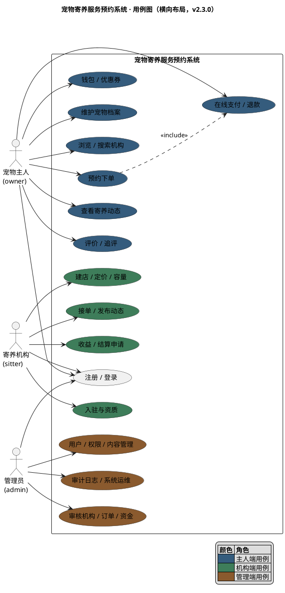
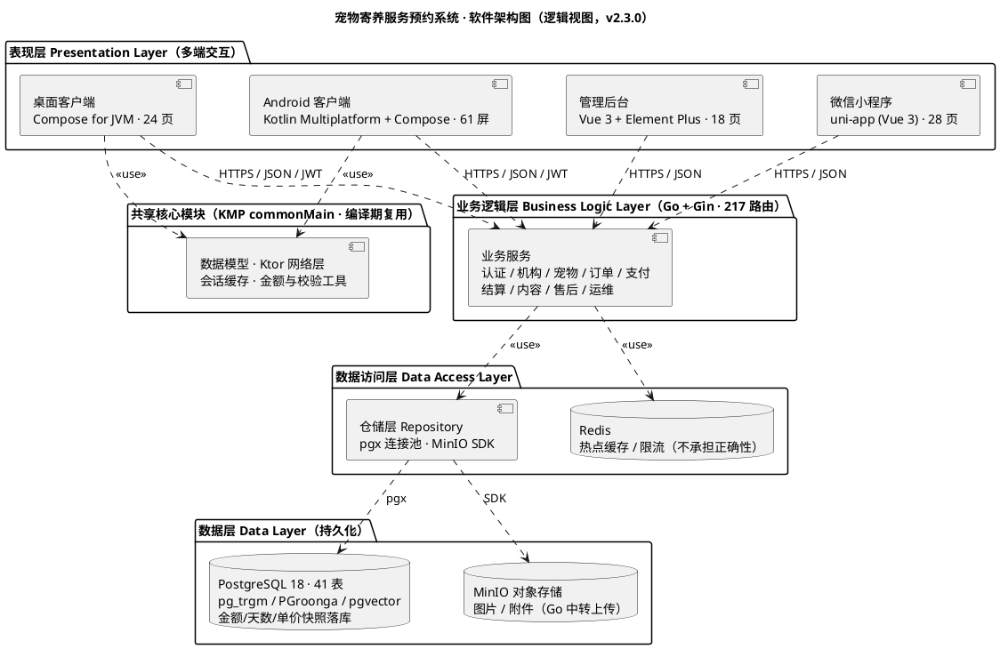
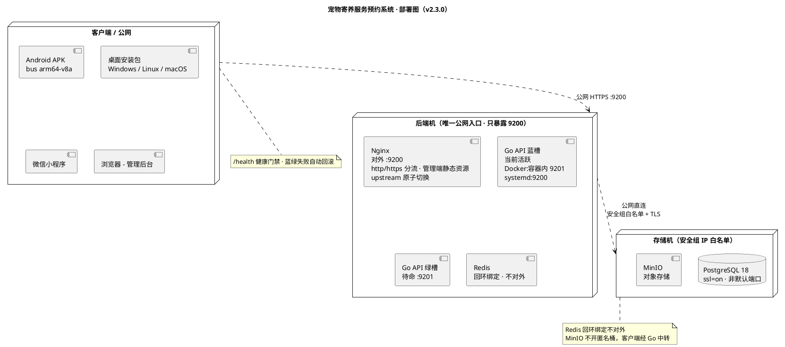
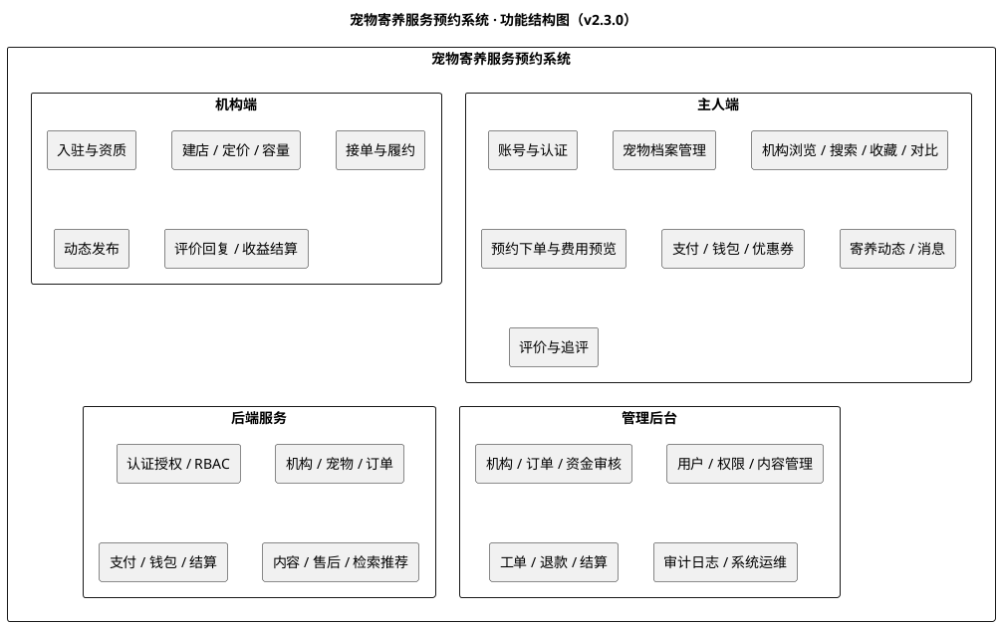
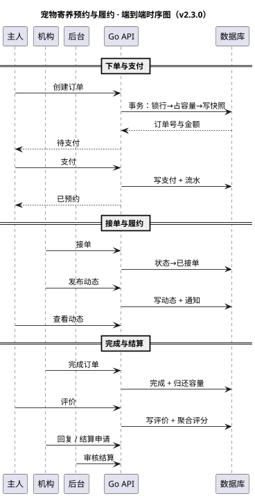
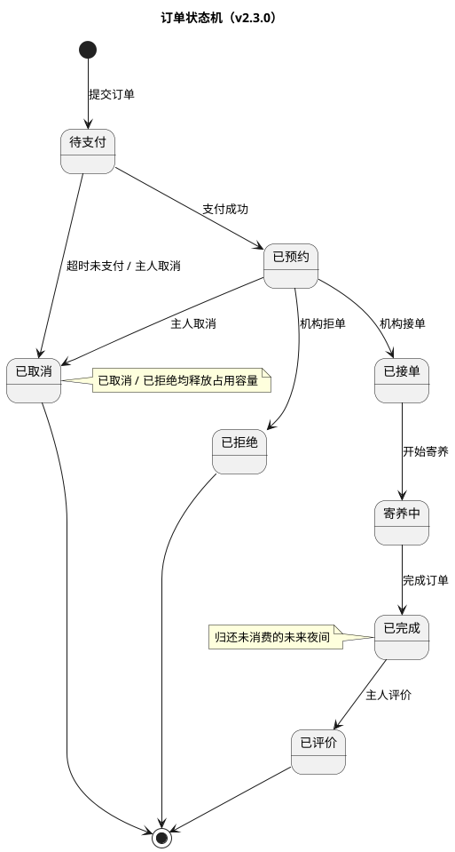
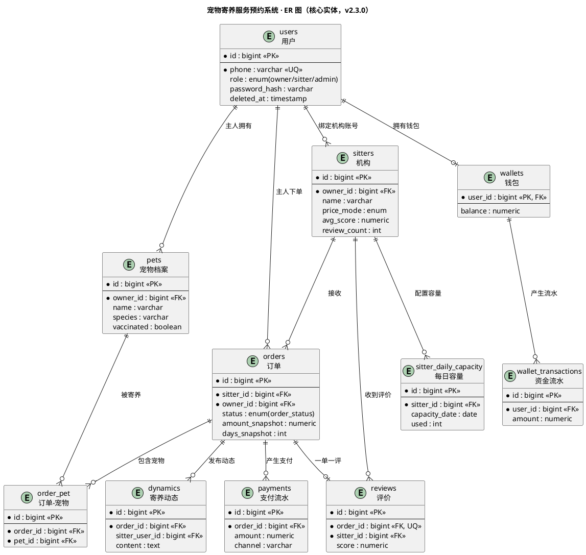

# 宠物寄养服务预约系统（宠栖 PatNest）· UML 图集

> 版本：v2.3.0
> 格式：PlantUML 源码，可直接粘贴到任意 PlantUML 渲染器生成白底图片
> 内容依据：`docs/项目说明.md`、`docs/02-数据库设计.md`、`docs/release/v2.3.0.md`

本图集共 7 张标准 UML 图，覆盖软件架构的静态结构与动态行为：

| 序号 | 图名 | 视图类型 | 说明 |
| --- | --- | --- | --- |
| 1 | 用例图 | 功能视图 | 主人 / 机构 / 管理员三角色功能 |
| 2 | 系统架构图 | 逻辑视图 | 表现层→共享模块→业务层→数据访问层→数据层 |
| 3 | 部署图 | 物理视图 | 双服务器拓扑、对外端口、蓝绿槽位、白名单 |
| 4 | 功能结构图 | 功能树 | 主人端 / 机构端 / 管理后台 / 后端服务 |
| 5 | 时序图 | 交互视图 | 下单→支付→接单→履约→评价→结算主流程 |
| 6 | 状态图 | 状态视图 | 订单状态机（含取消/拒单分支与容量释放） |
| 7 | ER 图 | 数据视图 | 核心实体及关系（11 个主干实体） |

---

## 1. 用例图（Use Case Diagram）

横向布局：`left to right direction` + 去掉嵌套 package 分区（分区在用例图里会被竖着堆），所有用例在系统边界内按「主人端 → 机构端 → 管理端」从左向右平铺，三个 actor 位于左侧，并用背景色区分角色归属。

---

## 2. 系统架构图（Component Diagram · 逻辑视图）

严格区分逻辑视图与物理视图：本图只表现分层与依赖，Nginx/端口/服务器见部署图。组件统一用标准 UML 组件符号，依赖用虚线 `..>` + `<<use>>`。

---

## 3. 部署图（Deployment Diagram · 物理视图）

双服务器拓扑。端口按实际配置标注：对外只暴露 9200（Nginx），API 槽位 Docker 容器内 9201 / systemd 蓝 9200 绿 9201。说明性 note 置于节点下方，避免超出画布被裁切。

---

## 4. 功能结构图（功能树）

四个子系统嵌套进根节点矩形，形成标准树状层次，避免根节点被甩到角落、连线绕圈。

---

## 5. 时序图（Sequence Diagram · 下单支付主流程）

participant 采用「引号显示名 + `as` 别名」写法，兼容新版 PlantUML 严格解析。

---

## 6. 状态图（State Machine Diagram · 订单状态机）

---

## 7. ER 图（Entity Relationship Diagram · 核心数据模型）

仅绘制主干实体（41 表中的核心 11 个），适合放入报告；如需完整 41 表可在此基础上扩展。

---

## 使用说明

- 每张图的 `@startuml` ... `@enduml` 之间是独立的 PlantUML 源码，复制到 [PlantUML Web Server](https://www.plantuml.com/plantuml/) 或任意支持 PlantUML 的编辑器（如 IntelliJ / VS Code 插件）即可渲染。
- 均为白底渲染（未设置深色 skinparam），可直接截图插入 Word 报告。
- 若需调整尺寸，在对应图的 `skinparam` 区加 `scale 1.5` 或 `skinparam nodesep/ranksep` 控制间距。
