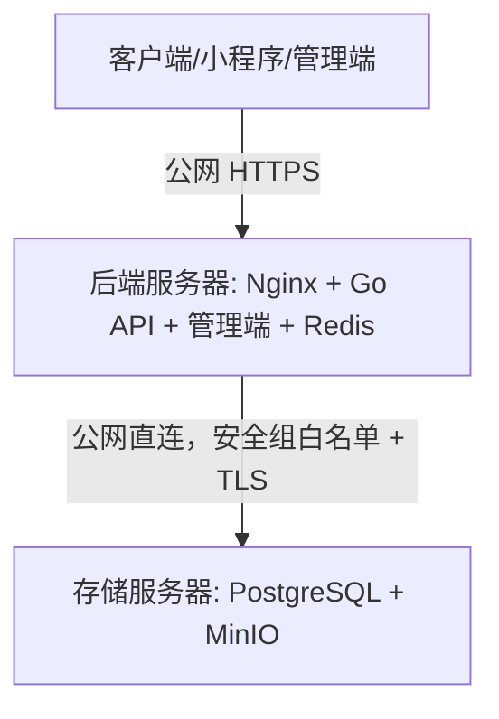

# 宠物寄养服务预约系统（宠栖 PatNest）· 项目说明文档

> 面向读者：指导老师、答辩评委、项目评审及任何想了解本项目的人
> 配套文档：`docs/02-数据库设计.md`、`docs/03-接口文档.md`、`docs/04-部署与热更新.md`、`docs/05-编译打包发布运行.md`、`docs/12-后端权限与限流收紧说明.md`、`docs/13-隐私与个人信息说明.md`、`docs/14-订单资金与容量缺陷修复.md`（完整清单见 `docs/README.md`）
> 版本：V1.7（修订记录见文末）

---

## 1 项目概述

### 1.1 项目定位

**宠物寄养服务预约系统**是一款面向宠物主人的寄养服务预约平台。它整合了**家庭寄养、门店寄养、上门喂养**三类服务资源，为宠物主人提供从"找机构、建档案、预约下单、查看动态、发表评价"的完整闭环，解决**节假日、出差期间宠物无人照看**的现实痛点。

### 1.2 一句话说明

> 主人不在家时，帮宠物找到一个值得托付的"临时之家"——通过多端应用快速找到合适的寄养机构，一键预约下单，全程看到宠物在寄养期间的真实动态。

### 1.3 项目形态

本项目并非单一小程序，而是**多端一体化**产品：

| 端 | 形态 | 定位 | 交付级别 |
|---|---|---|---|
| KMP · Android | Kotlin + Compose Multiplatform | **主体**，功能最完整 | 必交付（完整版） |
| KMP · Desktop | Compose for JVM | 答辩现场演示最稳的一端 | 必交付（演示版） |
| KMP · Web | Kotlin/Wasm + Compose Web | 探索方向 | 可选，不进答辩必演 |
| 微信小程序 | uni-app | 微信生态轻入口 | 必交付（核心闭环） |
| 后台管理端 | Vue3 + Element Plus | 管理员运营管理 | 必交付 |

> 口径说明：`app/patnestApp/shared/build.gradle.kts` 目前配置 `android / jvm` 两个 target，**没有启用 `wasmJs`**。iOS 曾在 2026-10 收敛为"只复用代码、不承诺出包"，2026-11-04 起彻底移除：开发机是 Windows，Kotlin/Native 的 iOS target 既构建不了也验证不了，留着只会让答辩口径含糊。对外统一表述为"Android + Desktop 双端可演示，Web 视进度探索"，不使用"多端齐活"这种容易被追问、又拿不出证据的说法。

---

## 2 项目背景与意义

### 2.1 背景

- 宠物经济持续增长，养宠家庭数量庞大，宠物被视为家庭成员；
- 节假日出行、出差、短期离开时，宠物无人照看成为高频痛点；
- 现有服务分散在微信群、朋友圈、电话沟通，**信息不透明、预约靠人工、过程不可见**，主人难以放心。

### 2.2 解决的问题

1. **信息不对称**：主人难以找到靠谱的寄养机构（环境、价格、口碑不透明）→ 平台统一展示机构环境照片、价格、评分、地址。
2. **预约流程繁琐**：靠电话/私聊反复确认 → 在线选机构、选日期、选宠物、自动算费、一键下单。
3. **寄养过程不可见**：主人无法了解宠物状态 → 机构发布文字+照片动态，全程可查。
4. **服务品质无反馈**：好坏无从评价 → 寄养结束后主人评价，评分聚合形成机构口碑。

### 2.3 意义

- **社会价值**：让"宠物托付"更透明、更放心，促进宠物服务行业规范化；
- **工程价值**：以 KMP 跨端复用 + Go 分层后端 + 双服务器容器化部署（计算与存储分离），展示现代软件工程能力；
- **学习价值**：覆盖多实体建模、事务与并发控制、中文全文检索、多角色权限、对象存储、容器化部署等关键技术点；相似度推荐作为可选加分项。

---

## 3 目标用户与角色

系统采用三角色权限模型（RBAC）：

| 角色 | 用户画像 | 主要行为 |
|---|---|---|
| 主人（owner） | 养宠家庭、节假日出行的宠物主人 | 维护宠物档案、浏览机构、预约下单、查看动态、发表评价 |
| 机构（sitter） | 家庭寄养主、宠物门店、上门喂养服务者 | 维护机构信息、接单确认、发布寄养动态 |
| 管理员（admin） | 平台运营人员 | 管理全部机构、订单、宠物、评价与用户 |

---

## 4 核心功能

### 4.1 机构展示与筛选

- 展示机构列表：环境照片、日寄养价格、评分、地址；
- 按类型筛选：家庭寄养 / 门店寄养 / 上门喂养；
- 支持排序：评分、价格、距离；距离由小程序 `uni.getLocation` 或客户端定位取经纬度，后端按 Haversine 公式计算，**不引入 PostGIS**（数据量级不需要）；
- 中文搜索：按机构名、地址、描述检索，基于 PostgreSQL 内置 `tsvector` + `pg_trgm`（GIN 索引），分词在 Go 侧完成后写入检索列（详见 8.2）。

> 为什么不用 pgroonga：它需要自行编译 Groonga 扩展，官方 PostgreSQL 镜像不带，安装步骤在不同机器上难以复现，答辩前一旦环境崩了没有退路。内置方案零额外依赖，演示数据量级下检索效果足够。时间充裕时再作为可选增强替换。

### 4.2 宠物档案管理

- 添加宠物：类型（猫/狗/其他）、名字、体型、年龄、疫苗情况、照片、备注；
- 一主多宠，预约时快速勾选（**一单可寄养多只宠物**）；
- 宠物删除为软删除，历史订单不受影响。

### 4.3 在线预约与费用计算

- 流程：选机构 → 选寄养起止日期 → 选宠物 → 自动计算费用 → 提交订单；
- 计费口径由机构的 `price_mode` 字段驱动，避免"按天"和"按次"两套规则在实现时互相打架：
  - `per_day`（家庭寄养 / 门店寄养）：口径"含首不含尾"，天数 = 结束日期 − 开始日期，费用 = 天数 × 日单价；
  - `per_visit`（上门喂养）：按次或按项目计费，费用 = 次数 × 单次价，与天数无关，下单时选服务项与上门次数；
- 费用以后端计算为准（前端仅预览），**多端口径一致**；
- 一致性怎么保证：费用规则写成共享核心层的纯函数（`commonMain`），KMP 各端直接调用；Go 后端独立实现同一份规则，两边用同一组用例（含跨月、单日、多宠物、混合计费）各自单测，用例数据放在 `docs/` 里对照；
- 订单金额、天数**快照落库**，机构后续调价不影响历史订单；
- 防冲突以**数据库约束**为准，不依赖分布式锁：
  - 同一宠物同一时段不可重复预约：`order_pet` 上建排他约束 `EXCLUDE USING gist (pet_id WITH =, daterange(start_date, end_date) WITH &&)`，依赖 `btree_gist` 扩展（官方镜像自带，`CREATE EXTENSION` 即可）；
  - 机构每日容量校验：`sitter_daily_capacity(sitter_id, stay_date, used, capacity)`，下单事务内用 `UPDATE ... SET used = used + n WHERE used + n <= capacity` 原子扣减，影响行数不足即回滚；
  - Redis 只做热点缓存与接口限流，**不承担正确性**：Redis 挂了系统仍然正确，只是变慢。

### 4.4 寄养动态与评价

- 寄养期间机构发布动态（文字 + 照片），主人实时查看宠物状态；
- 寄养结束后主人评价（评分 + 多维度 + 文字），评分原子聚合进机构口碑。

### 4.5 后台管理

- 管理员在 Web 管理端维护机构、订单、宠物、评价、用户数据；
- 与客户端共用同一套后端 API，独立角色权限。

---

## 5 业务使用流程（场景走查）

### 5.1 主人视角

1. 注册/登录，创建宠物档案（猫/狗、体型、疫苗等）；
2. 按类型/价格/评分搜索并浏览寄养机构；
3. 选择机构 → 选择寄养起止日期 → 勾选宠物 → 预览费用 → 提交订单；
4. 支付（模拟闭环）→ 订单进入"已预约"；
5. 寄养期间查看机构发布的宠物动态；消息提醒以站内消息中心为主，小程序订阅消息作为可选增强（依赖已备案的小程序主体与 HTTPS 合法域名，演示时可在开发者工具中关闭域名校验）；
6. 接回宠物，订单结束，发表评价。

### 5.2 机构视角

1. 注册机构账号，完善机构信息（类型、价格、地址、容量、照片）；
2. 查看收到的订单，确认接单；
3. 寄养期间发布动态（文字+照片）；
4. 订单结束，查看主人评价。

### 5.3 管理员视角

登录管理端，统一管理机构、订单、宠物、评价、用户，处理违规与投诉。

### 5.4 完整业务闭环


---

## 6 系统架构

### 6.1 总体架构（五层）

| 层 | 内容 |
|---|---|
| 客户端层 | KMP（Android / Desktop 必交付，Web 可选）、微信小程序、后台管理端 |
| 共享核心层 | KMP `commonMain`：领域模型、费用纯函数、订单状态机、网络层、本地缓存 |
| 服务层 | Go 后端：认证 RBAC、机构、宠物、订单、动态、评价、上传 |
| 数据层 | PostgreSQL（业务数据 + 全文检索）、Redis（缓存/限流）、MinIO（对象存储） |
| 部署层 | 异地双服务器：后端服务器（唯一公网入口）经公网直连存储服务器（白名单 + TLS） |

### 6.2 客户端

- **KMP 多端（主体）**：Android 完整版；Desktop 演示版；Web(wasmJs) 视进度探索。iOS 端已于 2026-11-04 移除（见 V1.6）。各端只写 UI，业务逻辑全部复用共享核心层——改一处费用规则，所有可交付端同步生效。
- **微信小程序（辅）**：保留核心闭环（浏览、预约、动态、消息提醒），做微信生态轻入口。
- **后台管理端**：Vue3 + Element Plus，表格化管理。注意 `webadmin/patnestServerAdminWeb` 目前还是 Vite 脚手架，`package.json` 里 `vue` 锁的是 `rc`、Vite 是 `^8`，引入 Element Plus 之前先把依赖降到稳定组合（Vue 3.5.x + Vite 6/7 + Element Plus 2.x），否则 RC 版本的 API 变动会在中途反复咬人。

### 6.3 后端（Go）

- 标准分层：`handler / service / repository / model / middleware`；
- 统一响应格式与全局错误码、结构化日志、审计日志；
- JWT 双 token + RBAC 三角色；数据归属校验放在 service / repository 层（机构只能读写自己的数据），**不启用 PostgreSQL RLS**，避免调试成本和排错难度；
- 下单正确性由数据库事务 + 排他约束保证（见 4.3），Redis 只做缓存与限流。

### 6.4 部署（异地双服务器，公网直连）



- 两台服务器位于**不同地点、通过公网互通**；后端服务器直接经公网访问存储服务器，**不额外组网**，这是本项目的既定网络形态，运维最简单、环境最易复现；
- 职责划分：**后端服务器**是唯一公网入口，Nginx 反向代理 Go API 并托管管理端静态资源，只暴露 80/443；**存储服务器**承载 PostgreSQL 与 MinIO，只对后端服务器公网 IP 白名单开放对应端口，其余地址不可达；
- Redis 放**后端服务器**：缓存贴近应用，避免每次读写缓存都跨地域公网绕一圈；跨地域链路延迟高，这一条要作为既定架构写清楚，不留给实现时随机发挥；
- 公网直连的安全控制（缺一不可）：
  - 安全组 + 宿主机防火墙**双重白名单**：只放行后端服务器公网 IP → 存储服务器对应端口（PostgreSQL、MinIO），其余地址一律拒绝；
  - PostgreSQL 开启 `ssl=on`、使用强密码（`scram-sha-256`），并改到非默认端口降低扫描噪音；
  - MinIO 只使用预设 Access Key / Secret Key，不开匿名桶，管理控制台与 API 都只对后端 IP 开放；
  - Redis 不对外监听，只绑定后端服务器回环地址，公网不可达；
- 可选加固：答辩时间充裕时，可在公网直连之上叠加一层 WireGuard / Tailscale 隧道，把"仅白名单"升级为"加密组网"，作为延伸亮点展示；不进必交付范围；
- 编排与运维：两台各自用 Compose 编排（`docker compose` 与 `podman-compose` 均可用，compose 文件按 OCI 通用写法编写）——后端侧 `nginx + api + redis`，存储侧 `postgres + minio`；要求一键起停、容器健康检查、Go API 优雅退出、数据库初始化脚本与迁移自动执行；
- 热更新：后端采用蓝绿双槽位（同机 9200/9201）+ `/health` 健康门禁 + Nginx upstream 原子切换；数据库用版本化增量迁移（`cmd/migrate`，含校验和与咨询锁）；管理面板用 release 目录 + `current` 软链接原子切换，页面自动检测新版本并提示刷新。无论是否使用容器，槽位与切换逻辑一致，详见《04-部署与热更新.md》；
- 跨地域延迟对演示数据量级无感知，但数据库连接池与 API 超时要留足余量，避免跨地域偶发抖动直接变成演示事故；
- 公网域名与 HTTPS：小程序与真机演示依赖已备案域名 + 证书；证书未就绪前，演示走公网 IP + 端口，并在小程序开发者工具中关闭域名校验；
- 资源下限参考：演示数据量级下，后端服务器 2C2G、存储服务器 2C4G 足够，PostgreSQL 与 MinIO 各限 512MB 内存。

---

## 7 技术栈

| 层 | 技术 | 说明 |
|---|---|---|
| 客户端主端 | Kotlin 2.4 + Compose Multiplatform 1.12 | 已配置 Android / Desktop(JVM) target；iOS 已于 2026-11-04 移除（开发机无 macOS），Web(wasmJs) 未启用 |
| 共享层 | Ktor Client + kotlinx.serialization / SQLDelight | 网络与序列化 / 本地缓存；SQLDelight 只做轻量缓存，不做复杂离线同步 |
| 微信小程序 | uni-app | 微信生态轻入口，HBuilderX 运行 |
| 后台管理端 | Vue3 + Vite + Element Plus + Pinia | 依赖需先锁稳定版（当前脚手架为 vue rc / vite 8） |
| 后端 | Go 1.25 + Gin + cmd/migrate | 单二进制、容器友好；DDL 以版本化迁移脚本受管 |
| 数据库 | PostgreSQL 18 | 关系建模 + 事务 + 排他约束防并发冲突 |
| 全文检索 | `tsvector` + `pg_trgm`（GIN） | PG 内置能力，无需自编译扩展；分词在 Go 侧完成 |
| 相似度推荐 | pgvector（可选加分项） | 见 8.3，数据量小时不作为核心卖点 |
| 缓存 / 限流 | Redis | 热点缓存、登录态、接口限流；不承担数据正确性 |
| 对象存储 | MinIO | 宠物照片、动态图片，Go 中转上传 |
| 部署 | 异地双服务器，公网直连 | 后端唯一公网入口，存储仅对后端公网 IP 白名单开放（TLS + 强密码）；`docker compose` / `podman-compose` 通用 |

> 版本策略：M0 阶段把所有依赖锁到确定可用的稳定版本，并把版本号写进《04-部署与热更新.md》。答辩前两周不再升级任何框架版本。

---

## 8 数据与检索设计

### 8.1 核心数据模型

主人 `users` 1—N 宠物 `pets`；主人 1—N 订单 `orders`；机构 `sitters` 1—N 订单；宠物 M—N 订单（`order_pet` 关联表，支持一单多宠物，并承载时段排他约束）；订单 1—N 动态 `dynamics`；订单 1—1 评价 `reviews`。

支撑表（第 4、5 章已承诺的功能必须有落库位置，否则实现时才发现无处可放）：

- `sitter_daily_capacity`：机构每日容量，支撑 4.3 的容量校验；
- `payments`：模拟支付流水（金额、方式、状态、时间），支撑 5.1 的"支付（模拟闭环）"；
- `notifications`：站内消息中心，小程序订阅消息不可用时的兜底通道；
- `audit_logs`：审计日志；
- `sitters` 需包含 `price_mode`、`daily_price` / `visit_price`、`capacity`、经纬度，以及评分聚合字段 `review_count` / `avg_score`。

订单状态机（`orders.status`，共享核心层与后端各自实现同一套转移规则，非法转移统一返回错误码）：

```text
主线：待支付 → 已预约 → 已接单 → 寄养中 → 已完成 → 已评价
分支：待支付 → 已取消（超时未支付 / 主人主动取消）
      已预约 → 已取消（主人主动取消） / 已拒绝（机构拒单）
```

- 只有"已完成"可评价；"已取消 / 已拒绝"必须释放已占用的每日容量；
- 状态机以纯函数实现，单测覆盖全部合法转移与典型非法转移（如"已评价"退回"寄养中"）。

### 8.2 中文全文检索

- 机构名称 / 地址 / 描述、动态内容、评价内容各自维护一个 `tsvector` 检索列（写入时同步或生成列），配合 `pg_trgm` GIN 索引支持前缀与模糊匹配；
- 中文分词在 Go 侧完成（如 `gojieba`，或退化为二元切分），切好的词写入 `tsvector`（`simple` 配置），不依赖数据库端中文分词扩展；
- 排序用 `ts_rank` 叠加评分与距离加权，检索结果对答辩演示足够；
- 数据规模按演示量级设计（机构 100~500 条），该方案毫秒级返回，且环境零额外依赖。

### 8.3 相似度推荐（可选加分项）

- 方案：为机构与宠物各生成低维特征向量（类型、体型、价格档、评分、地理栅格做 one-hot 与归一化，16~64 维即可，不需要 128 维），用 pgvector 做余弦相似度检索，给出"更适合这只宠物的机构"；
- 现实约束：演示数据只有数百条，HNSW / IVFFlat 在这个量级没有性能意义，顺序扫描即可。因此**不把它当核心创新点**，也不在答辩里强调"近实时向量检索"；
- 推荐结果必须可解释：返回时同时给出命中的特征维度（例如"支持大型犬寄养、价格区间匹配、评分 4.8、距离 2.3km"），这比向量本身更有说服力；
- 优先级低于订单闭环，时间不够时整块砍掉，主流程不受影响。

---

## 9 安全设计

- 认证授权：JWT 双 token（access + refresh）；
- 权限控制：RBAC 三角色 + 行级权限（机构只能操作自己的数据）；
- 上传安全：类型白名单、大小限制、随机文件名、Go 中转（客户端不直连 MinIO）；上传时做尺寸归一并生成缩略图，列表页只取缩略图，避免演示时被原图打爆带宽和内存；
- 接口限流：注册、登录、下单等公开接口防刷；
- 数据保护：订单金额快照、软删除、审计日志、pg_dump 备份。

---

## 10 工程结构（与仓库实际目录一致）

```
biyezuopin/                          # 单仓库分目录，不使用 git submodule
├── app/patnestApp/                  # KMP 主工程
│   ├── shared/src/commonMain/       # 共享核心层：domain / estimate / order / network / data
│   ├── shared/src/{android,jvm}Main/      # 平台 actual 实现
│   ├── androidApp/  desktopApp/
│   └── webApp/                      # 可选，需先启用 wasmJs target
├── uniapp/patnestUniapp/            # uni-app 微信小程序（HBuilderX 运行）
├── webadmin/patnestServerAdminWeb/  # Vue3 + Vite 管理后台（待引入 Element Plus）
├── server/patnestServer/            # Go 后端：cmd/api + internal/{handler,service,repository,model,middleware}
├── deploy/                          # compose 编排 + Nginx 配置 + 初始化脚本（待建）
└── docs/                            # 项目说明 / 软件设计 / 数据库设计 / 接口文档 / 部署运行
```

当前进度：KMP 端已完成启动页与跨端版本号读取（`AppVersionInfo` 的 expect/actual 三平台实现）；`server/patnestServer` 只有 `go.mod`；`deploy/` 尚未创建；`uniapp` 与 `webadmin` 仍是官方脚手架。

---

## 11 创新点

1. **KMP 跨端复用**：一套共享核心层覆盖 Android / Desktop，费用计算与订单状态机以纯函数实现并统一单测，"改一处、多端生效"——这是本项目最扎实的创新点；
2. **多端一体闭环**：KMP 重客户端 + 小程序轻入口 + Web 管理端，共用同一套 Go 后端与同一份 API 契约；
3. **正确性交给数据库**：用 PostgreSQL 排他约束 + 事务解决"同一宠物同一时段重复预约""机构超容量"这类并发问题，而不是在应用层堆锁，方案更简单也更可靠；
4. **检索体验**：基于 PostgreSQL 内置能力实现中文全文检索与可解释的相似度推荐，不依赖需要自行编译的扩展，环境可复现；
5. **异地双机直连**：两台不同地点的服务器经公网直连，后端服务器是唯一对外入口，存储服务器仅对后端公网 IP 白名单开放，并用 TLS + 强密码防护，架构简单、可复现，兼顾容灾与安全。

---

## 12 开发计划（里程碑）

按单人开发、每周约 20 小时投入估算，每个阶段都以"可运行、可演示"为完成标准，不留半成品阶段。

| 阶段 | 周期 | 内容 | 交付物 |
|---|---|---|---|
| M0 | 第 1 周 | 环境就绪：Node 入 PATH、容器工具可用、JDK 21 工具链、依赖锁稳定版，PG + Redis + MinIO 能起 | 可运行的空后端 + compose 文件 + 版本清单 |
| M1 | 第 2-3 周 | 需求与库表定稿、Go 骨架、认证 + 机构 + 宠物模块 | DDL、迁移脚本、API 契约、联调用例 |
| M2 | 第 4-5 周 | 共享核心层（费用纯函数、状态机、网络层）+ 订单模块与并发控制 | 单测报告、下单与防冲突接口 |
| M3 | 第 6-8 周 | KMP 各端 UI（Android 完整 + Desktop 演示）+ 小程序核心闭环 | 两端可演示 App、小程序体验版 |
| M4 | 第 9-10 周 | 管理端 + 动态 / 评价 + 上传 + 容器化部署 | 管理端、compose 部署、演示数据脚本 |
| M5 | 第 11-12 周 | 测试、文档、答辩材料；**第 12 周起代码冻结**，只修阻塞演示的缺陷 | 测试报告、设计文档、演示脚本与录屏 |

**MVP（最小可演示闭环，必须完成）**：主人注册登录 → 建宠物档案 → 搜索机构 → 选日期选宠物 → 后端算费 → 下单（排他约束防冲突）→ 机构接单 → 发布动态 → 主人查看 → 完成 → 评价 → 管理端可见全部数据。

**砍功能的顺序**（时间不够时从前往后砍，MVP 永不动）：向量推荐 → Web(wasmJs) → 订阅消息 → HTTPS 备案域名 → 距离排序。

---

## 13 风险与降级预案

| 风险 | 现实约束 | 应对 / 降级 |
|---|---|---|
| ~~iOS 无法构建~~ 已消除 | Kotlin/Native 的 iOS target 需 macOS + Xcode，开发机是 Windows，只能写不能验 | 2026-11-04 直接移除 iOS：删掉 `iosApp/`、`shared/src/iosMain/`、`iosTest/` 与 Gradle 里的 iOS target，风险从"降级交付"变成"不在范围内"；将来有 macOS 环境再按常规方式加回 |
| Compose Web 成熟度 | `wasmJs` target 未启用，Compose Web 仍在快速演进 | 列为可选探索，不进 MVP；Android + Desktop 已足够支撑"跨端复用"叙事 |
| pgroonga 安装 | 需自编译 Groonga 扩展，官方镜像不含，环境难复现 | 改用 PG 内置 `tsvector` + `pg_trgm`，分词放 Go 侧 |
| 小程序订阅消息 | 需已备案主体 + HTTPS 合法域名 + 证书 | 站内消息中心兜底；开发者工具关闭域名校验演示；真机用体验版 |
| 依赖版本过新 | 脚手架用 `vue: rc`、Vite 8、AGP 9.4、Kotlin 2.4 等前沿版本 | M0 统一锁稳定版并记录版本号，写进部署文档，答辩前不再升级 |
| 异地公网互联 | 两台机器不同地点，公网链路延迟高，PG / MinIO 端口暴露公网 | 安全组 + 宿主机防火墙双重白名单只放行后端公网 IP；PostgreSQL 开启 `ssl=on`、强密码、非默认端口；MinIO 仅用预设密钥；可选叠加 WireGuard / Tailscale 隧道加固 |
| 公网域名与备案 | 小程序真机与 HTTPS 依赖已备案域名 + 证书 | 证书未就绪前用公网 IP + 端口演示，小程序开发者工具关闭域名校验；备案下来后再切 HTTPS |
| 向量推荐价值有限 | 演示数据仅数百条，向量索引无性能意义 | 降为可选加分项，强调"可解释推荐"而非"高性能检索" |
| 单人多模块并行 | 五个模块同时推进容易全线拖延 | 严格按 M0→M5 串行推进，每阶段必须有可演示产物 |
| 本机环境缺口 | `npm` 不在 PATH、`podman` 未安装、JDK 为 25 而工程目标 JVM 21 | M0 一次性解决：装 Node LTS 入 PATH、用 Docker Desktop 或补装 Podman、装 JDK 21 工具链 |

---

## 14 预期成果与答辩亮点

- **完整可演示的产品**：Android + Desktop 双端 App + 微信小程序 + Web 管理端 + 容器化部署；
- **扎实的技术纵深**：多实体建模与状态机、事务与数据库约束解决并发、中文全文检索、多角色权限、对象存储、容器编排；
- **清晰的创新叙事**：KMP 跨端复用是核心创新，"正确性交给数据库"与可解释推荐是支撑亮点；
- **诚实的范围声明**：Web、订阅消息等受限项在文档中明确标注前提条件，不因过度承诺在答辩现场被动；
- **可直接演进的工程**：代码分层规范、数据库迁移受管、文档齐备，具备继续扩展的基础。

---

## 15 修订记录

| 版本 | 日期 | 修订内容 |
|---|---|---|
| V1.0 | 2026-10-29 | 初稿：项目定位、功能、架构、技术栈、里程碑 |
| V1.1 | 2026-10-29 | 按仓库实际配置与本机环境收敛范围：端口径改为"Android + Desktop 可演示、iOS 代码复用、Web 可选"；全文检索由 pgroonga 改为 PG 内置 `tsvector` + `pg_trgm`；并发防冲突由 Redis 分布式锁改为事务 + 排他约束；pgvector 推荐降为可选加分项；部署由双服务器改为单机多网络（双机可选）；补齐 `price_mode` 计费口径、订单状态机与支撑表；工程结构改为真实目录；新增 M0 阶段、MVP 定义与风险降级预案 |
| V1.2 | 2026-10-29 | 部署架构按实际环境改为**双服务器**：后端服务器（Nginx + Go API + 管理端静态资源）为唯一公网入口，存储服务器（PostgreSQL + MinIO + Redis）仅内网可达；同步修正总体架构、技术栈、创新点、里程碑与风险表中所有部署相关表述 |
| V1.3 | 2026-10-29 | 明确两台服务器为**异地部署、公网互通**：改用 WireGuard / Tailscale 加密隧道组网，存储服务不留公网端口、禁止公网直连数据库；Redis 移至后端服务器（缓存贴近应用）；同步修正部署图、架构表、技术栈、创新点与风险表 |
| V1.4 | 2026-10-29 | 按实际需求简化为**公网直连**：去掉隧道，后端服务器经公网直连存储服务器；安全由安全组 + 宿主机防火墙双重白名单、PostgreSQL SSL/强密码、MinIO 预设密钥控制；隧道降级为可选加固项；同步修正架构表、技术栈、创新点与风险表 |
| V1.5 | 2026-10-29 | 数据库版本修正为 **PostgreSQL 18**（技术栈表） |
| V1.6 | 2026-11-04 | **移除 iOS 端**：删除 `iosApp/` Xcode 工程与 `shared` 的 `iosMain`、`iosTest` 源集及 Gradle 中的 iOS target、`ktor-client-darwin` 依赖；交付端收敛为 Android + Desktop + 微信小程序 + 管理后台。同步更新技术栈表、工程结构图、创新点、砍功能顺序与风险表（该风险已不存在），`docs/10` 删除高德 iOS 配置整节并重编小节号。历史修订记录中的 iOS 表述按当时情况保留 |
| V1.7 | 2026-11-04 | 文档头部配套文档清单由"规划中"改为指向实际存在的 `docs/02`、`docs/03`、`docs/04`、`docs/05`、`docs/12`、`docs/13`、`docs/14`；根 `README.md` 按当前工程实况整篇重写（数据库口径改为 PostgreSQL、后端启动命令改为 `go run ./cmd/api`、补齐 `deploy/`、`release/`、一键构建脚本与 iOS 移除后的交付端范围） |
