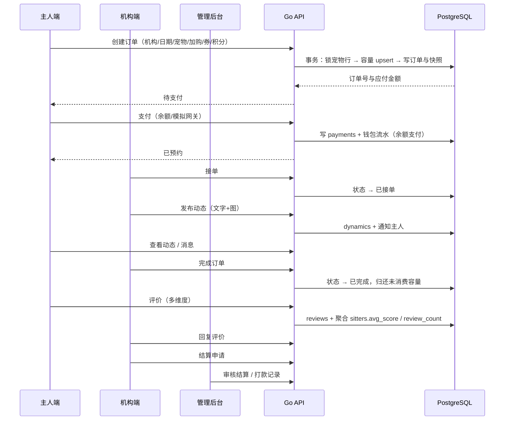
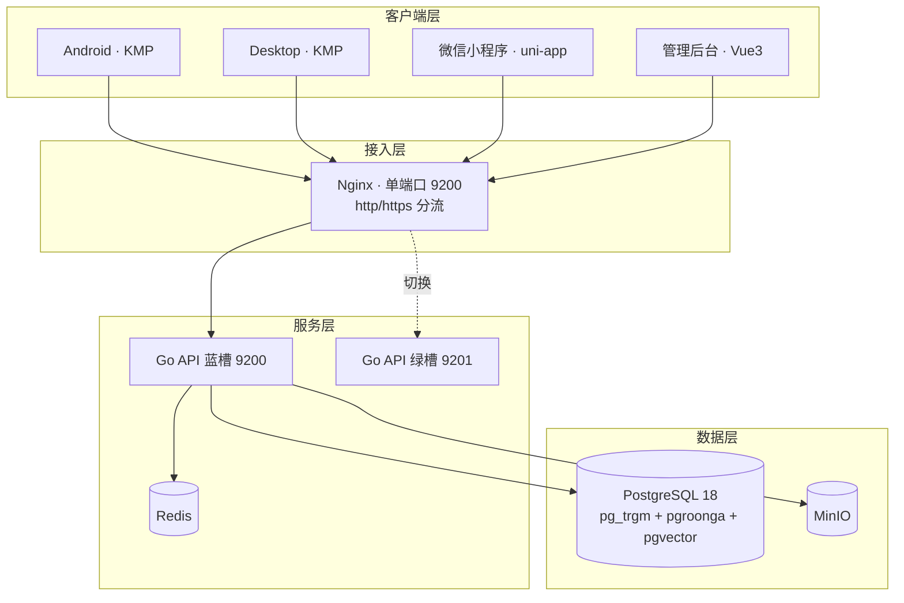
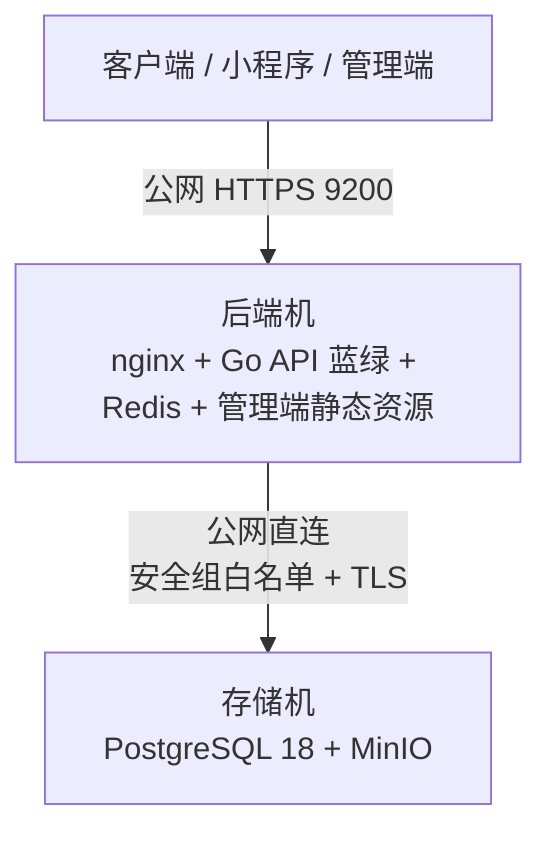

# 宠物寄养服务预约系统（宠栖 PatNest）· 项目说明文档

> **适用版本：v2.3.0（2026-11-22 发布）**
> 面向读者：指导老师、答辩评委、项目评审，以及任何需要快速了解本系统的人
> 配套文档：`docs/02-数据库设计.md`、`docs/03-接口文档.md`、`docs/04-部署与热更新.md`、`docs/05-编译打包发布运行.md`、`docs/21-系统测试报告.md`、`docs/23-GitHub-Actions打包.md`（完整清单见 `docs/README.md`）
>
> **数据口径**：本文所有数量统计都取自 v2.3.0 对应的源码与 tag；接口、表、页面有增减时先改本文，再改实现。

---

## 一、项目概述

### 1.1 项目定位

**宠物寄养服务预约系统**是一个面向宠物主人的寄养服务预约平台。它把**家庭寄养、门店寄养、上门喂养**三类服务资源整合到一处，为宠物主人提供「找机构 → 建档案 → 预约下单 → 支付 → 看动态 → 评价」的完整闭环，解决节假日、出差期间宠物无人照看的现实痛点。

### 1.2 一句话说明

> 主人不在家时，帮宠物找到一个值得托付的「临时之家」——多端应用上快速找到合适的寄养机构，一键预约下单，全程看到宠物在寄养期间的真实动态。

### 1.3 要解决的四个问题

| 问题 | 现状 | 系统的做法 |
| --- | --- | --- |
| 信息不对称 | 机构靠谱程度、价格、口碑靠口口相传 | 统一展示环境照片、价格、评分、评价、地址与距离 |
| 预约流程繁琐 | 电话/微信反复确认时间、宠物、费用 | 在线选日期、选宠物、后端自动算费、一键下单 |
| 寄养过程不可见 | 主人不知道宠物每天状态 | 机构按订单发布文字 + 图片动态，主人随时查看 |
| 服务品质无反馈 | 好坏无处评价，口碑无法沉淀 | 结束后主人在多维度评分，评分原子聚合进机构口碑 |

### 1.4 项目形态

本项目不是单一小程序，而是**一个后端 + 四个前端**的多端一体化产品，全部在同一个仓库、同一套提交历史里：

| 端 | 形态 | 定位 | 交付级别 |
| --- | --- | --- | --- |
| Android（KMP） | Kotlin + Compose Multiplatform | **主体**，功能最完整，61 个屏幕 | 必交付 |
| Desktop（KMP） | Compose for JVM | 答辩现场演示最稳的一端，24 个页面 | 必交付 |
| 微信小程序 | uni-app（Vue 3） | 微信生态轻入口，28 个页面 | 必交付（核心闭环） |
| 管理后台 | Vue 3 + Element Plus | 管理员运营管理，18 个业务页面 | 必交付 |
| 服务端 | Go + Gin | 全端共用的唯一业务入口，217 条路由 | 必交付 |

> iOS 端已于 2026-11-04 移除：开发机是 Windows，Kotlin/Native 的 iOS target 既构建不了也验证不了，保留只会让答辩口径含糊。Web（wasmJs）作为探索方向保留在文档里，不进答辩必演。

### 1.5 版本与仓库

| 项 | 当前值 |
| --- | --- |
| 当前版本 | **v2.3.0**（2026-11-22 发布，测试用途的正式 Release） |
| 上一个正式版 | v2.0.5（2026-11-14） |
| 首个正式版 | v2.0.0（2026-11-14） |
| 代码仓库 | <https://github.com/zlddba/bishe>（另有局域网 gitea 镜像） |
| 线上环境 | `https://www.linkzdsada.dpdns.org:9200`（API 与管理后台同域，`/swagger/index.html` 为接口文档） |
| 发布方式 | tag 驱动：发布分支 + 同名 tag + 发布文档三项校验 → 11 个 job → 15 个多架构附件 |

### 1.6 规模数据（v2.3.0）

| 维度 | 数量 | 说明 |
| --- | --- | --- |
| 后端 Go 文件 | 104 个 | 含 19 个 `_test.go`；`internal/handler` 下 56 个文件 |
| 后端路由 | **217 条** | 公开 12 + 根 1、认证 7、受保护自身 8、主人 46 + 浏览别名 12、机构 31、管理员 100 |
| 数据库表 | **41 张** | 含 `schema_migrations`，业务表 40 张 |
| 迁移脚本 | 主目录 16 个 + 归档 20 个 | 当前到 `0027_auth_phone_codes.sql` |
| 客户端 Kotlin 文件 | 90 个 | shared 52 + desktopApp 37 + androidApp 1；Android 61 屏、桌面 24 页 |
| 管理后台页面 | 23 个 `.vue` | 18 个业务页 + 登录页 + 布局/组件 |
| 小程序页面 | 28 个 | HBuilderX 工程，无 `package.json` |

---

## 二、角色与权限

### 2.1 三角色模型

系统采用 RBAC 三角色 + 行级归属校验：

| 角色 | 数据库值 | 用户画像 | 主要行为 |
| --- | --- | --- | --- |
| 主人 | `owner` | 养宠家庭、节假日出行的宠物主人 | 维护宠物档案、浏览机构、下单支付、查看动态、评价、钱包与优惠券 |
| 机构 | `sitter` | 家庭寄养主、宠物门店、上门喂养服务者 | 建店与资质、排期容量、定价与加购、接单履约、发动态、结算 |
| 管理员 | `admin` | 平台运营人员 | 审核机构、订单与资金、内容、用户与权限、审计、系统运维 |

### 2.2 权限矩阵（按能力域）

| 能力域 | 主人 | 机构 | 管理员 |
| --- | --- | --- | --- |
| 注册 / 登录 / 令牌刷新 | ✅ | ✅ | ✅（仅后台密码 + TOTP） |
| 验证码登录（演示模式） | ✅ | ✅ | ❌ 明确拒绝 |
| 宠物档案 | ✅ 增删改查 | 只读（订单内） | ✅ 管理与软删 |
| 机构浏览 / 搜索 / 相似推荐 | ✅ 未登录也可浏览 | ✅ | ✅ |
| 机构入驻与资质 | 提交申请 | 维护自己的资料 | 审核 / 驳回 / 封禁 |
| 下单 / 支付 / 退款 | ✅ | ❌ | ✅ 代操作与审核 |
| 接单 / 拒单 / 完成 | ❌ | ✅ 仅自己店铺 | ✅ 强制流转 |
| 容量与节假日价 | ❌ | ✅ 仅自己店铺 | ✅ 只读 |
| 动态 | 查看 / 点赞 / 评论 | 按订单发布 | 审核 / 删除 |
| 评价 | 发表 / 追评 | 回复 | 审核 / 删除 |
| 优惠券 / 积分 / 邀请码 | 领取 / 使用 | 发放（仅本店） | 平台券与规则 |
| 钱包 / 提现 / 结算 | 余额与流水 | 收益 / 结算申请 | 审核 / 打款记录 |
| 工单与售后 | 提交 / 回复 | 处理本店工单 | 全量处理 |
| 审计日志 / 权限点 | ❌ | ❌ | ✅ |
| 系统更新 / 证书 / TOTP / Swagger 开关 | ❌ | ❌ | ✅ |

### 2.3 归属与越权规则

- 机构只能读写**自己店铺**的数据：`sitter` 相关接口在 SQL 里强制带 `sitter_id`，不依赖前端传参；
- 令牌里的角色只是**快照**，真正判定以数据库当前角色为准（`docs/18-接口权限口径调整-20261110.md`）；
- 所有「资源属于谁」的校验放在 service / repository 层，不使用 PostgreSQL RLS；
- 越权统一返回 `403`，资源不存在返回 `404`，不泄露资源是否存在。

### 2.4 管理员子权限

管理员内部再按权限点细分（`role_permissions` 表 + `permissions` 页面），可以在后台给不同管理员分配菜单与操作权限；审计日志记录每一次敏感操作（操作人、对象、前后值）。

---

## 三、业务闭环

### 3.1 主人视角（7 步）

1. 注册 / 登录（手机号 + 密码，或手机号 + 验证码）；
2. 创建宠物档案：类型、名字、体型、年龄、疫苗、照片、备注，一主多宠；
3. 按类型 / 价格 / 评分 / 距离浏览与搜索机构，可收藏、可对比；
4. 选择机构 → 选寄养起止日期 → 勾选宠物 → 选加购服务 → 用券 / 用积分 → 预览费用；
5. 提交订单并支付（余额 / 模拟网关）；
6. 寄养期间查看机构发布的动态，接收站内消息；
7. 接回宠物 → 订单完成 → 评价（多维度评分）→ 可追评。

### 3.2 机构视角（5 步）

1. 注册机构账号 → 提交入驻申请与资质（营业执照、身份证、场地照片）；
2. 审核通过后建店：类型、地址（地图选点 / 地址解析）、价格模式、容量、封面与实拍图；
3. 配置按日容量、节假日价格规则、加购服务、优惠券；
4. 接单 → 寄养中发布动态 → 完成订单；
5. 查看收益、评价并回复、发起结算。

### 3.3 管理员视角

登录后台（密码 + TOTP 两步验证）→ 审核机构 → 监控订单与资金 → 处理工单 / 退款 / 结算 → 维护内容（动态、评价、公告、推送）→ 看审计日志 → 系统更新与证书。

### 3.4 订单状态机

```text
主线：待支付 → 已预约 → 已接单 → 寄养中 → 已完成 → 已评价
分支：待支付 → 已取消（超时未支付 / 主人主动取消）
      已预约 → 已取消（主人主动取消） / 已拒绝（机构拒单）
```

规则要点：

- 状态用 PostgreSQL 枚举 `order_status` 落库：`pending_pay` / `confirmed` / `accepted` / `staying` / `completed` / `evaluated` / `cancelled` / `rejected`；
- 状态流转由后端在事务内校验（先 `SELECT ... FOR UPDATE` 读当前状态，再按目标状态更新），非法转移统一返回 `409`；客户端只按当前状态决定展示哪些操作，不自行流转；
- 只有「已完成」可评价，评价后变「已评价」；
- 「已取消 / 已拒绝」必须释放已占用的每日容量；「已完成 / 已评价」归还尚未消费的未来夜间；后台软删进行中订单同样释放（迁移 `0015` 补齐）；
- 改期 / 续住会重算天数与金额，并重新占用容量（`docs/14-订单资金与容量缺陷修复.md`）。

### 3.5 端到端时序



---

## 四、功能清单

### 4.1 服务端能力域（Go）

| 能力域 | 关键内容 |
| --- | --- |
| 账号与认证 | 注册（手机号必填）、用户名/手机号登录、JWT 双 token（access 30 分钟 + refresh）、令牌刷新与吊销、登出、注销与撤销注销、验证码登录（演示模式，迁移 0027） |
| 权限与安全 | RBAC 三角色、管理员权限点、行级归属、TOTP 两步验证（迁移 0023 + 恢复码）、接口限流、CORS、上传校验、审计日志、隐私口径 |
| 机构 | 入驻申请与资质、建店与资料、封面/实拍图、地理编码与选点、审核（通过/驳回/封禁）、距离排序、相似机构 |
| 宠物 | 档案增删改查、软删除、疫苗证明上传、寄养历史、按 species 筛选 |
| 预约与计价 | 估价与下单、`per_day` / `per_visit` 两种计费、节假日价、加购、券与积分抵扣、金额与天数快照 |
| 容量台账 | 每日容量查询与设置、`fn_reserve_capacity` 逐晚占用、超限回滚、取消/完成归还 |
| 支付与钱包 | 模拟支付网关、余额支付、钱包流水、充值、提现申请与审核、退款 |
| 优惠券 / 积分 / 邀请码 | 平台券与店铺券、领取与核销、积分流水、邀请奖励 |
| 订单履约 | 接单 / 拒单 / 开始 / 完成、改期 / 续住 / 取消、退款申请与进度、订单动态 |
| 内容 | 寄养动态（图集/点赞/评论）、评价与追评、回复、公告、消息中心、推送任务 |
| 售后 | 工单与消息、退款工单、结算申请与审核 |
| 运维 | 系统信息、版本、更新（zip + sha256 manifest + 蓝绿）、证书（上传 / Let's Encrypt DNS-01）、运行期 Swagger 开关、发布记录 |
| 地理 | 地理编码、逆地理编码、区县、瓦片代理、静态地图、浏览器选点会话 |
| 检索与推荐 | PGroonga 中文全文检索（自动降级 pg_trgm）、pgvector 16 维机构向量 + HNSW 余弦相似度 |
| 接口文档 | Swagger 由 `router.go` 生成，`go test ./internal/swagger` 校验漏掉的路由 |

### 4.2 Android 端（61 屏）

| 分组 | 屏幕 |
| --- | --- |
| 登录与账号 | D09Login、D40Register、D41ProfileEdit、D17Settings、D61SettingsDetail、D47Agreements |
| 主人首页与发现 | D01Home、D02FindSitters、D38SearchResults、D52SearchHistory、D23SitterCompare |
| 机构与下单 | D03SitterDetail、D04Booking、D10Checkout、D22PaySuccess、D35Addons、D24MapPicker |
| 订单 | D05Orders、D19OrderDetail、D48OrderCancel、D56OrderReschedule、D57OrderExtend、D37SitterOrderDetail |
| 宠物 | D08Pets、D12PetAdd、D42PetDetail、D33PetHistory |
| 内容与互动 | D06Dynamics、D32DynamicDetail、D49ReviewAppend、D11ReviewWrite、D59ReviewDetail |
| 钱包与资产 | D60Wallet、D21Points、D54PointsLedger、D14Coupons、D55CouponDetail、D43ClaimCenter、D50Invite |
| 消息与售后 | D15Messages、D39Announcements、D20Tickets、D45Support、D34RefundProgress |
| 地址与其他 | D13Favorites、D16Addresses、D44AddressAdd、D53EmptyStates |
| 机构工作台 | D18SitterWorkspace、D25RoleSwitch、D51SitterDashboard、D26ShopProfile、D27Capacity、D28PublishDynamic、D29SitterIncome、D30SitterCoupons、D31SitterReviews、D36HolidayRules、D46SitterOnboarding、D58SitterGallery、D07Profile |

视觉上，Android 端已在 v2.3.0 全量换成**液态玻璃**（页面级背景记录 + 窗口级环境光两层，AGSL 边缘折射与色散，API 33 以下自动回退），导航保留 `androidx.navigation.compose`，组件库为 Miuix（HyperOS 风格）。

### 4.3 桌面端（24 页）

| 分组 | 页面 |
| --- | --- |
| 主人端（16） | 登录、首页、机构列表、机构详情、下单、支付、订单、评价、宠物列表、宠物编辑、钱包、优惠券、收藏、动态、消息、个人资料 |
| 机构端（8） | 概览、接单、容量、收益与结算、评价回复、动态发布、优惠券、机构资料 |
| 通用 | 地图选点面板、远程图片、标题栏、启动页 |

桌面端通过 `jlink` 自带裁剪后的 JVM 运行时，用户机器**不需要安装 Java**；接口地址在构建期固化，运行时按「环境变量 → `.env` → 构建期值 → 内置默认」取值。

### 4.4 微信小程序（28 页）

首页与筛选、登录、定位选点、机构详情、评价列表、机构选择器、宠物列表/详情/编辑、创建订单、订单列表/详情/评价、通知、收藏、收藏对比、动态列表/详情、钱包、退款进度、工单列表/详情/创建、我的、邀请、资料、设置、修改密码。

工程为 HBuilderX 项目（无 `package.json`），只发行微信小程序（AppID `wx1366ab99a6b27171`），不出 H5 / App；宿主域名、`request` 合法域名与图片域名需在微信公众平台配置。

### 4.5 管理后台（18 个业务页面）

经营看板、机构管理、订单管理、宠物管理、寄养动态、评价管理、优惠券、通知公告、消息模板、推送任务、售后服务、机构结算、钱包管理、用户管理、权限配置、审计日志、系统更新、账号安全（TOTP / 证书 / Swagger 开关）。

---

## 五、技术架构

### 5.1 总体架构（五层）

| 层 | 内容 |
| --- | --- |
| 客户端层 | KMP（Android / Desktop）、微信小程序、管理后台 |
| 共享核心层 | KMP `commonMain`：数据模型、网络层（Ktor）、会话与缓存、金额与校验工具 |
| 服务层 | Go + Gin：认证、机构、宠物、订单、支付、内容、售后、结算、运维 |
| 数据层 | PostgreSQL（业务 + 全文检索 + 向量）、Redis（缓存/限流）、MinIO（对象存储） |
| 部署层 | 双服务器（后端机 + 存储机），容器编排 + 蓝绿热更新 |



### 5.2 客户端共享层

`app/patnestApp/shared` 按 target 分源集：

| 源集 | 内容 |
| --- | --- |
| `commonMain` | `data/api`（ApiClient、模型、映射、HTTP 引擎）、`data/model`、`data/session`、`data/NotificationCenter`、`ui/components`（图标）、`ui/util`（地图投影）、`utils`（金额、手机号、版本信息、倒计时） |
| `androidMain` | 61 个屏幕、Miuix 与玻璃组件（`DGlass`、`DMiuix`、`DScreensA~D`）、定位、地图瓦片、本地通知 |
| `jvmMain` | 桌面端平台实现（文件、启动参数） |
| `androidHostTest` / `jvmTest` / `commonTest` | 各 1 个脚手架级单测（占位，尚无实质断言） |

一条硬约定：**金额与天数以后端为准**。估价走 `GET /pet-owner/sitters/:id/estimate`，下单时后端用同一套计价逻辑重算并快照落库，客户端只负责预览与展示；共享层承担模型、网络、会话、金额格式化与输入校验，不重复实现业务规则，避免「两套算费逻辑对不上」这类问题。

### 5.3 后端分层

```text
server/patnestServer/
├─ cmd/
│  ├─ api/          常驻服务（路由、中间件、优雅退出、蓝绿槽位）
│  ├─ migrate/      在线迁移（校验和 + 咨询锁）
│  ├─ dbprobe/      数据库连通性排查
│  └─ capprobe/     证书与 TLS 探测
├─ internal/
│  ├─ router/       217 条路由与分组（公开 / auth / owner / sitter / admin）
│  ├─ handler/      56 个文件，按业务域拆分
│  ├─ middleware/   JWT、权限、CORS、文件 URL 归一
│  ├─ model/        请求/响应模型
│  ├─ config/       环境变量与默认值
│  ├─ db/           pgx 连接池与事务
│  ├─ cache/        Redis（手写 RESP 客户端，不引第三方库）
│  ├─ storage/      MinIO 上传与签名
│  ├─ payment/      模拟支付网关
│  ├─ amap/         高德地理编码与逆地理
│  ├─ swagger/      OpenAPI 生成与运行期开关
│  ├─ totp/         TOTP 两步验证
│  ├─ acme/         Let's Encrypt（Cloudflare DNS-01）
│  ├─ tlsmux/ backendtls/   同端口 http/https 分流与上游 TLS
│  ├─ updater/      更新包校验、暂存、蓝绿切换
│  └─ version/      编译期注入的版本、提交号、构建时间、槽位
└─ serverdb/        init.sql 全量基线 + migrations 增量
```

统一响应为 `{ "code": 0, "message": "ok", "data": ... }`，错误码与 HTTP 状态码一一对应；分页统一 `page` / `per_page`（上限 50）与 `items` / `total`。

### 5.4 数据层

41 张表按域分组：

| 域 | 表 |
| --- | --- |
| 账号与权限 | `users`、`auth_phone_codes`、`refresh_tokens`、`totp_recovery_codes`、`role_permissions` |
| 机构 | `sitters`、`sitter_daily_capacity`、`sitter_price_rules`、`sitter_addons`、`sitter_settlements` |
| 宠物与订单 | `pets`、`orders`、`order_pet`、`order_addons` |
| 资金 | `payments`、`wallets`、`wallet_transactions`、`wallet_withdrawals`、`recharge_orders`、`refund_requests` |
| 营销 | `coupons`、`user_coupons`、`points_ledger`、`invite_rewards` |
| 内容与互动 | `dynamics`、`dynamic_likes`、`dynamic_comments`、`reviews`、`review_followups`、`favorites` |
| 消息与售后 | `notifications`、`notification_templates`、`notification_push_tasks`、`support_tickets`、`ticket_messages` |
| 地理与平台 | `geocode_cache`、`geo_pick_sessions`、`platform_settings`、`audit_logs`、`system_release`、`schema_migrations` |

迁移策略：

- `serverdb/init.sql` 是**唯一全量基线**，新库执行一次即可（含函数、触发器、索引、视图、种子数据）；
- 已上线库走 `cmd/migrate`，按 `00NN_名字.sql` 顺序执行，校验和不符直接拒绝；
- 结构变更必须同时改 `init.sql` 与新增迁移脚本，保证「新库」与「老库升级后」结构一致；
- `archive/` 与 `0001` 不再改动（老库校验和依赖它）。

### 5.5 检索与推荐

| 能力 | 实现 | 降级 |
| --- | --- | --- |
| 机构中文搜索 | PGroonga 表达式索引（`name::text` / `address::text` / `description`），查询用 `pgroonga_query_escape` | 扩展不存在或查询失败 → `pg_trgm` 的 `ILIKE + similarity()`，不报 500 |
| 相似机构 | `sitters.embedding vector(16)` + HNSW 余弦索引，向量由触发器 `trg_sitters_embedding` 按类型/价格/容量/评分/评价数/经纬度/图片完整度维护 | 维度固定、规则可解释，不依赖外部 embedding 服务 |
| 距离排序 | `sort=distance` + Haversine，缺坐标的机构排最后 | 未传经纬度返回 400 |

> 设计取舍：向量不用 128 维、不引入外部模型，是因为演示数据只有数百条机构，HNSW 在这个量级没有性能意义；**推荐结果可解释**（相似度百分比 + 类型/价格/评分维度）比「高性能检索」更有说服力。

### 5.6 并发与一致性

| 场景 | 做法 |
| --- | --- |
| 同一宠物同一时段重复预约 | 下单事务内先 `SELECT ... FOR UPDATE` 锁宠物行，再做重叠查询，把并发下单串行化 |
| 机构超容量 | 逐晚 `INSERT ... ON CONFLICT DO UPDATE ... RETURNING` 占用容量，超限 `RAISE` 回滚整笔事务；机构显式设置过的日期保留自己的上限 |
| 改期 / 续住 | 先释放旧占用再占用新日期，失败整体回滚 |
| 重复支付 | 支付前校验订单状态，重复支付返回 `409` |
| 金额被后续调价影响 | 订单金额、天数、单价**快照落库** |
| 缓存一致性 | Redis 只做热点缓存与限流，**不承担正确性**：Redis 挂掉系统仍然正确，只是变慢 |

### 5.7 安全设计

- **认证**：JWT 双 token（access 30 分钟 + refresh），刷新采用轮换与吊销（`refresh_tokens`），登出即失效；
- **授权**：RBAC + 行级归属；机构只能操作自己的数据，角色以数据库为准；
- **两步验证**：管理员 TOTP（`0023`），登录两段式（密码通过 → 一次性票据换令牌），恢复码一次性使用并防重放；
- **限流**：注册、刷新、上传、地理编码按 IP / 用户计数，阈值可配置；
- **上传**：类型白名单、大小限制、随机文件名、Go 中转（客户端不直连 MinIO）、尺寸归一与缩略图；
- **审计**：敏感操作写 `audit_logs`，保留 180 天后由 worker 分批清理；
- **隐私**：公开机构接口只下发 `contact_phone` / `contact_name` / `contact_person`，不碰邮箱等字段；口径见 `docs/13-隐私与个人信息说明.md`；
- **传输**：后台可上传证书或申请 Let's Encrypt（Cloudflare DNS-01，不占 80 端口），9200 端口同时接受 http 与 https，切换即时生效。

---

## 六、接口概览

### 6.1 路由分布（217 条）

| 分组 | 前缀 | 数量 | 说明 |
| --- | --- | --- | --- |
| 根 | `/health` | 1 | 健康检查（蓝绿切换门禁用） |
| 公开 | `/api/v1/*` | 12 | 机构浏览/搜索/相似/容量/评价/加购、地理、支付回调 |
| 认证 | `/api/v1/auth` | 7 | 注册、登录、验证码、TOTP、刷新、登出、me |
| 受保护自身 | `/api/v1/*` | 8 | 版本、上传、通知等 |
| 主人 | `/api/v1/pet-owner` | 46 | 宠物、订单、支付、钱包、券、积分、收藏、动态、工单、退款 |
| 主人浏览别名 | `/api/v1/pet-owner` | 12 | 新旧两套机构浏览入口保留兼容 |
| 机构 | `/api/v1/sitter` | 31 | 建店、接单、容量、价格、动态、收益、结算 |
| 管理员 | `/api/v1/admin` | 100 | 审核、订单、资金、内容、用户、权限、审计、运维 |

### 6.2 约定

- 统一信封：`{ code, message, data }`，`code=0` 表示成功；
- 分页：`page` 从 1 开始，`per_page` 最大 50，返回 `items` + `total`；
- 鉴权头：`Authorization: Bearer <access_token>`，401 时客户端用 refresh 静默续期并重放请求；
- 时间：ISO 8601（带时区），金额单位元、保留两位小数，天数按「含首不含尾」；
- 错误码：400 参数、401 未登录/令牌失效、403 越权、404 不存在、409 状态冲突、429 限流、5xx 服务端错误。

### 6.3 接口文档与覆盖

- 文档入口：`/swagger/index.html`，JSON 在 `/swagger.json`；当前收录 **173 个路径 / 215 个操作**；
- 由 `internal/swagger/gen_swagger.py` 从 `router.go` 生成，改路由后必须重跑；
- `go test ./internal/swagger` 会检查「已注册但文档漏掉」的路由，漏一条测试失败；
- v2.3.0 新增运行期开关：`GET/PUT /api/v1/admin/settings/swagger`，关闭后文档返回 404，业务接口不受影响；开关写入 `platform_settings`，重启后以数据库值为准。

### 6.4 v2.3.0 新增接口

| 方法 | 路径 | 说明 |
| --- | --- | --- |
| POST | `/api/v1/auth/send-code` | 发送登录验证码（演示模式返回 `demo_code`） |
| POST | `/api/v1/auth/login/code` | 手机号 + 验证码登录 |
| GET | `/api/v1/sitters/:id/similar` | 相似机构（pgvector 余弦） |
| GET/PUT | `/api/v1/admin/settings/swagger` | 接口文档运行期开关 |

此外机构列表新增 `sort=distance` + `latitude/longitude`，搜索接口改为优先 PGroonga。

---

## 七、部署与运维

### 7.1 双服务器拓扑



- 两台服务器位于**不同地点、公网互通**，不额外组网；
- 后端机是唯一公网入口，只暴露 9200（nginx 内做 http/https 分流）；
- 存储机只对后端机公网 IP 白名单开放，PostgreSQL 开启 `ssl=on`、强密码、非默认端口；
- Redis 只绑定后端机回环地址，不对外；
- MinIO 不开匿名桶，客户端不直连，上传走 Go 中转。

### 7.2 容器编排

- 后端机：`nginx + api + redis`（`deploy/docker/compose.yaml`）；
- 存储机：`postgres + minio`；
- `docker compose` 与 `podman-compose` 通用，要求一键起停、健康检查、优雅退出；
- 镜像不在构建机生成：基础镜像都是多架构的，在目标架构宿主机本地 build。

### 7.3 蓝绿与热更新

| 对象 | 方式 |
| --- | --- |
| 后端 API | 双槽位（9200 blue / 9201 green）+ `/health` 健康门禁 + nginx upstream 原子切换；失败自动回滚 |
| 数据库 | `cmd/migrate` 版本化增量，校验和 + 咨询锁，支持 `-status` |
| 管理后台 | release 目录 + `current` 软链原子切换，`version.json` 驱动「发现新版本」提示 |
| 更新包 | zip + `update-manifest.json`（size / sha256），后台「系统更新」上传校验后切换 |

发布脚本：`deploy/scripts/deploy-backend.sh`、`deploy-web.sh`、`migrate.sh`、`rollback.sh`（Windows 侧有对应 `.ps1`）。

### 7.4 主要配置项

| 变量 | 作用 | 备注 |
| --- | --- | --- |
| `APP_PORT` / `APP_SLOT` | 监听端口与槽位 | 本地开发保持 `blue` |
| `SERVER_SCHEME` | 启动时初始协议 | 页面开关优先级更高 |
| `DB_*` | PostgreSQL 连接 | 跨地域时留足连接池与超时 |
| `MINIO_*` | 对象存储 | 只走预置密钥 |
| `JWT_SECRET` / `JWT_ACCESS_TTL_MINUTES` | 令牌 | 客户端需实现静默续期 |
| `AUTH_CODE_DEMO` | 验证码演示模式 | **生产必须 false** |
| `SWAGGER_ENABLED` | 文档默认开关 | 后台可运行期覆盖 |
| `CORS_ALLOW_ORIGINS` | 跨域白名单 | 同源部署可不配 |
| `*_RATE_LIMIT` | 注册/刷新/上传限流 | 演示期可调大 |
| `AUDIT_RETENTION_DAYS` | 审计保留天数 | 默认 180 |
| `AMAP_KEY` / `AMAP_JS_KEY` | 高德 Web 服务 / JS API | 两张不同的 Key |

### 7.5 备份与恢复

- 数据备份：`pg_dump` 每日全量 + 迁移前手动快照；
- 对象存储：MinIO 桶按需同步到另一块盘；
- 配置与证书：`shared/.env`、`TLS_DIR` 单独备份，不入库；
- 回滚：`rollback.sh` 切回上一槽位 / 上一个 `releases/<version>` 目录。

---

## 八、构建与发布

### 8.1 本地构建

```bash
# 服务端部署包（与 CI 的 bundle job 相同）
bash build.sh --version 2.3.0 --arch amd64
bash build.sh --version 2.3.0 --arch arm64

# Android Release（仅 arm64-v8a）
cd app/patnestApp && ./gradlew :androidApp:assembleRelease

# 桌面端（当前系统）
cd app/patnestApp && ./gradlew :desktopApp:packageDistributionForCurrentOS
```

`build.ps1`（Windows）与 `build.sh`（Linux/WSL）做四件事：构建管理后台 dist → 交叉编译 `patnest-api` / `patnest-migrate`（`-ldflags` 注入版本、提交号、构建时间）→ 组装部署包（Dockerfile、compose、nginx、db、scripts、update-manifest）→ 打 zip。

### 8.2 CI 流水线（11 个 job）

| 阶段 | 内容 |
| --- | --- |
| `verify` | 校验远端 tag 存在、发布分支存在、tag 提交在分支上、`docs/release/vX.Y.Z.md` 存在且非空 |
| `bundle` × 2 | 服务端部署包 amd64 / arm64 |
| `miniapp` | 小程序工程 zip（不编译，交给 HBuilderX） |
| `android` | release APK（校验不含 `armeabi-v7a`） |
| `linux` × 2 | deb / rpm / AppImage / tar.gz，amd64 与 arm64 各一台 runner |
| `desktop` × 3 | Windows x64、Windows arm64、macOS arm64 |
| `release` | 用发布文档正文创建/更新 GitHub Release，附上全部产物 |

### 8.3 产物命名与架构矩阵

统一格式 `patnest-<版本>-<平台>-<架构>.<扩展名>`，架构标识必写（源码包除外），一次发布共 **15 个附件**：

| 端 | 支持架构 | 格式 |
| --- | --- | --- |
| 服务端 / 容器 | amd64 + arm64 | `.zip`（内含二进制 + Dockerfile + compose + db） |
| Linux 桌面 | amd64 + arm64 | `.deb` / `.rpm` / `.AppImage` / `.tar.gz` |
| Windows 桌面 | x64 + arm64 | `.msi` |
| macOS 桌面 | 仅 arm64 | `.dmg` |
| Android | 仅 arm64-v8a | `.apk` |
| 小程序 | 无架构概念 | 工程 `.zip` |

### 8.4 版本历史

| 版本 | 日期 | 重点 |
| --- | --- | --- |
| v2.0.0 | 2026-11-14 | 首个正式版：三端全链路、TOTP、Let's Encrypt、CI 发布流水线 |
| v2.0.1 | 2026-11-14 | 桌面端开箱即用（无需 `.env` / 无需 Java）、Linux 增加 rpm / AppImage / tar.gz |
| v2.0.2 | 2026-11-14 | 双架构矩阵、Android 收窄为 arm64-v8a、产物命名统一 |
| v2.0.3 | 2026-11-14 | KMP 全列表页下拉刷新、后端代录评价状态同步 |
| v2.0.4 | 2026-11-14 | 平板下拉刷新对齐、容量日历宽屏适配 |
| v2.0.5 | 2026-11-14 | 下拉刷新指示条收回修复、转圈图标改纯文字 |
| v2.3.0 | 2026-11-22 | 测试用途正式版：液态玻璃 UI、验证码登录（演示）、PGroonga 检索 + pgvector 相似机构、Swagger 运行期开关 |

> 版本号从 2.0.5 直接跳到 2.3.0 是刻意的：中间的三批改动体量远超普通维护版。另外本地曾有过 2.0.6 / 2.0.7 / 2.1.7~2.1.9 的构建产物，均未走发布流程、没有对应 tag，不作为正式版本对外。

### 8.5 v2.3.0 发布记录

- 第一轮 `45025015290`：`verify`、小程序、Android、两个服务端包全过，**4 个桌面端 job 全部失败**。根因是这一版把 `/geo/static-map`、`/geo/pick`、`/geo/pick-result` 当成「Android 死包装」从 `ApiClient` 删除，而桌面端地址页的地图预览与浏览器选点一直在用；
- 修复：恢复三个方法与 `GeoPick*` 模型，`docs/25` 的口径同步改正；
- 第二轮 `45025624310`：全绿，墙钟约 9 分钟，15 个附件，Release 正文与发布文档逐字一致（3027 字）。

教训：删 `shared` 公共网络层的方法前，要同时 grep `androidApp`、`shared/androidMain` 和 `desktopApp`——Android 不用 ≠ 桌面端不用。

---

## 九、质量保障

### 9.1 接口契约比对（v2.0.0 基线）

| 端 | 调用点 | 命中 | 不匹配 |
| --- | --- | --- | --- |
| 管理后台 | 99 | 99 | 0 |
| 微信小程序 | 64 | 64 | 0 |
| KMP 客户端 | 90 | 90 | 0 |
| 合计 | **253** | **253** | **0** |

方法：以 `swagger.json` 为后端唯一真值，抽取三端实际请求路径与方法，归一化路径参数后求差集；KMP 侧 109 个 `@SerialName` 字段逐个与后端输出比对，0 处漂移。

### 9.2 线上运行测试（v2.0.0 基线）

- 线上实测 **160 项检查**，全部符合预期（含 4 项负向用例）；
- **18 步完整业务闭环**跑通：下单 → 支付 → 接单 → 动态 → 完成 → 评价 → 回复 → 评分回写 → 结算；
- 结论：无阻塞缺陷，发现 4 处一致性问题与 1 项性能风险，均不影响可用。

> 上述两组数字是 v2.0.0（169 条路由）的口径。v2.3.0 路由增至 217 条，新增的 5 条路由由 Swagger 覆盖测试与 `docs/25` 的全量审计兜底，但**尚未重跑整轮线上联通测试**——这一点在答辩时应如实说明。

### 9.3 单元测试

| 位置 | 覆盖内容 |
| --- | --- |
| Go（19 个 `_test.go`） | 路由与 Swagger 覆盖、邀请码、订单资金、机构处理器、上传、TLS、限流、CORS、JWT 角色、客户端 IP |
| KMP `commonTest` / `jvmTest` / `androidHostTest` | 各 1 个脚手架级占位单测，**尚无实质断言** |

客户端侧的保障主要来自契约比对（9.1）与线上实测（9.2），而不是单元测试；这一点在文档里如实标注，避免夸大测试覆盖率。

### 9.4 CI 门禁

1. 发布前：分支 + tag + 文档三项校验，缺一项直接失败并点名；
2. 构建中：Go 交叉编译、Gradle 全端编译（Android / Linux / Windows / macOS）、APK ABI 校验；
3. 发布后：正文取自发布文档，附件数不足直接拒绝发布空 Release。

### 9.5 已知问题与限制

- Android 仅 arm64-v8a，32 位 ARM / x86 设备不支持；macOS 仅 Apple Silicon；
- 液态玻璃效果仅 Android 13（API 33）以上生效，低版本回退为不透明卡片，低端机可能掉帧；
- 验证码登录是演示模式，没有真实短信通道，不能作为手机号归属验证；
- 支付为模拟网关，不接真实第三方支付；
- 小程序依赖已备案域名与 HTTPS 合法域名，开发者工具可临时关闭校验；
- `0025` 迁移依赖 pgvector 扩展，目标库没有时迁移会失败；PGroonga 缺失会自动降级；
- 桌面端地图选点依赖浏览器回跳与后端一次性 token，离线环境不可用。

---

## 十、工程规范与文档

### 10.1 目录结构

```text
biyezuopin/
├─ server/patnestServer/        Go 后端（cmd / internal / serverdb）
├─ webadmin/patnestServerAdminWeb/  管理后台（Vue3 + Vite + Element Plus）
├─ app/patnestApp/              KMP 客户端（shared / androidApp / desktopApp）
├─ uniapp/patnestUniapp/        微信小程序（HBuilderX 工程）
├─ deploy/                      容器编排、nginx、发布与回滚脚本、systemd
├─ docs/                        需求、设计、部署、测试、修复记录与发布说明
│  └─ release/                  TEMPLATE.md + 每个 tag 一份发布说明
├─ .github/workflows/build.yml  tag 驱动发布流水线
├─ build.ps1 / build.sh         一键构建（管理后台 dist + Go 二进制 + 部署包）
└─ release/                     本地构建产物（已忽略，不入库）
```

单仓库分目录，**不使用 submodule**：跨模块改动能一次提交完成，拷贝作业时也不会出现子模块拉不下来的问题。

### 10.2 Git 约定

- 常驻分支 `master`；发布时切 `release/vX.Y.Z`，与 tag `vX.Y.Z` 一一对应；
- 提交信息带模块前缀：`server:` / `web:` / `app:` / `uni:` / `docs:` / `ci:` / `release:`；
- 发布提交统一用 `release: vX.Y.Z <一句话>`，正文列本版改动；
- 不入库：根目录 `/release/`、`/dist/`、`/build/`、`app/patnestApp/out/`、桌面打包中间目录与 `*.AppImage`、IDE 配置、`local.properties`、`.env`、运行期数据（`uploads/`、日志）、签名文件、`.workbuddy/`，以及个人材料 `docs/bswd/`。

### 10.3 文档索引

| 文件 | 内容 |
| --- | --- |
| `docs/01-需求规格说明书.md` | SRS：角色权限、功能需求、业务流程、数据/接口/非功能需求、验收追溯 |
| `docs/02-数据库设计.md` | ER 图、表结构、字段说明 |
| `docs/03-接口文档.md` | 路径、方法、请求/响应示例、错误码 |
| `docs/04-部署与热更新.md` | 环境要求、蓝绿发布、在线迁移、管理面板热更新 |
| `docs/05-编译打包发布运行.md` | 本机构建、容器打包、服务器发布、回滚 |
| `docs/13-隐私与个人信息说明.md` | 收集范围、可见范围、留存期、第三方共享 |
| `docs/21-系统测试报告.md` | 契约比对、线上 160 项、18 步闭环、遗留问题 |
| `docs/23-GitHub-Actions打包.md` | 流水线设计、Secrets、历次发布结果与排错 |
| `docs/24-Miuix逐屏重写迁移计划.md` | Miuix 迁移台账与液态玻璃架构记录 |
| `docs/25-后端API未接前端清单.md` | 217 条路由逐条核对三端覆盖情况 |

### 10.4 文档与实现冲突时

接口以源码为准：路由、字段、错误码有冲突时**先改文档**，再到 `docs/12-后端权限与限流收紧说明.md` 的遗留表里记一笔，避免同一个坑踩两次。

---

## 十一、后续演进

| 方向 | 说明 | 优先级 |
| --- | --- | --- |
| 真实短信 / 推送通道 | 替换 `AUTH_CODE_DEMO` 演示模式，接短信服务商与微信订阅消息 | 高 |
| 真实支付 | 把模拟网关替换为微信 / 支付宝，保持 `payments` 与钱包流水口径不变 | 高 |
| 线上回归 | 路由从 169 增至 217，重跑 253 调用点级别的联通测试 | 高 |
| 文档自动化 | 版本号、路由数、页面数由脚本生成，避免 README 再次滞后 | 中 |
| Web 端（wasmJs） | 启用 `wasmJs` target，复用共享层做浏览器版 | 低 |
| Android 性能 | 液态玻璃在低端机的掉帧优化（降采样、按需关闭模糊） | 中 |
| 检索生产化 | 数据量上来后评估 PGroonga 与 HNSW 的真实收益 | 低 |

---

## 附录 A：术语表

| 术语 | 含义 |
| --- | --- |
| 主人 / owner | 下单寄养服务的宠物主人 |
| 机构 / sitter | 提供寄养或上门喂养服务的个人或门店 |
| 容量台账 | `sitter_daily_capacity`，按自然日记录已占用与上限 |
| 槽位 / slot | 蓝绿发布的运行实例，`blue` 与 `green` 交替 |
| 快照 | 下单时把金额、天数、单价固化进订单，后续调价不影响 |
| 信封 | 统一响应结构 `{code, message, data}` |
| 演示模式 | 验证码直接返回给客户端的开发/答辩便利，生产必须关闭 |

## 附录 B：常用命令

```bash
# 后端
cd server/patnestServer
cp .env.example .env
psql -U postgres -d patnest_db -f serverdb/init.sql   # 新库
go run ./cmd/migrate -dir serverdb/migrations         # 老库增量
go run ./cmd/api                                      # 默认 9200

# 管理后台
cd webadmin/patnestServerAdminWeb && npm install && npm run dev

# 客户端
cd app/patnestApp
./gradlew :desktopApp:run
./gradlew :androidApp:assembleDebug
./gradlew :shared:jvmTest

# 发布（三项缺一不可）
git switch -c release/vX.Y.Z
# 写 docs/release/vX.Y.Z.md
git push origin release/vX.Y.Z
git tag vX.Y.Z && git push origin vX.Y.Z
```

## 附录 C：版本与依赖清单

| 组件 | 版本 |
| --- | --- |
| Go | 1.25（`go.mod`） |
| Gin / pgx | 1.9.1 / 5.9.2 |
| PostgreSQL | 18（含 pg_trgm、pgroonga、pgvector） |
| Redis / MinIO | 自建 RESP 客户端 / minio-go 7.0.70 |
| Kotlin | 2.4.21 |
| Compose Multiplatform | 1.12.2（Miuix 0.9.4） |
| AGP / Gradle | 9.4.1 / 9.8.2 |
| Ktor / Serialization | 3.6.1 / 1.12.0 |
| JDK | 21（打包自带运行时） |
| Android | minSdk 28 / targetSdk 37，仅 arm64-v8a |
| 管理后台 | Vue 3 + Vite 8 + Element Plus 2.14.7 + Pinia 4 + ECharts 6 |
| Node | `^22.18.0 || >=24.12.0` |
| 小程序 | uni-app（Vue 3），HBuilderX |

---

## 修订记录

| 版本 | 日期 | 修订内容 |
| --- | --- | --- |
| V1.0 | 2026-10-29 | 初稿：项目定位、功能、架构、技术栈、里程碑 |
| V1.1 | 2026-10-29 | 按仓库实际配置收敛范围：Android + Desktop 可演示、检索改 PG 内置、并发改事务 + 约束、双机部署、补 `price_mode` 与状态机 |
| V1.2 | 2026-10-29 | 部署架构改为双服务器：后端机唯一公网入口，存储机仅白名单可达 |
| V1.3 | 2026-10-29 | 明确两台服务器异地公网互通，改用加密隧道组网，Redis 移至后端机 |
| V1.4 | 2026-10-29 | 按实际需求简化为公网直连，安全由安全组 + 防火墙双重白名单控制 |
| V1.5 | 2026-10-29 | 数据库版本修正为 PostgreSQL 18 |
| V1.6 | 2026-11-04 | 移除 iOS 端，交付端收敛为 Android + Desktop + 小程序 + 管理后台 |
| V1.7 | 2026-11-04 | 文档头部配套清单改为指向实际存在的文件，根 README 整篇重写 |
| V1.8 | — | （历史断号，无对应修订：合并文档时删过一篇，编号未回填） |
| V1.9 | 2026-11-04 | Android 端补完：主人端覆盖首页、机构列表与详情、下单估价、订单与改期/续住/取消/退款/评价、支付收银台、宠物档案与疫苗证明、优惠券、积分、消息、收藏、动态、工单退款进度；机构端覆盖概览看板、接单、按日容量、收益与结算、评价回复、动态发布、优惠券管理、机构资料、节假日定价、加购服务 |
| **V2.0** | **2026-11-22** | **按 v2.3.0 实现全面重写**：数量口径更新为 217 路由 / 41 表 / 61+24+28+18 页面；补液态玻璃与 Miuix、验证码登录、PGroonga 与 pgvector、Swagger 运行期开关、双服务器部署与蓝绿热更新、v2.3.0 发布记录与已知问题；删除「server 只有 go.mod」「deploy 尚未创建」等过时描述 |
