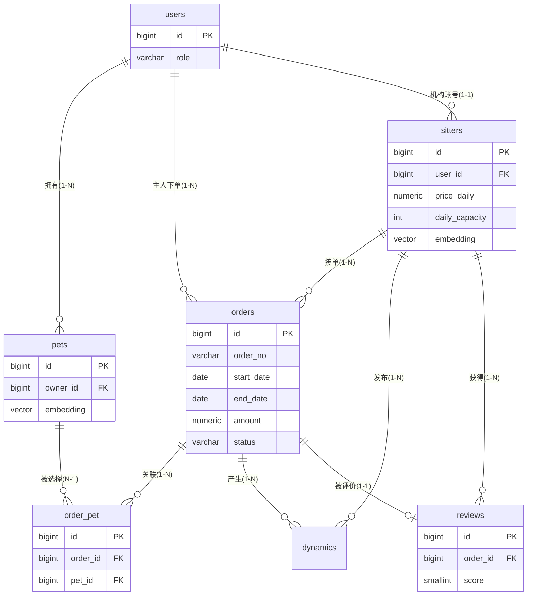
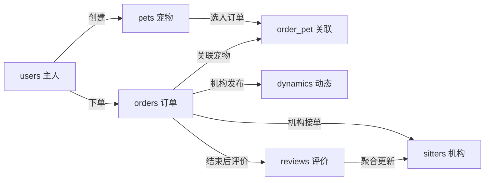

# 宠物寄养服务预约系统 · 数据库设计文档

> 数据库：PostgreSQL · 全文检索：pgroonga · 向量检索：pgvector
> 配套文档：《软件设计文档》（V1.0）
> 版本：V1.1（强化表间数据联系，并纳入删除策略、软删除、触发器、关联一致性等优化）
> 说明：本文件为设计参考稿，DDL 与事务 SQL 可直接在开发库中执行验证。

---

## 1 概述

### 1.1 技术选型

| 能力 | 实现 | 用途 |
|---|---|---|
| 关系数据 | PostgreSQL 15+ | 核心业务数据（用户、宠物、机构、订单、动态、评价） |
| 中文全文检索 | pgroonga | 机构名称/地址/描述、动态与评价内容的**中文**全文搜索 |
| 向量检索 | pgvector | 机构特征向量与宠物特征向量的**相似度推荐** |
| 事务与并发 | PostgreSQL ACID + 行锁（SELECT FOR UPDATE） | 下单防冲突、订单状态流转、评价聚合评分 |

### 1.2 设计原则

- **多实体关联建模**：主人、宠物、机构、订单、动态、评价构成完整业务链；宠物与订单为多对多（一单可寄养多只宠物）。
- **数据联系显式化**：所有跨表引用均声明外键、统一命名、明确删除策略，保证参照完整性与数据血缘清晰。
- **金额与天数快照**：订单表存下单时计算的 `amount`、`day_count`，历史订单不受后续调价影响。
- **状态机约束**：订单状态用 `status` + `CHECK` + 事务内前置状态校验，保证合法迁移。
- **并发安全**：下单通过事务 + 行锁 + 区间重叠判断 + 机构容量校验，杜绝同一宠物同时段被重复预约。
- **检索分离**：常规查询走 B-tree；中文搜索走 pgroonga；智能推荐走 pgvector HNSW。

---

## 2 扩展安装与初始化

```sql
-- 需要具备 superuser 或相应权限
CREATE EXTENSION IF NOT EXISTS pgroonga;   -- 中文全文检索
CREATE EXTENSION IF NOT EXISTS vector;      -- 向量检索
-- btree_gist 本设计不采用排除约束（见 9.4 取舍说明），如需可另行安装
```

> pgroonga 需在服务器安装 `PGroonga` 软件包（pgdg 源）；pgvector 建 HNSW 索引前 `embedding` 列应先有数据。

---

## 3 ER 关系设计



---

## 4 表间数据联系（重点）

### 4.1 外键关系明细

> 每张业务表的跨表引用全部通过外键声明，保证参照完整性。`ON DELETE` 策略统一遵循"**保护历史业务数据**"原则：订单、动态、评价等历史记录不随主表物理删除，宠物/机构采用软删除。

| 从表 | 外键字段 | 关联主表 | 关系 | ON DELETE | 含义 |
|---|---|---|---|---|---|
| pets | owner_id | users.id | N:1 | RESTRICT | 一个主人拥有多只宠物 |
| sitters | user_id | users.id | 1:1 | RESTRICT | 机构账号绑定其机构资料 |
| orders | user_id | users.id | N:1 | RESTRICT | 主人下单，历史订单保留 |
| orders | sitter_id | sitters.id | N:1 | RESTRICT | 机构接单，历史订单保留 |
| order_pet | order_id | orders.id | N:1 | CASCADE | 订单删除则关联记录删除 |
| order_pet | pet_id | pets.id | N:1 | RESTRICT | 宠物被选入订单后不得硬删（配合软删除） |
| dynamics | order_id | orders.id | N:1 | RESTRICT | 订单产生动态 |
| dynamics | sitter_id | sitters.id | N:1 | RESTRICT | 机构发布动态 |
| reviews | order_id | orders.id | 1:1 | RESTRICT | 一单一评，历史保留 |
| reviews | user_id | users.id | N:1 | RESTRICT | 主人发表评价 |
| reviews | sitter_id | sitters.id | N:1 | RESTRICT | 机构被评价 |

### 4.2 关联字段矩阵

> 行表通过指定字段关联列表中的表，`●` 表示存在外键引用。便于快速定位"某表要 join 哪些表、通过哪个字段"。

| 表 | users | pets | sitters | orders | order_pet | dynamics | reviews |
|---|---|---|---|---|---|---|---|
| pets | ●owner_id | | | | | | |
| sitters | ●user_id | | | | | | |
| orders | ●user_id | | ●sitter_id | | | | |
| order_pet | | ●pet_id | | ●order_id | | | |
| dynamics | | | ●sitter_id | ●order_id | | | |
| reviews | ●user_id | | ●sitter_id | ●order_id | | | |

### 4.3 业务数据链路（数据如何在表间流转）



**链路说明**：主人 `users` 创建宠物 `pets` → 主人下单生成 `orders`，宠物通过 `order_pet` 挂到订单 → 机构 `sitters` 接单并发布动态 `dynamics` → 寄养结束后主人评价 `reviews`，评价反向聚合成机构 `sitters.score / rating_count`。

### 4.4 跨表关联查询示例（体现联系）

```sql
-- ① 我的订单：带机构名 + 宠物名单（orders→sitters、orders→order_pet→pets 两级关联）
SELECT o.id, o.order_no,
       s.name AS sitter_name, s.sitter_type,
       o.start_date, o.end_date, o.amount, o.status,
       string_agg(p.name, ',') AS pet_names
FROM orders o
JOIN sitters s           ON s.id = o.sitter_id
LEFT JOIN order_pet op   ON op.order_id = o.id
LEFT JOIN pets p         ON p.id = op.pet_id
WHERE o.user_id = $uid
GROUP BY o.id, s.name, s.sitter_type
ORDER BY o.created_at DESC;
```

```sql
-- ② 机构收到的评价：评价 + 评价人昵称（reviews→users）
SELECT r.id, r.score, r.dimensions, r.content, u.nickname, r.created_at
FROM reviews r
JOIN users u ON u.id = r.user_id
WHERE r.sitter_id = $sid
ORDER BY r.created_at DESC;
```

```sql
-- ③ 机构发布的动态：动态 + 涉及宠物（dynamics→order_pet→pets）
SELECT d.id, d.content, d.photos, d.created_at, p.name AS pet_name
FROM dynamics d
JOIN order_pet op ON op.order_id = d.order_id
JOIN pets p       ON p.id = op.pet_id
WHERE d.sitter_id = $sid
ORDER BY d.created_at DESC;
```

```sql
-- ④ 主人某时段已预约的宠物（orders + order_pet + pets 三表关联，做冲突提示）
SELECT DISTINCT p.id, p.name
FROM order_pet op
JOIN orders o ON o.id = op.order_id
JOIN pets  p  ON p.id = op.pet_id
WHERE p.owner_id = $uid
  AND o.status IN ('booked','caring')
  AND o.start_date < $end_date
  AND o.end_date   > $start_date;
```

---

## 5 表结构设计（DDL）

> 通用约定：主键 `BIGSERIAL`；时间戳 `TIMESTAMPTZ`；金额 `NUMERIC(10,2)`；状态用 `VARCHAR + CHECK`；外键统一 `fk_` 前缀命名；带 `updated_at` 的表统一挂触发器自动维护。

### 5.1 用户表 users

```sql
CREATE TABLE users (
    id            BIGSERIAL PRIMARY KEY,
    username      VARCHAR(64)  NOT NULL,
    password_hash VARCHAR(128) NOT NULL,
    nickname      VARCHAR(64),
    avatar        TEXT,
    phone         VARCHAR(20),
    email         VARCHAR(128),
    role          VARCHAR(16)  NOT NULL DEFAULT 'owner'
                  CHECK (role IN ('owner','sitter','admin')),
    status        SMALLINT     NOT NULL DEFAULT 1,   -- 1启用 0禁用
    created_at    TIMESTAMPTZ  NOT NULL DEFAULT now(),
    updated_at    TIMESTAMPTZ  NOT NULL DEFAULT now(),
    CONSTRAINT uq_users_username UNIQUE (username),
    CONSTRAINT uq_users_phone    UNIQUE (phone)
);
```

### 5.2 宠物档案表 pets（含软删除）

```sql
CREATE TABLE pets (
    id             BIGSERIAL PRIMARY KEY,
    owner_id       BIGINT NOT NULL,
    name           VARCHAR(64) NOT NULL,
    pet_type       VARCHAR(32) NOT NULL CHECK (pet_type IN ('cat','dog','other')),
    breed          VARCHAR(64),
    body_size      VARCHAR(16) CHECK (body_size IN ('small','medium','large')),
    age            INT,
    vaccine_status VARCHAR(16) DEFAULT 'unknown'
                   CHECK (vaccine_status IN ('vaccinated','unvaccinated','unknown')),
    avatar         TEXT,
    remark         TEXT,
    embedding      VECTOR(128),               -- 宠物特征向量
    deleted_at     TIMESTAMPTZ,               -- 软删除时间，NULL 为未删除
    created_at     TIMESTAMPTZ NOT NULL DEFAULT now(),
    updated_at     TIMESTAMPTZ NOT NULL DEFAULT now(),
    CONSTRAINT fk_pets_owner FOREIGN KEY (owner_id) REFERENCES users(id) ON DELETE RESTRICT
);

CREATE INDEX idx_pets_owner      ON pets (owner_id) WHERE deleted_at IS NULL;
CREATE INDEX idx_pets_embedding  ON pets USING hnsw (embedding vector_cosine_ops);
```

> 软删除：删除宠物时置 `deleted_at = now()` 而非物理删除，历史订单的 `order_pet.pet_id` 引用不失效。

### 5.3 寄养机构表 sitters

```sql
CREATE TABLE sitters (
    id             BIGSERIAL PRIMARY KEY,
    user_id        BIGINT NOT NULL,
    name           VARCHAR(128) NOT NULL,
    sitter_type    VARCHAR(16)  NOT NULL
                   CHECK (sitter_type IN ('home','store','doorstep')),
    price_daily    NUMERIC(10,2),
    price_unit     NUMERIC(10,2),
    address        VARCHAR(255),
    lat            NUMERIC(9,6),
    lng            NUMERIC(9,6),
    score          NUMERIC(3,2)  NOT NULL DEFAULT 5.00,
    rating_count   INT          NOT NULL DEFAULT 0,
    daily_capacity INT          NOT NULL DEFAULT 1 CHECK (daily_capacity > 0),
    description    TEXT,
    photos         TEXT[],
    status         SMALLINT     NOT NULL DEFAULT 1,   -- 1上架 0下架
    embedding      VECTOR(128),
    created_at     TIMESTAMPTZ  NOT NULL DEFAULT now(),
    updated_at     TIMESTAMPTZ  NOT NULL DEFAULT now(),
    CONSTRAINT fk_sitters_user FOREIGN KEY (user_id) REFERENCES users(id) ON DELETE RESTRICT
);

CREATE INDEX idx_sitters_type         ON sitters (sitter_type);
CREATE INDEX idx_sitters_status       ON sitters (status);
CREATE INDEX idx_sitters_score        ON sitters (score DESC);
CREATE INDEX idx_sitters_fulltext     ON sitters USING pgroonga (name, address, description);
CREATE INDEX idx_sitters_embedding    ON sitters USING hnsw (embedding vector_cosine_ops);
```

### 5.4 订单表 orders

```sql
CREATE TABLE orders (
    id         BIGSERIAL PRIMARY KEY,
    order_no   VARCHAR(32)  NOT NULL,
    user_id    BIGINT NOT NULL,
    sitter_id  BIGINT NOT NULL,
    start_date DATE NOT NULL,
    end_date   DATE NOT NULL,
    day_count  INT,
    amount     NUMERIC(10,2) NOT NULL,
    status     VARCHAR(20) NOT NULL DEFAULT 'pending_pay'
               CHECK (status IN ('pending_pay','booked','caring','finished','reviewed','cancelled')),
    remark     TEXT,
    created_at TIMESTAMPTZ NOT NULL DEFAULT now(),
    updated_at TIMESTAMPTZ NOT NULL DEFAULT now(),
    CONSTRAINT fk_orders_user   FOREIGN KEY (user_id)   REFERENCES users(id)   ON DELETE RESTRICT,
    CONSTRAINT fk_orders_sitter FOREIGN KEY (sitter_id) REFERENCES sitters(id) ON DELETE RESTRICT,
    CONSTRAINT uq_orders_order_no UNIQUE (order_no),
    CONSTRAINT chk_orders_dates CHECK (end_date >= start_date)
);

CREATE INDEX idx_orders_user   ON orders (user_id, created_at DESC);
CREATE INDEX idx_orders_sitter ON orders (sitter_id);
CREATE INDEX idx_orders_sitter_status_date ON orders (sitter_id, status, start_date);
```

### 5.5 订单-宠物关联表 order_pet

```sql
CREATE TABLE order_pet (
    id       BIGSERIAL PRIMARY KEY,
    order_id BIGINT NOT NULL,
    pet_id   BIGINT NOT NULL,
    CONSTRAINT fk_order_pet_order FOREIGN KEY (order_id) REFERENCES orders(id) ON DELETE CASCADE,
    CONSTRAINT fk_order_pet_pet   FOREIGN KEY (pet_id)   REFERENCES pets(id)   ON DELETE RESTRICT
);

CREATE UNIQUE INDEX uq_order_pet ON order_pet (order_id, pet_id);
CREATE INDEX idx_order_pet_pet   ON order_pet (pet_id);
```

### 5.6 寄养动态表 dynamics

```sql
CREATE TABLE dynamics (
    id         BIGSERIAL PRIMARY KEY,
    order_id   BIGINT NOT NULL,
    sitter_id  BIGINT NOT NULL,
    content    TEXT NOT NULL,
    photos     TEXT[],
    created_at TIMESTAMPTZ NOT NULL DEFAULT now(),
    CONSTRAINT fk_dynamics_order  FOREIGN KEY (order_id)  REFERENCES orders(id)  ON DELETE RESTRICT,
    CONSTRAINT fk_dynamics_sitter FOREIGN KEY (sitter_id) REFERENCES sitters(id) ON DELETE RESTRICT
);

CREATE INDEX idx_dynamics_order  ON dynamics (order_id);
CREATE INDEX idx_dynamics_sitter ON dynamics (sitter_id);
CREATE INDEX idx_dynamics_content ON dynamics USING pgroonga (content);
```

### 5.7 评价表 reviews

```sql
CREATE TABLE reviews (
    id         BIGSERIAL PRIMARY KEY,
    order_id   BIGINT NOT NULL,
    user_id    BIGINT NOT NULL,
    sitter_id  BIGINT NOT NULL,
    score      SMALLINT NOT NULL CHECK (score BETWEEN 1 AND 5),
    dimensions JSONB,
    content    TEXT,
    created_at TIMESTAMPTZ NOT NULL DEFAULT now(),
    CONSTRAINT fk_reviews_order  FOREIGN KEY (order_id)  REFERENCES orders(id)  ON DELETE RESTRICT,
    CONSTRAINT fk_reviews_user   FOREIGN KEY (user_id)   REFERENCES users(id)   ON DELETE RESTRICT,
    CONSTRAINT fk_reviews_sitter FOREIGN KEY (sitter_id) REFERENCES sitters(id) ON DELETE RESTRICT,
    CONSTRAINT uq_reviews_order UNIQUE (order_id)   -- 一单一评
);

CREATE INDEX idx_reviews_sitter ON reviews (sitter_id);
CREATE INDEX idx_reviews_content ON reviews USING pgroonga (content);
```

### 5.8 updated_at 自动维护触发器

```sql
CREATE OR REPLACE FUNCTION set_updated_at()
RETURNS TRIGGER AS $$
BEGIN
    NEW.updated_at := now();
    RETURN NEW;
END;
$$ LANGUAGE plpgsql;

CREATE TRIGGER trg_users_updated    BEFORE UPDATE ON users    FOR EACH ROW EXECUTE FUNCTION set_updated_at();
CREATE TRIGGER trg_pets_updated     BEFORE UPDATE ON pets     FOR EACH ROW EXECUTE FUNCTION set_updated_at();
CREATE TRIGGER trg_sitters_updated  BEFORE UPDATE ON sitters  FOR EACH ROW EXECUTE FUNCTION set_updated_at();
CREATE TRIGGER trg_orders_updated   BEFORE UPDATE ON orders   FOR EACH ROW EXECUTE FUNCTION set_updated_at();
```

---

## 6 索引设计汇总

| 索引 | 类型 | 用途 |
|---|---|---|
| `uq_users_username` / `uq_users_phone` | UNIQUE | 账号/手机号唯一 |
| `uq_orders_order_no` | UNIQUE | 订单号唯一 |
| `uq_reviews_order` | UNIQUE | 一单一评 |
| `uq_order_pet` | UNIQUE | 同一订单内宠物不重复 |
| `idx_pets_owner` | B-tree(部分) | 按主人查未删宠物 |
| `idx_orders_user` | B-tree(复合) | 我的订单按时间倒序 |
| `idx_orders_sitter` | B-tree | 机构订单 |
| `idx_orders_sitter_status_date` | B-tree(复合) | 机构容量、时段查询 |
| `idx_sitters_type` / `status` / `score` | B-tree | 类型筛选/上架/评分排序 |
| `idx_sitters_fulltext` | **pgroonga** | 机构中文全文搜索 |
| `idx_dynamics_content` / `idx_reviews_content` | **pgroonga** | 动态/评价中文全文搜索 |
| `idx_sitters_embedding` / `idx_pets_embedding` | **pgvector(HNSW)** | 相似推荐 |

---

## 7 事务与并发控制设计

### 7.1 下单事务（防同一宠物同时段重复预约 + 机构容量）

```sql
BEGIN;

-- 1) 锁定宠物行，串行化对该宠物的下单（应用层再加 Redis 锁按 pet_id 兜底）
SELECT id FROM pets WHERE id = $pet_id AND owner_id = $uid FOR UPDATE;

-- 2) 校验该宠物目标时段是否已有未结束/未取消订单（区间重叠：start<end && end>start）
SELECT o.id
FROM orders o
JOIN order_pet op ON op.order_id = o.id
WHERE op.pet_id = $pet_id
  AND o.status IN ('booked','caring')
  AND o.start_date < $end_date
  AND o.end_date   > $start_date
LIMIT 1;
-- 查到 → ROLLBACK 并返回"该宠物该时段已被预约"

-- 3) 锁定机构行，防容量并发超卖
SELECT id FROM sitters WHERE id = $sitter_id AND status = 1 FOR UPDATE;

-- 4) 统计机构重叠时段已占用容量
SELECT COUNT(*)
FROM orders
WHERE sitter_id = $sitter_id
  AND status IN ('booked','caring')
  AND start_date < $end_date
  AND end_date   > $start_date;
-- COUNT >= daily_capacity → ROLLBACK 并返回"机构当日已约满"

-- 5) 落订单与关联
INSERT INTO orders (order_no, user_id, sitter_id, start_date, end_date,
                    day_count, amount, status)
VALUES ($order_no, $uid, $sitter_id, $start_date, $end_date, $day_count, $amount, 'pending_pay');
INSERT INTO order_pet (order_id, pet_id) VALUES (currval('orders_id_seq'), $pet_id);

COMMIT;
```

### 7.2 订单状态流转事务（乐观状态机）

```sql
BEGIN;
UPDATE orders
SET status = 'caring', updated_at = now()
WHERE id = $order_id AND status = 'booked';   -- 前置状态做条件，非法流转影响 0 行
-- row_count = 0 → ROLLBACK 并返回"状态不允许"
COMMIT;
```

### 7.3 评价事务（写评价 + 聚合机构评分 + 订单置为已评价，原子完成）

```sql
BEGIN;
INSERT INTO reviews (order_id, user_id, sitter_id, score, dimensions, content)
VALUES ($order_id, $uid, $sitter_id, $score, $dimensions, $content);

UPDATE sitters s
SET rating_count = s.rating_count + 1,
    score = ROUND(((s.score * s.rating_count) + $score)::numeric / (s.rating_count + 1), 2)
WHERE s.id = $sitter_id;

UPDATE orders SET status = 'reviewed', updated_at = now()
WHERE id = $order_id AND status = 'finished';
COMMIT;
```

### 7.4 事务使用小结

- 多表写操作必须包在事务内，异常统一 `ROLLBACK`。
- 高并发写点用行锁（`FOR UPDATE`）或乐观前置状态校验，避免覆盖式更新。
- 只读查询（列表、搜索、推荐）不需事务，走索引即可。

---

## 8 典型查询示例

### 8.1 pgroonga 中文全文搜索（机构）

```sql
SELECT id, name, sitter_type, price_daily, score, address
FROM sitters
WHERE name &@~ '猫 寄养' OR address &@~ '呼和浩特' OR description &@~ '上门喂养'
ORDER BY created_at DESC LIMIT 20;

SELECT s.id, s.name, pgroonga_score(s) AS rel
FROM sitters s WHERE s.description &@~ '上门 喂养'
ORDER BY rel DESC;
```

### 8.2 pgvector 智能推荐（相似机构）

```sql
-- 给定宠物特征向量，推荐最相近机构（余弦距离升序，配 HNSW 索引）
SELECT s.id, s.name, s.sitter_type, s.price_daily, s.score,
       1 - (s.embedding <=> $pet_embedding) AS similarity
FROM sitters s
WHERE s.status = 1
ORDER BY s.embedding <=> $pet_embedding
LIMIT 10;
```

---

## 9 设计优化点（本版新增）

1. **外键统一命名 + 删除策略**：所有跨表引用显式声明 `fk_` 外键，`ON DELETE` 按"保护历史业务数据"策略设置（`RESTRICT` + 软删除），杜绝误删导致历史订单、动态、评价失效。
2. **软删除**：`pets` 增加 `deleted_at`，宠物"删除"后历史 `order_pet` 引用仍可读；`users`/`sitters` 用 `status` 停用而非删除。
3. **updated_at 自动维护**：统一触发器 `set_updated_at()`，代码层无需手动维护更新时间。
4. **关联一致性**：`order_pet.pet_id` 对应的宠物必须属于该订单的主人，由下单事务内 `WHERE owner_id = $uid` 校验，防止跨用户宠物被误关联。
5. **一单一评**：`reviews.order_id UNIQUE` 数据库级防重复评价；评分聚合用基于旧值的原子 `UPDATE`，避免并发丢更新。
6. **快照反规范化**：`orders.amount/day_count`、`sitters.score/rating_count` 均冗余计算值，换取读性能与历史稳定。
7. **索引补充**：新增 `orders(user_id, created_at DESC)`、`sitters(score DESC)` 支持"我的订单""评分排序"。
8. **排除约束的取舍**：因支持一单多宠物（`order_pet` 多行 + `orders` 区间），难以用单行排除约束直接表达"同一宠物时段不重叠"，故采用"事务 + 行锁 + 区间重叠判断"为主、应用层 Redis 锁兜底的方案，这是多宠物设计下的合理取舍。

---

## 10 数据迁移与备份

- **迁移**：采用 `goose` 管理 DDL 版本，每个 `CREATE TABLE / INDEX / EXTENSION / TRIGGER` 对应一个迁移文件，禁止手工改库。
- **备份**：存储服务器定时 `pg_dump` 逻辑备份写入 MinIO，演示环境数据损坏可一键还原。
- **种子数据**：提供初始化脚本（机构、宠物、订单示例 + 预生成的 `embedding`），答辩一键重建。

---

## 11 命名与规范约定

- 表名复数小写（`users`、`orders`），字段单数小写；多对多关联表用两表名单数拼接（`order_pet`）。
- 主键统一 `id BIGSERIAL`；外键 `fk_` 前缀命名；索引 `idx_`/唯一 `uq_`/检查 `chk_`/触发器 `trg_` 前缀。
- 时间统一 `TIMESTAMPTZ`；金额 `NUMERIC(10,2)`；评分 `SMALLINT`(1-5) 或 `NUMERIC(3,2)`(聚合)。
- 状态与短枚举用 `VARCHAR + CHECK`，代码层再校验。

---

## 附：与软件设计文档的对齐

| 软件设计决策 | 数据库落地 |
|---|---|
| 多实体关联建模（主人-宠物-订单） | users / pets / orders / order_pet（多对多）+ 外键 |
| 订单金额快照 | `orders.amount`、`day_count` |
| 防重复下单 | 下单事务 + FOR UPDATE + 区间重叠校验 |
| 机构每日容量 | `sitters.daily_capacity` + 事务容量计数 |
| 多维度评价 | `reviews.dimensions`（JSONB） |
| 中文全文检索 | pgroonga 索引 |
| 智能推荐 | pgvector HNSW 索引 |
| 历史数据保护 | RESTRICT + 软删除 + updated_at 触发器 |
| 上线一致性 | goose 迁移 + pg_dump 备份 |
